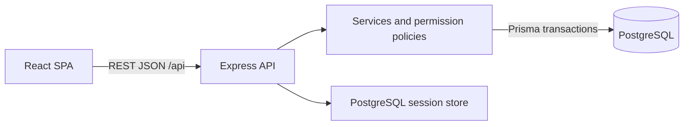
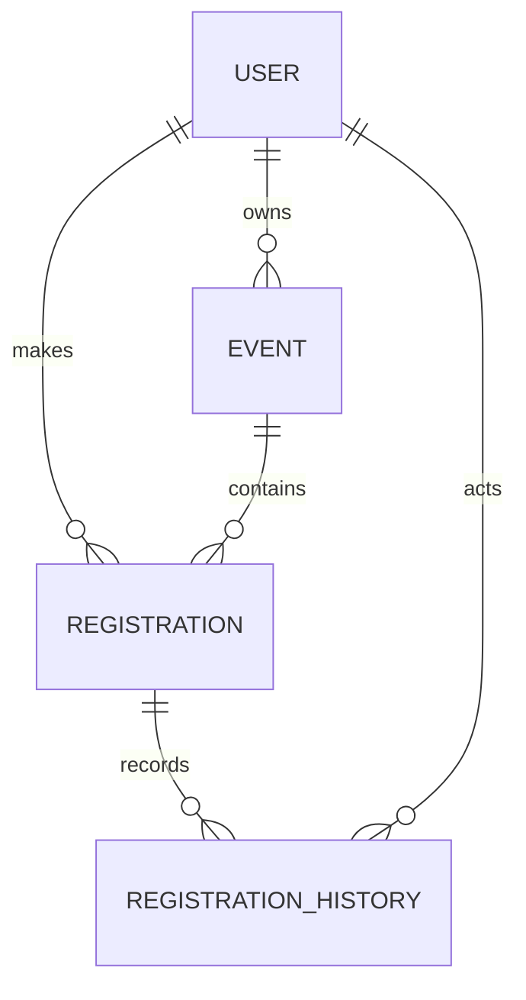
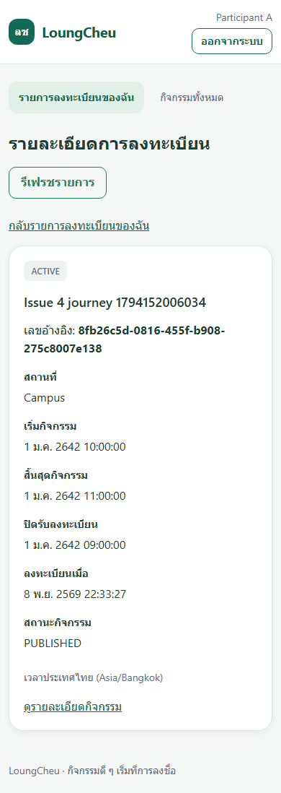
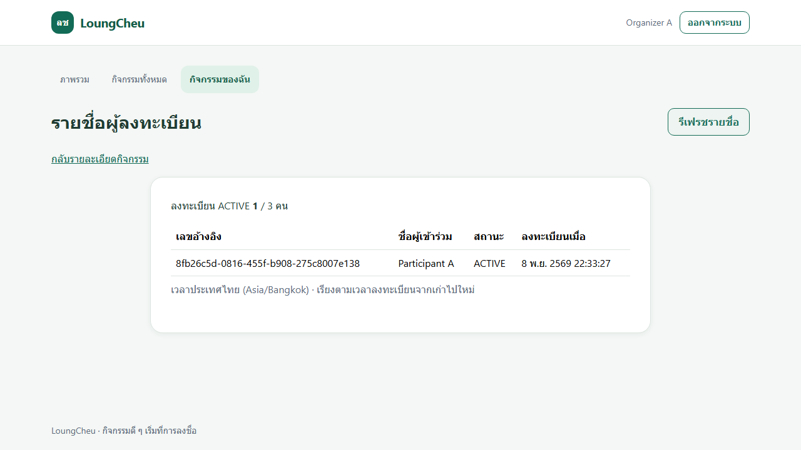

# CPE 334 Project Deliverable 1: Engineering Baseline and Working Sprint 1

**Semester 1/2026 | Department of Computer Engineering, KMUTT**

**สถานะ: ร่างประกอบรายงาน — ยังไม่ใช่ PDF พร้อมส่ง** (แก้ไข 14 พ.ย. 2026). รวมเนื้อหา engineering baseline A–E และ selected recorded evidence ไว้ด้านล่างแล้ว; ยังต้องเติมหลักฐาน acceptance ที่ขาด, ภาพ rejection/access และ workflow/history ที่อ่านได้, final board/release reference และเลขหน้าหลัง export. ลิงก์ใช้ตรวจย้อนกลับ source; pending items ไม่ถือว่าผ่านจากการรวมเอกสาร.

---

## Submission Metadata & Navigation

### Team Information
* **Theme / Project Name:** LoungCheu (ระบบบริหารจัดการและลงทะเบียนกิจกรรมชุมชนแบบอะตอมมิก)
* **Repository URL:** https://github.com/jetanin/LoungCheu
* **Submitted main release:** ยังไม่มีหลักฐาน accepted main release/tag; `v1.0.0-sprint-1` เป็น target เท่านั้น. Staging merge candidate: `97a5b91`; recorded automated tested source: `3313288`.
* **Members:**
  1. นายเจตนินทร์ นายโท (Jetanin Naitho) — รหัสนักศึกษา 67070501011 (GitHub: `@jetanin`)
  2. นายปภังกร ล่วนเส้ง (Paphangkorn Luanseng) — รหัสนักศึกษา 67070501083 (GitHub: `i3artuf`)

---

### Navigation Table (ตารางนำทางโครงสร้างรายงาน Parts A–F)

| Part | Section | Description / Key Artifacts | Identifiers (IDs) |
|:---:|:---|:---|:---|
| **A** | **Software Requirements Specification (SRS)** | Stakeholders, User Context, Scopes/Exclusions, FRs, BRs, NFRs, Architectural Decisions | FR-01–15, BR-01–14, NFR-01–09, DEC-01–17 |
| **B** | **Feature Inventory & Traceability** | Feature Mapping to Requirements, Planned Sprints, Traceability Matrix, Coverage Analysis | F-01–09, SYS-AUTH, SYS-DATA, SYS-UX, SYS-DELIVERY, SYS-QA, AC-01–27 |
| **C** | **System-Level Software Design Specification (SDS)** | Architecture Stack, ERD/Data Models, API Error Protocols, RBAC Permission Matrix, Deployment Plan | Components (UI/API/DB), Models, Endpoints |
| **D** | **Three-Sprint Plan** | Sprint 1–3 Goals, Feature Scope Allocations, Dependencies, Delivery Checkpoints | Sprints 1, 2, 3 |
| **E** | **Sprint 1 Engineering Contracts & STS** | Feature Design Contracts, Detailed ACs, Software Test Specification (STS), Product Definition of Done | AC-01–27, TEST-01–36, DOD-01–10 |
| **F** | **Working Sprint 1 & Verification Evidence** | Selected recorded screenshots/output, AC-to-test results, Test Excerpts, Git Workflow Chains, Contributions; missing acceptance disclosed | EV-01–12, PR #7, PR #10, Commit 97a5b91 |

---

## Part A: SRS and Product Scope

### A.1 Complete SRS

เนื้อหาจาก [docs/srs.md](../srs.md); คัดรวม 14 พ.ย. 2026 โดยคง IDs และแยก historical execution จาก acceptance ที่ยัง pending.

เอกสาร LC-SRS | Documentation baseline v0.5 | 5 พฤศจิกายน 2026

### 1. ปัญหาและเป้าหมาย

ชมรมหรือหน่วยงานในมหาวิทยาลัยต้องการเผยแพร่กิจกรรมที่มีที่นั่งจำกัด ป้องกันการลงทะเบียนซ้ำหรือเกินความจุ ตรวจรายชื่อ และบันทึกการเข้าร่วม LoungCheu รวมกระบวนการเหล่านี้ไว้ในระบบเดียว โดยผู้จัดแต่ละคนจัดการได้เฉพาะกิจกรรมของตน และผู้เข้าร่วมเข้าถึงรายละเอียดการลงทะเบียนของตนเท่านั้น

เป้าหมายของผลิตภัณฑ์คือให้ผู้จัดสร้าง/เผยแพร่กิจกรรม ผู้เข้าร่วมลงทะเบียนหรือยกเลิกตามกติกา ผู้จัดเช็กชื่อ และดูสรุปยอดลงทะเบียน/เข้าร่วมได้อย่างถูกต้องและตรวจสอบย้อนหลังได้

### 2. Actors และความรับผิดชอบ

| Actor | ความรับผิดชอบ/สิทธิ์ |
|---|---|
| Participant | ดูกิจกรรมที่เผยแพร่ ลงทะเบียน ดูรายการ/สถานะของตน และยกเลิกก่อนปิดรับ |
| Organizer | สร้างและเผยแพร่กิจกรรมของตน ดูรายชื่อ ปิดรับ ปรับรายละเอียด/ความจุ เช็กชื่อ และดูรายงานของตน |
| ผู้ไม่มี session | เข้าหน้า Login และขอ CSRF token ได้ แต่ใช้ข้อมูลกิจกรรม/ข้อมูลส่วนตัวผ่าน API ไม่ได้ |

หนึ่งบัญชีมีหนึ่ง role ใน baseline นี้ ไม่มี Admin UI การเตรียมบัญชีเป็นงาน seed ของผู้ดูแลสภาพแวดล้อม ไม่ใช่ role ของผลิตภัณฑ์

### 3. Scope

In scope: บัญชี demo, session login/logout, role/ownership enforcement, กิจกรรมมีความจุจำกัด, ลงทะเบียน/ยกเลิก, การปิดรับ, เช็กชื่อ และสรุปยอดต่อกิจกรรม

Out of scope: self-registration, reset password, email verification, หลาย role ต่อบัญชี, หลาย Organizer ร่วมเป็นเจ้าของกิจกรรม, ซื้อบัตร/ชำระเงิน, waitlist, QR code, email/SMS, file upload, ระบบอนุมัติกิจกรรม, recurring event และ external calendar integration

ไม่มีการรับประกันตัวบุคคลหน้างานด้วยเทคโนโลยี Organizer ตรวจตัวผู้เข้าร่วมก่อนกดเช็กชื่อเอง ใช้ข้อมูลสังเคราะห์ในการสาธิต

#### Technology และ workflow

- Frontend: React 19.3.1 + TypeScript + Vite + Bootstrap 5.3.8
- Backend: Node.js + Express + TypeScript
- Database/data access: PostgreSQL + Prisma
- Architecture: REST-style APIs
- Testing: Vitest + Supertest เป็นชุดหลัก; ใช้ Playwright สำหรับ selected automated browser E2E ของ F-01/F-02 และ audit regressions แล้ว (execution update 6 พ.ย. 2026; [ผลจริง](../events/verification.md))
- Workflow: GitHub Issues/Projects, feature/* → sprint-1-staging → main พร้อม teammate review ตาม DEC-15

### 4. คำศัพท์และสถานะ

- FR: ความสามารถของระบบ; BR: กฎธุรกิจ; NFR: คุณภาพ/ข้อจำกัดที่ตรวจวัดได้
- Event: กิจกรรมหนึ่งครั้ง มี Organizer เจ้าของหนึ่งคน
- Event status: `DRAFT` → `PUBLISHED` → `CLOSED`; ไม่เปิดกลับใน baseline
- Registration status: `ACTIVE` หรือ `CANCELLED` (การยกเลิกเริ่ม Sprint 2)
- Check-in: ค่า `checked_in_at` บน registration เริ่ม Sprint 3
- Active count: จำนวน registration ที่ status = ACTIVE รวมผู้ที่เช็กชื่อแล้ว
- AC: Acceptance Criterion; STS: Software Test Specification; DoD: Definition of Done

กิจกรรม PUBLISHED ที่เลย registration deadline ยังเป็น PUBLISHED ได้ แต่ถือว่าปิดรับตามเวลาที่ตรวจบน server จึงไม่ต้องมี cron job การ CLOSED โดยผู้จัดเป็นการปิดรับก่อนกำหนด ไม่ใช่ยกเลิกกิจกรรม

### 5. Functional Requirements

| ID | ข้อกำหนดที่สังเกตผลได้ | Sprint |
|---|---|---:|
| FR-01 | ผู้ใช้ที่ active Login ด้วย username/password ได้ และข้อมูลผิดต้องไม่สร้าง authenticated session | 1 |
| FR-02 | ผู้ใช้เรียกดู identity/role ของตนและ Logout เพื่อยกเลิก session ปัจจุบันได้ | 1 |
| FR-03 | Organizer สร้างกิจกรรม DRAFT พร้อมรายละเอียด เวลา วันปิดรับ และความจุได้ | 1 |
| FR-04 | Organizer เผยแพร่ DRAFT ของตนที่ผ่าน validation ได้ | 1 |
| FR-05 | ผู้ใช้ที่ Login ดูรายการและรายละเอียดกิจกรรม PUBLISHED/CLOSED ได้ โดยไม่เปิดเผยรายชื่อผู้ลงทะเบียน | 1 |
| FR-06 | Participant ลงทะเบียนกิจกรรมที่เปิดรับได้ และได้รับเลขอ้างอิงที่บันทึกในฐานข้อมูล | 1 |
| FR-07 | Participant ดูรายการ/รายละเอียดการลงทะเบียนของตน พร้อมสถานะและกิจกรรมที่เกี่ยวข้องได้ | 1 |
| FR-08 | Organizer ดูรายการกิจกรรมของตนและรายชื่อผู้ลงทะเบียนพร้อมยอด ACTIVE ของกิจกรรมนั้นได้ | 1 |
| FR-09 | Participant ยกเลิก ACTIVE ของตนก่อนปิดรับได้ และที่นั่งกลับมาใช้ได้ | 2 |
| FR-10 | Organizer ปิดรับกิจกรรม PUBLISHED ของตนได้โดยไม่ลบรายการลงทะเบียนเดิม | 2 |
| FR-11 | Organizer แก้ DRAFT ของตนได้ทุกช่องใน EventInput (ไม่รวม id/owner/status/system fields) และแก้ชื่อ คำอธิบาย สถานที่ หรือความจุของ PUBLISHED ได้ตามกฎ | 2 |
| FR-12 | Participant ที่เคยยกเลิกลงทะเบียนใหม่ได้เมื่อกิจกรรมยังเปิดรับและมีที่นั่ง | 2 |
| FR-13 | Organizer เช็กชื่อผู้มี ACTIVE registration ในกิจกรรมของตนภายในช่วงกิจกรรมได้ | 3 |
| FR-14 | Participant ดูสถานะการเช็กชื่อของตนได้ | 3 |
| FR-15 | Organizer ดูยอด ACTIVE, CANCELLED, checked-in และอัตราเข้าร่วมของกิจกรรมตนได้ | 3 |

### 6. Business Rules

| ID | กฎและผลเมื่อไม่ผ่าน |
|---|---|
| BR-01 | capacity เป็น JSON integer 1–1,000 ไม่ coercion string/boolean; title 1–120, description 1–2,000, location 1–200 Unicode code points หลัง trim; ทุกช่องต้องเป็น string และว่างไม่ได้ |
| BR-02 | `registration_closes_at <= starts_at < ends_at`; เผยแพร่ได้เมื่อ closes_at อยู่ในอนาคตเทียบเวลา server |
| BR-03 | ลงทะเบียนได้เมื่อ status=PUBLISHED และ `server_now < registration_closes_at`; ที่เท่ากับ deadline ต้องปฏิเสธ |
| BR-04 | หนึ่ง registration record ต่อ user/event; S2 reactivate record เดิมโดยคง registered_at ครั้งแรก ล้าง cancelled_at และ append history; ไม่สร้าง ACTIVE ซ้ำ |
| BR-05 | ACTIVE count ต้องไม่เกิน capacity แม้คำขอเข้าพร้อมกัน; คำขอที่แพ้ต้องไม่เพิ่ม record/กินที่นั่ง |
| BR-06 | Participant เข้าถึงและเปลี่ยนเฉพาะ registration ของตน และไม่มีสิทธิ์จัดการกิจกรรม/รายชื่อ |
| BR-07 | Organizer จัดการกิจกรรม รายชื่อ เช็กชื่อ และรายงานเฉพาะกิจกรรมตน; ไม่มีสิทธิ์ใช้ฟังก์ชันลงทะเบียนของ Participant |
| BR-08 | Participant ยกเลิกได้เฉพาะ ACTIVE ก่อน deadline และเมื่อ event=PUBLISHED; เรียกซ้ำกับ CANCELLED ต้องปฏิเสธโดยไม่มีผลข้างเคียง |
| BR-09 | Event transition คือ DRAFT→PUBLISHED→CLOSED; CLOSED ห้ามแก้ Event fields/เปิดกลับ แต่ check-in บน Registration ทำได้ตาม BR-12 |
| BR-10 | ลด capacity ไม่ต่ำกว่า ACTIVE count; ลงทะเบียน/ยกเลิก/ปรับความจุ/ปิดรับต้องประสาน transaction บน event เดียวกัน |
| BR-11 | owner immutable ทุกสถานะและกำหนดจาก session; PUBLISHED แก้เวลา/วันปิดรับไม่ได้; id/status/system fields ไม่รับผ่าน edit input และไม่มี hard delete ผ่านผลิตภัณฑ์ |
| BR-12 | Check-in ได้เฉพาะ ACTIVE และ `starts_at <= server_now <= ends_at`; CLOSED ยังเช็กชื่อได้ภายในช่วงงาน; เช็กชื่อซ้ำปฏิเสธ 409 ALREADY_CHECKED_IN โดยไม่เปลี่ยน checked_in_at/checked_in_by_id หรือยอดเข้าร่วม |
| BR-13 | ACTIVE/CANCELLED นับ record ตามสถานะปัจจุบันของ event; checked-in นับ ACTIVE ที่ checked_in_at ไม่เป็น null; reactivate ย้ายยอด CANCELLED ไป ACTIVE ไม่สะสมจำนวนครั้ง cancel ใน summary; อัตราเข้าร่วม = checked-in / ACTIVE × 100 ปัดทศนิยม 2 ตำแหน่ง ถ้า ACTIVE=0 แสดง 0.00%; lifecycle history แยกจากยอดปัจจุบัน |
| BR-14 | ทุกเวลาเก็บ UTC ความละเอียด millisecond; API รับ ISO 8601 ที่มี offset และเศษวินาที 0–3 หลัก คืน UTC แบบ YYYY-MM-DDTHH:mm:ss.SSSZ; input ละเอียดกว่า 3 หลักปฏิเสธ 400 ไม่ปัดเงียบ ๆ; UI Asia/Bangkok ระบุเขตเวลา; ใช้ server clock และตรวจเวลาของ event/registration mutations ภายใน transaction หลังได้ Event lock |

### 7. Non-Functional Requirements และวิธีตรวจ

| ID | เป้าหมายที่วัดได้ | วิธีตรวจ / Sprint |
|---|---|---|
| NFR-01 | API protected ต้องปฏิเสธทุกกรณีไม่มี session, role ผิด และ ownership ผิดใน access matrix โดยไม่ส่งข้อมูลที่ป้องกัน | Automated API integration tests / 1 และ regression ทุก Sprint |
| NFR-02 | หลัง Logout session เดิมใช้ endpoint protected ไม่ได้; session หมดอายุภายใน 2 ชั่วโมงนับจาก Login; ไม่เก็บรหัสผ่าน plaintext; production cookie เป็น HttpOnly/Secure/SameSite=Lax | Session/expiry/hash tests และ config check / 1; HTTPS deployment check / Lab 5 |
| NFR-03 | Demo registration ยังอ่านได้และ active count ไม่เปลี่ยนหลัง restart แอป; เมื่อ deploy ต้องอยู่หลัง restart/redeploy ด้วย | Real PostgreSQL integration และ manual restart test / 1; deployment persistence / Lab 5 |
| NFR-04 | คำขอผู้ใช้ต่างกัน 2 คำขอพร้อมกันแย่งที่นั่งสุดท้าย ต้องสำเร็จ 1 และถูกปฏิเสธ 1; duplicate concurrent request ของผู้ใช้เดียวกันสร้าง record เดียว | Separate connections/transactions บน PostgreSQL จริง / 1 |
| NFR-05 | จากฐานข้อมูล demo ใหม่ อีกคนติดตั้งตาม README/migration/seed และทำ critical journey ได้ครบ โดยไม่ต้องแก้ source | Reproduction checklist / 1; Docker fresh build / Lab 5 |
| NFR-06 | Error API ต้องมี code/message ที่คงรูปแบบและไม่แสดง traceback, password, session ID หรือ SQL; UI แสดง loading/empty/validation/error ตามที่ออกแบบ | Negative API tests และ UI checklist / 1 |
| NFR-07 | Relevant PRs มี build/test required checks และ failed check ไม่เข้าสู่เส้นทาง release ปกติ; deploy version ตรง main release | CI gate demonstration + deployed version check / Lab 5 และคงไว้ |
| NFR-08 | ทุก Sprint 1 AC มี planned test และตอนส่งมี actual test/manual record ที่ระบุผลกับ commit; requirement คงเหลือมี Sprint รับผิดชอบ | Traceability review / 1; ปรับทุก checkpoint |
| NFR-09 | ผู้ทดสอบภายนอกทีมทำ UAT อย่างน้อย 4 กรณี (normal/rule/access/persistence) พร้อม tester/version และ re-test accepted defect อย่างน้อย 1 รายการตาม Lab 6 | Independent UAT records / Lab 6; final re-test ตามผลกระทบ |

### 8. เส้นทางใช้งานหลักและข้อผิดพลาด

1. Organizer Login แล้วสร้าง DRAFT ที่ capacity=2 และกำหนดวันเวลาที่ถูกต้อง
2. Organizer Publish แล้ว Participant เห็นรายละเอียดโดยไม่มีข้อมูลผู้ลงทะเบียนคนอื่น
3. Participant A ลงทะเบียนสำเร็จและเปิดรายการของตนใหม่จากข้อมูลฐานข้อมูล
4. Organizer เห็น A ใน roster และ ACTIVE count=1
5. A ลงทะเบียนซ้ำถูกปฏิเสธโดย count คงเดิม
6. B ลงทะเบียนได้จนเต็ม จากนั้น C ถูกปฏิเสธ
7. Participant เรียก API ผู้จัดได้ 403; Organizer B เปิด roster ของ Organizer A ได้ 404

เส้นทางอื่นของผลิตภัณฑ์เต็ม: Participant ยกเลิกก่อนปิดรับ → ที่นั่งคืน → ลงใหม่; Organizer ปิดรับ/ปรับความจุ → เช็กชื่อในช่วงกิจกรรม → ดูสรุป

### 9. Assumptions และ scope changes

รายละเอียดที่ทีมเลือกเอง เช่น session อายุ 2 ชั่วโมง capacity สูงสุด และกติกายกเลิก/check-in อยู่ใน [Decisions](../decisions.md) การเปลี่ยนกฎต้องปรับ AC/STS/traceability และบันทึกเหตุผลใน [Changelog](../changelog.md)

### A.2 Decisions, Assumptions and Review Record

เนื้อหาจาก [docs/decisions.md](../decisions.md); คัดรวม 14 พ.ย. 2026 โดยคง IDs และแยก historical execution จาก acceptance ที่ยัง pending.

Documentation baseline v0.5 | 5 พฤศจิกายน 2026

Baseline v0.5 ได้ teammate review และ merge ผ่าน PR #5 แล้วเมื่อ 6 พฤศจิกายน 2026; ประวัติ revision/commit ดู [Changelog](../changelog.md)

| ID | การตัดสินใจ / สมมติฐาน | เหตุผล |
|---|---|---|
| DEC-01 | กิจกรรมภายในมหาวิทยาลัย; ชื่อ LoungCheu | จำกัดโดเมนและใช้ข้อมูลสังเคราะห์ |
| DEC-02 | React/TypeScript/Vite/Bootstrap, Express/TypeScript, PostgreSQL/Prisma และ REST JSON; stack ยืนยันแล้ว | แยก UI/API/data ชัดเจนและ deploy same-origin ได้ |
| DEC-03 | หนึ่งบัญชีมีหนึ่ง role; ใช้ seeded demo accounts | เพียงพอสำหรับ workflow โดยไม่เพิ่ม account administration |
| DEC-04 | Session อายุ 2 ชั่วโมงจาก Login; mutations ใช้ CSRF token | Logout invalidate ฝั่ง server ได้ |
| DEC-05 | Login ก่อนดูรายการกิจกรรม | ใช้ access policy เดียวกับข้อมูลลงทะเบียน |
| DEC-06 | UTC millisecond ใน DB/API; UI Asia/Bangkok; ตรวจ deadline หลังได้ event lock | ป้องกัน timezone/lock-wait boundary ผิด; format ตาม BR-14 |
| DEC-07 | ยกเลิกก่อน deadline และ event=PUBLISHED เท่านั้น | คงรายชื่อเมื่อปิดรับแล้ว |
| DEC-08 | หนึ่ง record ต่อ user/event; registered_at เป็นเวลาลงครั้งแรก; S2 cancel ตั้ง cancelled_at และ reactivate ล้าง cancelled_at พร้อมเก็บ history | ป้องกันซ้ำและรักษา timestamp สำหรับ backfill/history |
| DEC-09 | Lock Event ก่อนตรวจ count/ทำ seat mutations ใน transaction | คุม last-seat race และ capacity changes |
| DEC-10 | capacity 1–1,000; string lengths นับ Unicode code points หลัง trim; CLOSED ไม่เปิดกลับ/แก้ Event fields; ไม่มี delete | ใช้ validation เดียวกันทั้ง UI/API และคงข้อมูลอ้างอิง |
| DEC-11 | Organizer กดเช็กชื่อช่วงเริ่ม–จบ; ซ้ำตอบ 409 ALREADY_CHECKED_IN คงข้อมูลเดิม | ไม่ต้องใช้ QR และไม่สร้าง attendance ซ้ำ |
| DEC-12 | API prefix /api; identity/role จาก session | ป้องกัน client spoofing |
| DEC-13 | Vitest/Supertest, GitHub Projects และ Issues #1–4 ตาม sprint plan | จำนวน Issues เป็นแผนทีม; เพิ่ม setup/fix/change Issues ได้ |
| DEC-14 | express-session + PostgreSQL store, salted scrypt hash; เลือกใช้ Playwright สำหรับ auth E2E แล้วใน implementation 6 พ.ย. | รองรับ session lifecycle และ browser journey; ไม่มีการเปลี่ยน AC baseline |
| DEC-15 | sprint-1-staging เป็น integration branch; feature PRs กลับ staging ก่อน release PR เข้า main; ชื่อ branch ยืนยันแล้ว | รวมงานและให้เพื่อนตรวจทุก PR; baseline integration ตาม sprint plan |
| DEC-16 | Summary นับสถานะปัจจุบัน; lifecycle history นับเหตุการณ์แยก | Reactivate ลด CANCELLED และเพิ่ม ACTIVE; ไม่สะสมจำนวนครั้ง cancel ใน summary |
| DEC-17 | UUID และ named schemas; validation/error code/precedence ตาม System SDS และ feature contracts | ให้ UI/API/tests ใช้ contract เดียวกัน; ownership ยังตรวจบน backend |

### คำถามและสถานะ

| ID | สถานะ / ข้อสรุป | งานถัดไป |
|---|---|---|
| Q-01 | Resolved: Theme 3 จาก M2 รหัสลงท้าย 3 ตาม master หน้า 4 | ทีมตรวจ metadata ก่อนส่ง |
| Q-02 | ชื่อ/รหัส/repo ระบุใน README; ทีมแจ้งว่ามี Issues #1–4; assignment/board ยังรอยืนยัน | ตรวจ Issue scopes/assignees เติม board URL และ contribution ตามจริง |
| Q-03 | Resolved: stack ตาม DEC-02/13 | Pin runtime/dependency versions ตอน implement |
| Q-04 | Accepted baseline v0.5 ผ่าน [PR #5](https://github.com/jetanin/LoungCheu/pull/5); reviewer jetanin อนุมัติ baseline สำหรับ implementation | การเปลี่ยน behavior หลัง baseline ต้องอัปเดต contract/STS และ review |
| Q-05 | Pending: GCP resources/persistence ตาม Lab 5 | ยืนยัน deployment components ก่อน deploy |
| Q-06 | Master หน้า 13: Final video ≤10 นาที (8 คะแนน), summary ≤1 หน้า (2 คะแนน) | ตรวจ Final handout เพิ่ม; ถ้าขัดกันบันทึกแหล่งและถาม TA |
| Q-07 | Resolved: รวม unrelated histories และแก้ conflict ที่ `f5339b9`; baseline เข้า staging ที่ `5395942` ผ่าน PR #5 | ตรวจ remote ล่าสุดก่อนแตก feature branch |

### Teammate baseline review

| Revision | Reviewer / วันที่ | Document commit / PR | ข้อเสนอแนะและผลตัดสินใจ |
|---|---|---|---|
| v0.5 | jetanin / 6 พ.ย. 2026 00:26:25 Asia/Bangkok | `f5339b92f1a6f23704f23898649d0da8d19f4e18` / [PR #5 review](https://github.com/jetanin/LoungCheu/pull/5#pullrequestreview-5789144536) | APPROVED: ตรวจ Parts A–E, SRS, features/traceability, SDS, sprint plan, contracts/AC/STS/DoD และอนุมัติเป็น baseline สำหรับ implementation; author i3artuf, reviewer jetanin |

บันทึก reviewer จริง สิ่งที่ตรวจ DEC/BR/AC/Test ที่กระทบ และผล accepted/changes requested ถ้าร่วมเขียน ให้ระบุ contribution และส่วนที่ตรวจข้ามกัน ผู้เขียน PR ไม่ approve งานตนเอง การตรวจโดย Codex เป็น AI assistance ตาม changelog

---

## Part B: Feature Inventory and Traceability

### B.1 Complete Feature Inventory

เนื้อหาจาก [docs/features.md](../features.md); คัดรวม 14 พ.ย. 2026 โดยคง IDs และแยก historical execution จาก acceptance ที่ยัง pending.

**สถานะหลักฐาน — 14 พ.ย. 2026:** PR #7/#10 ได้ teammate review โดย i3artuf และ merge เข้า sprint-1-staging แล้ว ตาม snapshot 12 พ.ย.; PR #10 reviewed head `0bd3468`, merge `97a5b91` (10 พ.ย. 16:26:11 Asia/Bangkok). ผล 159 Vitest / 37 Chromium / typecheck / build / compiled smoke 3 PASS เป็นผลรัน 8 พ.ย. ของ source ที่ commit เป็น `3313288`; รอบแก้เอกสารนี้ไม่ได้รันทดสอบแอปใหม่. OS-process restart, independent clean reproduction/UAT และ reviewed main release ยังขาดหลักฐาน; GAP-02 ยัง OPEN และ Product DoD ยังไม่ครบ. [Review/merge evidence](evidence/review-merge-20261112/README.md). Baseline FR/BR/NFR/AC ไม่เปลี่ยน; F-06–09 อยู่ Sprint 2/3

**Historical Event UI run — 6 พ.ย. 2026:** 145 Vitest / 35 Chromium, typecheck/build/compiled smoke PASS รวม typography/layout/state checks ที่1280/390/320px ดู [current UI evidence](../events/visual-consistency.md) ผล141/32 และ seed follow-up ด้านล่างเป็น historical runs

**Seed follow-up (6 พ.ย.):** full Vitest **145 PASS** รวม seed integration ใหม่4 และ typecheck PASS; 141/32 ใน feature audit ด้านล่างเป็นรอบก่อนเพิ่ม seed โดย Chromium/build ไม่ได้ rerun รอบ seed ดู [latest seed results](../events/demo-seed.md) ไม่มี AC/scope ใหม่

Documentation baseline v1.0 | พฤศจิกายน 2026 | F-01 ถึง F-05 รวมเข้าสู่ `sprint-1-staging` ครบถ้วน พร้อมเปิด Release PR เข้าสู่ `main`

Registration integration update: F-01–05 implemented; PR #7/#10 approved/merged staging ตาม retained snapshots. Automated159/37 results ผูก source3313288; OS-process restart, independent clean reproduction/UAT และ accepted main release ยังไม่ครบ ดู [verification](../registration/views-verification.md).

| ID | Feature / ผลลัพธ์ | Requirement / Rules | Dependency | Sprint |
|---|---|---|---|---:|
| F-01 | Login, identity และ Logout สำหรับ demo users | FR-01–02; BR-06–07; NFR-01–02 | Seed users, session store | 1 |
| F-02 | สร้าง/เผยแพร่กิจกรรม ดูกิจกรรมที่เผยแพร่ และรายการกิจกรรมของผู้จัด | FR-03–05, FR-08 ส่วนรายการกิจกรรม; BR-01–02,07,09,11,14 | F-01 | 1 |
| F-03 | ลงทะเบียนโดยคุม duplicate, deadline และ capacity | FR-06; BR-03–07,10,14; NFR-04 | F-01, F-02 | 1 |
| F-04 | ดูรายการและรายละเอียด registration ของตน; เพิ่มสถานะ check-in ผ่าน F-08 ใน S3 | FR-07; BR-06 | F-03 | 1 |
| F-05 | ดู roster และ ACTIVE count ของกิจกรรมตน | FR-08 ส่วน roster; BR-07 | F-02, F-03 | 1 |
| F-06 | ยกเลิก ลงทะเบียนใหม่ และปิดรับกิจกรรม | FR-09–10,12; BR-03–11,14 | F-03–05 | 2 |
| F-07 | แก้รายละเอียดและปรับความจุแบบไม่ทำให้ข้อมูลผิดกฎ | FR-11; BR-01–02,07,10–11,14 | F-02, F-03 | 2 |
| F-08 | เช็กชื่อและเพิ่ม own attendance status ใน F-04 | FR-13–14; BR-06–07,12,14 | F-04–06, F-07 (เวลา/สถานะกิจกรรม) | 3 |
| F-09 | สรุปการลงทะเบียน ยกเลิก และอัตราเข้าร่วม | FR-15; BR-07,13 | F-05, F-06, F-08 | 3 |

### System responsibilities

| ID | ความรับผิดชอบร่วม | Owner feature / ตรวจ |
|---|---|---|
| SYS-AUTH | Authentication, role, record ownership, cookie, CSRF และ password policy | F-01 วางพื้นฐาน; ทุก feature ต้องตรวจ endpoint ของตน |
| SYS-DATA | Database constraints, migration, transaction, UTC และ seed | F-01 วาง User/session migration/seed; F-02/F-03 วาง domain/transaction foundation; F-06/F-07/F-08 รักษากฎร่วม |
| SYS-UX | Error contract, validation, loading และ empty state | F-01–05 เริ่ม; ทุก feature รักษา convention |
| SYS-DELIVERY | Reproduction, Docker, CI gate, GCP และ version identification | Sprint 1 ออกแบบ/ local setup; Lab 5 ทำจริง; ทุก release หลังจากนั้น |
| SYS-QA | AC→test traceability, regression และ independent UAT | ทุก Sprint; Lab 6 ทำ UAT; Lab 7 ทำ maintenance |

Sprint ของ F-04 คือการสร้าง capability เริ่มต้น; FR-14 อยู่ใน F-08/S3 ซึ่งขยายหน้าเดิม Allocation ราย FR/BR/NFR ฉบับเต็มอยู่ใน [Traceability](../traceability.md); ตารางนี้สรุป requirement หลัก

### B.2 Requirements-to-Feature-to-Sprint Allocation

เนื้อหาจาก [docs/traceability.md](../traceability.md); คัดรวม 14 พ.ย. 2026 โดยคง IDs และแยก historical execution จาก acceptance ที่ยัง pending.

**Current evidence reconciliation — 14 พ.ย. 2026:** PR #7/#10 ได้ teammate review โดย i3artuf และ merge เข้า sprint-1-staging แล้ว ตาม snapshot 12 พ.ย.; PR #10 reviewed head `0bd3468`, merge `97a5b91` (10 พ.ย. 16:26:11 Asia/Bangkok). ผล 159 Vitest / 37 Chromium / typecheck / build / compiled smoke 3 PASS เป็นผลรัน 8 พ.ย. ของ source ที่ commit เป็น `3313288`; รอบแก้เอกสารนี้ไม่ได้รันทดสอบแอปใหม่. OS-process restart, independent clean reproduction/UAT และ reviewed main release ยังขาดหลักฐาน; GAP-02 ยัง OPEN และ Product DoD ยังไม่ครบ. [Review/merge evidence](evidence/review-merge-20261112/README.md). Baseline FR/BR/NFR/AC ไม่เปลี่ยน; F-06–09 อยู่ Sprint 2/3

**Historical Event UI run — 6 พ.ย. 2026:** 145 Vitest / 35 Chromium, typecheck/build/compiled smoke PASS รวม typography/layout/state checks ที่1280/390/320px ดู [current UI evidence](../events/visual-consistency.md) ผล141/32 และ seed follow-up ด้านล่างเป็น historical runs

**Seed follow-up (6 พ.ย.):** full Vitest **145 PASS** รวม seed integration ใหม่4 และ typecheck PASS; 141/32 ใน feature audit ด้านล่างเป็นรอบก่อนเพิ่ม seed โดย Chromium/build ไม่ได้ rerun รอบ seed ดู [latest seed results](../events/demo-seed.md) ไม่มี AC/scope ใหม่

Documentation baseline v1.0 | พฤศจิกายน 2026

ผล159/37 ในตารางอ้าง recorded source3313288; merge commit ที่ระบุคือ workflow evidence ไม่ใช่ tested commit ของผลนั้น. AC-25/26/27 ยัง PARTIAL ตามขอบเขตหลักฐาน

Historical F-01–03 execution: parents 04106ff + ada659b ตาม [combined verification](../events/consistency-review.md); F-04/F-05 รวมใน PR #10 และ merge เข้า staging commit `97a5b91`.

**สถานะ:** F-01–05 รวมเข้าสู่ `sprint-1-staging` ครบถ้วน พร้อมสำหรับการเปิด Release PR เข้าสู่ `main` ภายใต้แท็ก `v1.0.0-sprint-1`

### 1. Functional requirements

| Requirement | Feature / responsibility | Sprint | AC หรือ verification target | Planned tests | Actual file/test/result/commit |
|---|---|---:|---|---|---|
| FR-01 | F-01 | 1 | AC-01–02,05 | TEST-01,02,05 | server/tests/integration/auth.test.ts + server/tests/unit/password.test.ts; API/unit PASS; [latest pre-PR results](../sprints/sprint-1/auth-pre-pr-review.md) |
| FR-02 | F-01 | 1 | AC-03–04 | TEST-03,04,06 | server/tests/integration/auth.test.ts; API/DB PASS รวม fixed expiry/disabled/logout; [source/result](evidence/auth/README.md) |
| FR-03 | F-02 | 1 | AC-06–07,10–11 | TEST-07,08,12–14,36 | events.test.ts + events.spec.ts PASS; [F-02 evidence](../events/verification.md) |
| FR-04 | F-02 | 1 | AC-08,10 | TEST-09,10,12,13 | events.test.ts publish/deadline/lock/permissions PASS; [evidence](../events/verification.md) |
| FR-05 | F-02 | 1 | AC-09,11 | TEST-11,14,36 | events.test.ts shared fields/visibility/sort/counts/snapshot + events.spec.ts browse/time PASS; [evidence](../events/verification.md) |
| FR-06 | F-03 | 1 | AC-12–17 | TEST-15–21 | registration.test.ts 17 cases + combined event/registration journey; own GET readback implemented in registration-views.test.ts; [current results](../registration/views-verification.md) |
| FR-07 | F-04 | 1 | AC-18–20 | TEST-22–25 | 3313288: own API/DB/UI and focused browser readback/re-login PASS; [source/results](../registration/views-verification.md) |
| FR-08 | F-02,F-05 | 1 | AC-09,21–23 | TEST-11,26–29 | F-02 own events + eeafc31 F-05 scoped roster/count/order/refresh API/DB/UI and focused real browser PASS; [source/results](../registration/views-verification.md) |
| FR-09 | F-06 | 2 | V2-01: own ACTIVE cancel ก่อนปิดรับ คืนที่นั่ง; invalid cancel ไม่เปลี่ยนข้อมูล | กำหนด detailed STS ก่อน F-06 coding | — |
| FR-10 | F-06 | 2 | V2-02: owner close และ reject register ต่อ โดยคง registration เดิม | กำหนด detailed STS ก่อน F-06 coding | — |
| FR-11 | F-07 | 2 | V2-03: owner edit ตาม status; capacity ไม่ต่ำกว่า active แม้มี concurrent registration | กำหนด detailed STS ก่อน F-07 coding | — |
| FR-12 | F-06 | 2 | V2-04: reactivate record เดิม ตรวจ capacity/deadline คง registered_at ล้าง cancelled_at และ append history | กำหนด detailed STS ก่อน F-06 coding | — |
| FR-13 | F-08 | 3 | V3-01: owner check-in ACTIVE ในช่วงกิจกรรม; reject invalid/duplicate/cross-owner | กำหนด detailed STS ก่อน F-08 coding | — |
| FR-14 | F-08 | 3 | V3-02: own attendance status ผ่านหน้า F-04 | กำหนด detailed STS ก่อน F-08 coding | — |
| FR-15 | F-09 | 3 | V3-03: totals ของสถานะปัจจุบัน/rate ตรง DB รวม reactivate และ 0 denominator; owner scope | กำหนด detailed STS ก่อน F-09 coding | — |

### 2. Business rules

| Requirement | Feature | Sprint | AC / verification | Planned tests | Actual result/version |
|---|---|---|---|---|---|
| BR-01 | F-02,F-07 | 1/2 | AC-07: strict types/trim/code-point lengths; V2-03 | TEST-08; เพิ่ม tests editing ใน S2 | F-02 create validation PASS; editing S2 pending |
| BR-02 | F-02,F-07 | 1/2 | AC-07–08; V2-03 | TEST-08–10 | F-02 ordering/past DRAFT/publish boundary PASS |
| BR-03 | F-03,F-06 | 1/2 | AC-15; V2-01,02,04 | TEST-18 และ S2 lifecycle cases | F-03 status/deadline/equality/post-lock clock PASS; S2 pending |
| BR-04 | F-03,F-06 | 1/2 | AC-13,17; V2-04: lifecycle fields/history | TEST-16,21 และ S2 reactivation cases | F-03 duplicate/unique-pair races PASS; S2 reactivation/history pending |
| BR-05 | F-03,F-06,F-07 | 1/2 | AC-14,17; V2-01,03,04 | TEST-17,20 และ S2 concurrent mutations | F-03 full/last-seat race + consistent Event ACTIVE counts PASS; S2 pending |
| BR-06 | F-01,F-03,F-04,F-06,F-08 | 1/2/3 | AC-16,19; V2-01,04; V3-02 | TEST-19,23; regression เมื่อเพิ่ม endpoints | S1 PASS: current session/role + session-owned creation and own-read scope; registration-views.test.ts TEST-23, focused browser foreign-reference denial; 3313288. S2/S3 endpoints pending |
| BR-07 | F-01,F-02,F-03,F-05–09 | 1/2/3 | AC-10,16,22; V2-02,03; V3-01,03 | TEST-12,13,19,27 และ future owner tests | S1 PASS: event/roster owner scope and role matrix; registration-views.test.ts TEST-27 (foreign Organizer404/Participant403/anonymous401). 3313288; S2/S3 pending |
| BR-08 | F-06 | 2 | V2-01: deadline equality/closed/already cancelled | กำหนดใน S2 STS | — |
| BR-09 | F-02,F-06 | 1/2 | AC-08; V2-02: close ซ้ำ/เปิดกลับไม่ได้ | TEST-09,10 และ S2 close tests | F-02 DRAFT publish/status precedence PASS; S2 close pending |
| BR-10 | F-03,F-06,F-07 | 1/2 | AC-17; V2-01–04: interleaved transactions | TEST-20,21 และ S2 capacity/cancel/close races | F-03 PostgreSQL separate-connection last-seat/duplicate races PASS; S2 pending |
| BR-11 | F-02,F-06,F-07 | 1/2 | AC-10; V2-03: immutable owner/published times | TEST-13 และ S2 edit restrictions | F-02 session owner/spoof rejection PASS; S2 edit restrictions pending |
| BR-12 | F-08 | 3 | V3-01: time bounds, ACTIVE-only, CLOSED และ duplicate=409 ALREADY_CHECKED_IN โดยข้อมูลเดิมไม่เปลี่ยน | กำหนดใน S3 STS | — |
| BR-13 | F-09 | 3 | V3-03: current-status counts หลัง reactivate, cancelled exclusion, zero count และ rounding; history ไม่ใช่ตัวนับ summary | กำหนดใน S3 STS | — |
| BR-14 | SYS-DATA,F-02,F-03,F-06,F-07,F-08 | 1/2/3 | AC-07,11,15; V2-01,03; V3-01: UTC millisecond, input precision และ clock หลัง event lock | TEST-08,18,36 และ future time-boundary tests | F-02 minute/second ISO offsets/precision/UTC/Bangkok + F-02/F-03 clock-after-lock/deadline equality PASS; future mutations pending |

### 3. Non-functional requirements

| Requirement | Responsibility | Establish / verify | AC / target | Planned verification | Actual measurement/result/version |
|---|---|---|---|---|---|
| NFR-01 | SYS-AUTH,F-01–09 | S1 และทุก Sprint | AC-03,10,16,19,22 | TEST-03,06,12,13,19,23,27 และ future endpoint matrix | S1 API/DB PASS includes F-04/F-05 TEST-23/27 privacy/role/ownership; focused browser foreign-reference/wrong-role PASS. 3313288; future endpoint/deployment checks pending |
| NFR-02 | SYS-AUTH,F-01 | S1; HTTPS config Lab 5 | AC-01,03–05 | TEST-01,03–06; deployment cookie check | F-01 API/DB/unit + browser 7 cases PASS รวม cookie config/rotation/expiry/logout/UI response ordering; deployed HTTPS NOT EXECUTED |
| NFR-03 | SYS-DATA,F-02–05 | S1; redeploy Lab 5 | AC-06,12,18,23,25 | TEST-07,15,22,29,31; Lab 5 persistence | PARTIAL: recreate createApp คง Event/session/Registration reference และ counts ผ่าน DB เดิม; OS process restart/redeploy pending |
| NFR-04 | SYS-DATA,F-03 | S1; regression S2 | AC-17 | TEST-20,21 และ S2 race expansion | registration.test.ts last-seat/duplicate races PASS บน real PostgreSQL separate connections + observed lock barrier; [combined verification](../events/consistency-review.md) |
| NFR-05 | SYS-DELIVERY | S1; Docker Lab 5 | AC-25 | TEST-35; fresh Docker build ใน Lab 5 | PARTIAL: F-01 clean npm dependency install/generate/build/test ตรวจโดย Codex; fresh machine/DB และ teammate TEST-35 ยัง pending |
| NFR-06 | SYS-UX,ทุก feature | S1 และต่อเนื่อง | AC-11,20,26 | TEST-14,25,32,33,36 | F-01–05 automated UI/error/retry/private-data lifecycle coverage PASS, including RegistrationViews.test.tsx and focused registration-views.spec.ts; manual/independent browser-device matrix remains pending; [current evidence](../registration/views-verification.md) |
| NFR-07 | SYS-DELIVERY | Lab 5; ทุก release หลังจากนั้น | CI gate / deployed version target | Controlled failed check + protected release path + version check | — |
| NFR-08 | SYS-QA | S1; D2; Final | AC-27 | TEST-34; baseline-to-final verification audit | PARTIAL: recorded source/results aligned; PR #7/#10 teammate approvals and staging merges evidenced in [snapshot reconciliation](evidence/review-merge-20261112/README.md); final board/main release and full process acceptance pending |
| NFR-09 | SYS-QA | Lab 6; Final re-tests | Independent UAT target | 4 UAT cases, accepted defect fix และ partner re-test | — |

Actual AC→test file/name/result table อยู่ใน Part F ด้านล่างของรายงานนี้.

---

## Part C: System-Level SDS

### C.1 Complete System-Level Design

เนื้อหาจาก [docs/system-sds.md](../system-sds.md); คัดรวม 14 พ.ย. 2026 โดยคง IDs และแยก historical execution จาก acceptance ที่ยัง pending.

**Implementation/evidence update — 14 พ.ย. 2026:** PR #7/#10 ได้ teammate review โดย i3artuf และ merge เข้า sprint-1-staging แล้ว ตาม snapshot 12 พ.ย.; PR #10 reviewed head `0bd3468`, merge `97a5b91` (10 พ.ย. 16:26:11 Asia/Bangkok). ผล 159 Vitest / 37 Chromium / typecheck / build / compiled smoke 3 PASS เป็นผลรัน 8 พ.ย. ของ source ที่ commit เป็น `3313288`; รอบแก้เอกสารนี้ไม่ได้รันทดสอบแอปใหม่. OS-process restart, independent clean reproduction/UAT และ reviewed main release ยังขาดหลักฐาน; GAP-02 ยัง OPEN และ Product DoD ยังไม่ครบ. [Review/merge evidence](evidence/review-merge-20261112/README.md). Baseline FR/BR/NFR/AC ไม่เปลี่ยน; F-06–09 อยู่ Sprint 2/3

เอกสาร LC-SYS-SDS | Documentation baseline v0.5 | 5 พฤศจิกายน 2026

### 1. Architecture

React SPA → REST JSON `/api` → Express application services → PostgreSQL ผ่าน Prisma ใช้ modular monolith และ origin เดียว: development ใช้ Vite proxy; production ให้ Express serve frontend build และ API

| Component | Responsibility |
|---|---|
| React 19.3.1 + TypeScript + Vite + Bootstrap 5.3.8 | Screens, navigation, form validation และ loading/empty/error states |
| Express + TypeScript | Routers, session/CSRF middleware, authorization, services และ JSON errors |
| PostgreSQL + Prisma | Domain/session persistence, migrations, constraints และ transactions |
| Vitest + Supertest | Unit และ API/database integration; concurrency ใช้ PostgreSQL จริง |
| Browser E2E | Playwright: recorded37 Chromium PASS at3313288 รวม cross-feature create/publish/register/own detail/roster; independent UAT ยัง pending |



Modules: accounts (auth/seed), events (create/publish/list; S2 edit/close), registrations (allocate seats/own records/roster; S2 cancel/reactivate), attendance (S3 check-in/summary) และ shared (errors/time/config/version) Backend/DB บังคับกฎ; frontend validation ช่วยผู้ใช้

#### Planned source layout

Layout ด้านล่างแสดง Sprint1 responsibilities; F-01–05 รวม own registrations/roster implement แล้วบน feature/registration-views@3313288 ดู [current source/results](../registration/views-verification.md). Event-only integration records เป็น historical runs; staging/main acceptance ต้องตรวจแยก

```text
LoungCheu/
├── package.json / package-lock.json
├── client/
│   ├── package.json / vite.config.ts / tsconfig.json / index.html
│   └── src/{main.tsx,app/,components/,lib/,styles/,features/}
├── server/
│   ├── package.json / tsconfig.json / .env.example
│   ├── prisma/{schema.prisma,seed.ts,migrations/}
│   ├── src/{app.ts,server.ts,config/,db/,middleware/,shared/}
│   ├── src/modules/{accounts,events,registrations}/
│   └── tests/{unit,integration}/
└── tests/e2e/
```

app.ts ประกอบ Express app สำหรับ Supertest; server.ts เปิด port; routes/controller รับส่ง HTTP, service ดูแลกฎ/transaction และ validation ตรวจ input Frontend features แบ่ง auth/events/registrations; component tests วางคู่ component ส่วน attendance เพิ่มใน S3 สร้างไฟล์ตามงานจริง Versions pin ใน package.json/lockfile; F-01 ใช้ Prisma 7.10.1 พร้อม PostgreSQL driver adapter และ `server/prisma.config.ts` อ่าน connection URL จาก environment, `server/src/db/client.ts` ประกอบ client

### 2. Data model / migrations



| Entity | Fields | Constraints / ownership |
|---|---|---|
| User | id, username, password_hash (salt/hash/parameters), display_name, role, is_active | username unique; role PARTICIPANT/ORGANIZER |
| Event | id, organizer_id, title, description, location, starts_at, ends_at, registration_closes_at, capacity, status, created_at, updated_at | FK User; owner immutable; capacity 1–1000; ordered timestamps; DRAFT/PUBLISHED/CLOSED |
| Registration | id, event_id, participant_id, status, registered_at | FK Event/User; UNIQUE(event_id, participant_id); enum ACTIVE/CANCELLED; S1 สร้าง ACTIVE เท่านั้น |
| Registration extensions | cancelled_at (S2), checked_in_at/checked_in_by_id (S3) | nullable จนเกิด action; checked_in_by_id FK User |
| RegistrationHistory (S2) | id, registration_id, actor_id, action, occurred_at | FK Registration/User; REGISTERED/CANCELLED/REACTIVATED; backfill initial REGISTERED ของ S1 |

IDs ใช้ UUID; timestamps ใช้ `timestamptz(3)` UTC ตาม BR-14 Fields ใน S1 required/non-null เพิ่ม S2/S3 fields/history ผ่าน versioned migrations ไม่มี hard delete และไม่มี history UI ใน baseline

registered_at เป็นเวลาลงครั้งแรกที่ service ใส่จาก clock หลัง Event lock; S2 cancel ตั้ง cancelled_at และ append history, reactivate คง registered_at/ล้าง cancelled_at พร้อม REACTIVATED history; S3 checked_in_at/checked_in_by_id มีค่าพร้อมกันเมื่อเช็กชื่อและไม่เปลี่ยนเมื่อเช็กซ้ำ

Prisma schema กำหนด relations/enums/unique; migrations เพิ่ม SQL checks สำหรับ capacity/time ordering ส่วน role relations, transitions และ ACTIVE count ตรวจใน service/transaction PostgreSQL session table เป็น infrastructure แยกจาก domain model

Implemented Sprint 1 indexes (schema.prisma): Event(status, starts_at), Event(organizer_id), Registration(participant_id, registered_at), Registration(event_id, status)

#### Implemented schema names and routes — reconciliation 14 November 2026

ตาราง entity ด้านบนใช้ชื่อ SQL/API แบบ snake_case; Prisma ใช้ camelCase ผ่าน `@map` และ `@@map` ตาม `server/prisma/schema.prisma`:

| Prisma model / table | Prisma field → SQL column / API field |
|---|---|
| User / users | passwordHash → password_hash (ไม่คืน API); displayName → display_name; isActive → is_active |
| Event / events | organizerId → organizer_id; startsAt → starts_at; endsAt → ends_at; registrationClosesAt → registration_closes_at; createdAt → created_at; updatedAt → updated_at |
| Registration / registrations | eventId → event_id; participantId → participant_id; registeredAt → registered_at |

EventStatus มี DRAFT/PUBLISHED/CLOSED; RegistrationStatus มี ACTIVE/CANCELLED ตาม enum จริง แต่ Sprint1 ไม่มี cancel/reactivate mutation. Registration extensions, RegistrationHistory และเส้นเชื่อม history ใน ER diagram เป็น design สำหรับ S2/S3 ยังไม่มีใน schema/migrations ปัจจุบัน. ส่วน session store เป็น infrastructure แยกจาก Prisma domain models.

| HTTP | Implemented API route | Implementation |
|---|---|---|
| GET | /api/health; /api/auth/csrf; /api/auth/me | server/src/app.ts |
| POST | /api/auth/login; /api/auth/logout | server/src/app.ts |
| GET | /api/events; /api/events/:id | modules/events/router.ts |
| GET | /api/organizer/events; /api/organizer/events/:id | modules/events/router.ts |
| POST | /api/organizer/events; /api/organizer/events/:id/publish | modules/events/router.ts |
| POST | /api/events/:id/registrations | modules/registrations/router.ts |
| GET | /api/my/registrations; /api/my/registrations/:id; /api/organizer/events/:id/registrations | modules/registrations/read-router.ts |

Module paths ในตารางอยู่ใต้ `server/src/`; routers mount ที่ `/api`. API response fields ยึด serializers/contracts จริง: own record มี id/status/registered_at/event; roster มี event_id/capacity/active_count/registrations และ participant.display_name. cancel/reactivate/close/edit/check-in/summary routes เป็น planned scope ของ F-06–09 ยังไม่ใช่ implemented endpoints.

#### Atomic registration

1. ตรวจ active session/role และ lock Event ด้วย parameterized `SELECT ... FOR UPDATE` ใน Prisma interactive transaction
2. หลังได้ lock ตรวจ event status และเรียก server application clock ใหม่เพื่อตรวจ deadline
3. ใช้ precedence ตาม F-03 contract: event scope → status/deadline → duplicate → capacity; นับ ACTIVE ใหม่หลัง lock, insert ACTIVE แล้ว commit
4. คืน 201 หลัง commit; failure ไม่เพิ่ม record/count; validation และ registered_at ใช้ค่าจาก clock หลัง lock เดียวกัน

ใช้ READ COMMITTED และ transaction client เดียวตลอด operation Seat mutations ของ publish/close/cancel/reactivate/capacity edit ใช้ lock order Event → Registration เดียวกัน Unique pair ป้องกัน duplicate ชั้นสุดท้าย; แปลง constraint conflicts เป็น domain errors โดยไม่คืน SQL

Concurrency tests ใช้ separate connections/transactions และ barrier บน PostgreSQL จริงตาม STS ฝั่ง browser ไม่ส่ง owner/participant/count แทนค่าที่ server ตรวจ Read payloads เช่น roster/count/availability ใช้ committed snapshot เดียวกันเพื่อไม่ให้ response ขัดกัน

### 3. UI / navigation

| Screen | Role / purpose | Sprint |
|---|---|---:|
| /login | Username/password และ generic credential error | 1 |
| /events, /events/{id} | Authenticated users ดู PUBLISHED/CLOSED; Participant ลงทะเบียน | 1 |
| /my/registrations, /my/registrations/{id} | Participant อ่าน list/detail ของตน | 1 |
| /organizer | Organizer overview จาก own event list เดิม: จำนวน Event ตามสถานะ, สามรายการล่าสุด และลิงก์สร้าง/ดูทั้งหมด; F-02 UI presentation | 1 |
| /organizer/events, /organizer/events/new | Organizer ดูของตนรวม DRAFT และสร้างกิจกรรม | 1 |
| /organizer/events/{id} | เจ้าของ preview/publish/roster/count | 1 |
| หน้าเดิมเพิ่ม Cancel/Close/Edit | ตาม role/ownership/deadline | 2 |
| Roster เพิ่ม Check-in; own record เพิ่ม attendance; หน้า summary | ตาม permission matrix | 3 |

Loading ปิดปุ่มซ้ำ; empty มีทางเลือกดู/สร้างกิจกรรม; field errors อยู่ใต้ input; conflicts อธิบายเหตุผลและ refresh availability; network errors retry ได้; expired session กลับ Login และล้าง private state; 403/404 ไม่เปิดเผยข้อมูลนอกสิทธิ์ เวลา UI แสดง Asia/Bangkok

UI presentation ใช้ shared type/layout classes ใน client/src/styles/app.css: page title28px desktop/24px mobile, section20px/card18px, body/input/action16px, labels/metadata14px และ status12px Input44px/primary actionอย่างน้อย44px; create/detail panel max800px centered, Login max496px Header logo36px/wordmark20px ไม่แตกบรรทัด บนมือถือชื่อบัญชี/Logout เรียงขวา และชื่อยาว truncateพร้อมtitle; role/pending/error semantics คงเดิม ดู [measured UI evidence](../events/visual-consistency.md)

Express SPA fallback ใช้เฉพาะ frontend routes; unknown API คืน JSON 404

### 4. API conventions

- Success `{ "data": ... }`; list ใช้ array; Logout 204 ไม่มี body
- Error `{ "error": { "code": "EVENT_FULL", "message": "กิจกรรมเต็มแล้ว", "fields": {} } }`; code/message เป็น strings, fields เป็น object mapping ชื่อ field → string[] และใช้ {} เมื่อไม่มี field error; ไม่คืน secrets/SQL/stack trace
- Success: 200 read/update, 201 create, 204 Logout; error codes ตามตารางด้านล่าง
- ตรวจ auth/role ก่อน CSRF สำหรับ protected mutations แล้ว validate input และ record scope/domain rules; Login ใช้ pre-auth CSRF token Permission tests แยกจาก CSRF failures
- Body ตรง JSON object schema; malformed JSON, array/null/primitive, wrong type หรือ unknown fields รวม owner/participant/status ที่ไม่อนุญาต ตอบ 400 INVALID_INPUT; EmptyInput ตาม contract อนุญาตไม่มี body
- JSON parser budgets: Auth 16 KiB, Event 32 KiB, Registration 1 KiB; เกิน budget ได้ 400 INVALID_INPUT โดยคง auth→role→CSRF→input precedence Event budget รองรับ strings ที่ยาวสุดตาม BR-01 แม้ JSON ใช้ surrogate escapes (~28 KiB) ไม่เปลี่ยนจำนวน code points ที่ยอมรับ
- UUID path ผิดรูปแบบ=400 INVALID_INPUT หลัง auth/role; valid UUID ที่ไม่พบ/นอก scope=404
- Input timestamp ใช้ `YYYY-MM-DDTHH:mm[:ss[.SSS]]` มี offset (Z หรือ ±HH:mm); ไม่ระบุวินาทีได้ (=00), ไม่รับ fractional minutes/เศษวินาทีเกิน 3 หลัก/ไม่มี offset/invalid calendar (=400 INVALID_INPUT); output UTC `YYYY-MM-DDTHH:mm:ss.SSSZ` ตาม BR-14 Event strings ต้องเป็น well-formed Unicode ไม่มี NUL/unpaired surrogate ที่ PostgreSQL TEXT เก็บไม่ได้ โดยยังนับ length หลัง trim ตาม BR-01
- Own queries scope จาก session ก่อนคืนข้อมูล; named schemas/endpoints อยู่ใน [Contracts](../sprints/sprint-1/contracts.md)
- เมื่อมี Origin header ต้องตรง APP_ORIGIN; หากไม่มี header ยังต้องผ่าน CSRF token สำหรับ mutations

| HTTP | error.code / ความหมาย |
|---|---|
| 400 | INVALID_INPUT: body/path/schema ไม่ถูกต้อง |
| 401 | INVALID_CREDENTIALS: Login ผิด; AUTH_REQUIRED: protected request ไม่มี/หมดอายุ/inactive session |
| 403 | ROLE_FORBIDDEN: role ไม่ผ่าน; CSRF_FAILED: token/origin ไม่ผ่าน |
| 404 | EVENT_NOT_FOUND หรือ REGISTRATION_NOT_FOUND: ไม่พบ/นอก record scope; ROUTE_NOT_FOUND: unknown API |
| 409 | INVALID_TRANSITION, DEADLINE_PASSED (publish), REGISTRATION_CLOSED, ALREADY_REGISTERED, EVENT_FULL; ALREADY_CHECKED_IN เริ่ม S3 |
| 500 | INTERNAL_ERROR: generic message, fields={} และไม่คืน internal details |

### 5. Role/permission matrix

| Operation | No session | Participant | Organizer |
|---|---|---|---|
| Login / CSRF bootstrap | อนุญาต | ได้ | ได้ |
| Me / Logout | 401 | ของตน | ของตน |
| Shared list/detail PUBLISHED/CLOSED | 401 | ได้ | ได้ |
| Create/publish/own event list/detail | 401 | 403 | ของตน; เจ้าของอื่น 404 |
| Register | 401 | ของตน | 403 |
| Own registration list/detail | 401 | ของตน; คนอื่น 404 | 403 |
| Roster/count | 401 | 403 | ของตน; เจ้าของอื่น 404 |
| Cancel/reactivate (S2) | 401 | ของตนตามกฎ | 403 |
| Edit/close (S2) | 401 | 403 | ของตนตามกฎ |
| Check-in/summary (S3) | 401 | 403 | ของตนตามกฎ |
| Own attendance status (S3) | 401 | ของตนผ่าน registration | 403 |

ตารางใช้ session/CSRF/input ที่ถูกต้องเมื่อทดสอบ record scope การซ่อนปุ่มไม่แทน backend authorization

### 6. Authentication / credentials

ใช้ `express-session` กับ PostgreSQL store Hash password ด้วย Node.js crypto scrypt พร้อม random salt และ parameters; verify แบบ constant-time หลัง derive ค่า Login ตรวจ is_active และ regenerate session ID

Cookie: HttpOnly, SameSite=Lax, Secure บน HTTPS; server expiry 2 ชั่วโมงจาก Login ไม่มี sliding extension Protected endpoints อ่าน user/role/current active state จาก backend

`GET /api/auth/csrf` สร้าง pre-auth session เมื่อจำเป็น หรือคืน token ของ current session; mutations ส่ง `X-CSRF-Token` หลัง Login fetch token ใหม่เพราะ session rotate `GET /api/auth/me` คืน Identity ตาม contract Logout destroy server session และ clear cookie attributes เดิม; cookie เก่าใช้ protected API ไม่ได้ PostgreSQL store ปิด touch เพื่อไม่ยืดอายุและ prune expired infrastructure rows ด้วยรอบพื้นฐาน 15 นาที (store มี randomized interval); application clock ยังบังคับ fixed expiry ทุก protected request

Frontend ใช้ลำดับ request ป้องกัน response เก่ามาแสดง private identity หลัง response ใหม่ยืนยันว่า session ใช้ไม่ได้; เมื่อ browser ส่ง persisted pageshow จะล้าง identity และตรวจ session ใหม่ รายละเอียด regression/หลักฐานอยู่ใน auth pre-PR review

Username ที่มี NUL เป็น unknown account ที่ PostgreSQL เก็บไม่ได้ จึงไม่ส่งเป็น DB query แต่ยังใช้ dummy scrypt verification แล้วคืน generic 401 INVALID_CREDENTIALS เหมือน unknown/wrong/inactive ไม่เพิ่มข้อมูลระบุบัญชีหรือสร้าง authenticated session

F-02 audit เพิ่ม session epoch แยกแต่ละ Login/Logout เพื่อไม่ให้ late mutation/identity responses ข้ามบัญชี Background identity network failure คงหน้าปัจจุบันและแสดง warning/retry เพื่อรักษา RegistrationAction state; 401 ของ current epoch ต้องล้างข้อมูลแม้มี temporary failure ของ request ใหม่กว่า Persisted pageshow และ Logout ยังล้างข้อมูลก่อนตรวจใหม่ Event read/publish 403/404 ล้าง cached record และ invalidate stale responses; conflict publish 409 refresh ข้อมูลโดยไม่ retry mutation ดู [audit evidence](../events/audit.md)

Consistency re-audit ขยาย definitive-401 rule มายัง Event reads ของ mounted session: 401 ที่รับได้ล้าง cached Event/invalidate reads และ publish scope แม้ request ใหม่กว่า network failure; mounted guard ป้องกัน response ของบัญชีที่ออกจากหน้าแล้วกระทบบัญชีใหม่ Non-auth stale responses ยังใช้ generation ordering ตามเดิม ดู [current evidence](../events/consistency-review.md)

Organizer overview เป็น frontend read view ของ Event module ใช้ own-list response ที่ scope/session/snapshot ตาม API เดิม คำนวณ total/DRAFT/PUBLISHED จาก array เดียวกันและแสดงสามแถวแรกตาม server order ไม่มี registration/attendance rollup หรือ schema/migration เพิ่ม แยก abortable reads ตาม identity/role; loading ใช้ placeholder แทน 0, errors มี retry และ 401/403/404 ล้าง protected data Login/shared list/detail และ RegistrationAction host คงพฤติกรรมเดิม

Seed ใช้ Participant A/B/C, Organizer A/B และ inactive account จากข้อมูลสังเคราะห์ Username trim แล้วเทียบ case-sensitive ตาม seed รับ demo password ผ่าน environment/private handoff แล้ว hash ไม่ commit/log credentials Demo events ใช้เวลาที่ยังเป็นอนาคตขณะ seed/สร้างผ่าน UI; fixed t0 ใช้เฉพาะ automated fixtures

Local demo seed เพิ่ม 6 Event scenarios (open/full/deadline-expired/DRAFT/CLOSED/other owner) และ 4 ACTIVE examples ใน `server/prisma/demo-data.ts` ใช้ Bangkok calendar days/future dates ตอนสร้างครั้งแรก; expired/CLOSED เป็น fixtures สำหรับดู state Seed สร้างเฉพาะ Event ID ที่ยังไม่มีและสร้าง registrations พร้อมกันใน transaction จึงไม่ทับค่าหรือเติม registrations เมื่อ rerun; PostgreSQL advisory lock ประสานเฉพาะ seed runs ไม่เปลี่ยน application lock order ดู [setup/results](../events/demo-seed.md)

### 7. Setup / reproduction design

README implementation ต้องระบุ runtime/dependency versions และคำสั่งจริง:

1. Install dependencies ตาม lockfile และเตรียม safe environment
2. สร้าง PostgreSQL database/account และ run versioned migrations/Prisma Client generation
3. Run idempotent synthetic seed; test database แยกจาก demo/deployment ปัจจุบันใช้ instance 5432 เดียวกัน โดย `db:setup:test` เตรียม test DB/URL และไม่ start PostgreSQL เพิ่ม
4. Build/run client/server, unit/API/DB/browser tests
5. ทำ normal journey, restart persistence และ teammate clean reproduction

Fixtures/time control และ expected results ตาม [STS](../sprints/sprint-1/sts.md)

### 8. Configuration / delivery design

| Environment | Purpose |
|---|---|
| DATABASE_URL | PostgreSQL connection |
| SESSION_SECRET | Session signing secret |
| NODE_ENV / PORT | Runtime mode/listening port |
| APP_ORIGIN | Origin/CSRF validation |
| API_PROXY_TARGET | Vite development proxy target |
| SESSION_COOKIE_SECURE | true บน HTTPS; false เฉพาะ local HTTP |
| DEMO_SEED_PASSWORD | Synthetic seed/private access |
| APP_VERSION | Release commit/tag |

แอปต้องอ่าน/validate config เอง Frontend build ห้ามมี DB/session/seed secrets

Lab 5 design: multi-stage Docker build ให้ Express serve SPA/API ใน image เดียว; ใช้ external durable PostgreSQL สำหรับ domain/session data เสนอ Cloud Run + Cloud SQL โดยยืนยัน resources ตาม Lab 5 ก่อน deploy

Delivery: PR build/tests gate → teammate review → staging integration → reviewed release PR เข้า main → image ผูก commit → controlled versioned migration → deploy → workflow/persistence/version checks ดู milestones ใน [Sprint plan](../sprints/plan.md) มี health/version metadata สำหรับตรวจ release

### 9. Risks / verification

| Risk | Verification |
|---|---|
| Last-seat/duplicate race | TEST-20/21 และ DB invariant |
| Owner/role leaks | Endpoint permission matrix และ negative tests |
| Data loss | Local restart; Lab 5 restart/redeploy |
| SPA/API session integration | Cookie/CSRF API tests และ browser journey |
| เวลาก่อน D1 | จำกัด F-01–05, seed accounts และ backend เดียว |

### 10. F-02 implementation update — 6 พฤศจิกายน 2026

Event module แยก router/input/service ใช้ Auth/session/role/CSRF/error convention เดิม Shared schema/migration reuse จาก #3 โดยตรง Owner queries scope ด้วย session; shared คืนเฉพาะ PUBLISHED/CLOSED พร้อม ACTIVE count จริง Read/create ใช้ REPEATABLE READ snapshot; publish ใช้ READ COMMITTED + Event row lock แล้วอ่าน server clock ใหม่ ตรวจ status ก่อน deadline และคืนผลหลัง commit

Frontend มี owner list/create/preview/publish และ shared list/detail โดย reuse RegistrationAction ของ #3 และคง action mounted ระหว่าง focus/refresh รวม transient read failure Backend Event/Registration routers mount ร่วมกันก่อน unknown-API fallback ใช้ session/CSRF/clock เดียวกัน รายละเอียดใน [integration](../events/integration.md) และ [combined verification](../events/consistency-review.md) ไม่เพิ่ม edit/close/cancel/roster/check-in

---

## Part D: Three-Sprint Plan

### D.1 Goals, Dependencies and Completion Outcomes

เนื้อหาจาก [docs/sprints/plan.md](../sprints/plan.md); คัดรวม 14 พ.ย. 2026 โดยคง IDs และแยก historical execution จาก acceptance ที่ยัง pending.

**Historical Event UI run — 6 พ.ย. 2026:** 145 Vitest / 35 Chromium, typecheck/build/compiled smoke PASS รวม typography/layout/state checks ที่1280/390/320px ดู [current UI evidence](../events/visual-consistency.md) ผล141/32 และ seed follow-up ด้านล่างเป็น historical runs

**Seed follow-up (6 พ.ย.):** full Vitest **145 PASS** รวม seed integration ใหม่4 และ typecheck PASS; 141/32 ใน feature audit ด้านล่างเป็นรอบก่อนเพิ่ม seed โดย Chromium/build ไม่ได้ rerun รอบ seed ดู [latest seed results](../events/demo-seed.md) ไม่มี AC/scope ใหม่

Documentation baseline v0.5 (5 พ.ย. 2026); evidence reconciliation 14 พ.ย. 2026: PR #7/#10 ได้ teammate review โดย i3artuf และ merge เข้า sprint-1-staging แล้ว ตาม snapshot 12 พ.ย.; PR #10 reviewed head `0bd3468`, merge `97a5b91` (10 พ.ย. 16:26:11 Asia/Bangkok). ผล 159 Vitest / 37 Chromium / typecheck / build / compiled smoke 3 PASS เป็นผลรัน 8 พ.ย. ของ source ที่ commit เป็น `3313288`; รอบแก้เอกสารนี้ไม่ได้รันทดสอบแอปใหม่. OS-process restart, independent clean reproduction/UAT และ reviewed main release ยังขาดหลักฐาน; GAP-02 ยัง OPEN และ Product DoD ยังไม่ครบ. [Review/merge evidence](evidence/review-merge-20261112/README.md). Baseline FR/BR/NFR/AC ไม่เปลี่ยน; F-06–09 อยู่ Sprint 2/3

| Sprint | เป้าหมาย / Features | Dependencies | Completion outcome / Checkpoint |
|---|---|---|---|
| 1 | F-01–05: auth, create/publish/browse, registration, own records และ roster | Reviewed SRS/SDS/contracts/STS; DB/session foundation | Local working release บน main พร้อม tests/review/setup; D1 8 พ.ย. |
| 2 | F-06–07: cancel/reactivate/close และ edit/capacity rules | Accepted S1 และ shared locking convention; Lab 5/6 | S2 ครบ มี integrated tested release; D2 29 พ.ย. |
| 3 | F-08–09: check-in, own attendance และ summary; regression/hardening | F-04–07 และ contracts/STS ก่อน implement | มี working progress และ remaining-work list ใน D2; ครบ Final 13 ธ.ค. |

### Sprint 1 work breakdown

ทีมแจ้งว่าสร้าง Issues #1–4 แล้ว ตารางนี้ผูกขอบเขต baseline กับ Issues ดังกล่าว; ตรวจ/เติม requirement/contract links และ assignees ใน Issue ก่อน coding เพิ่ม setup/fix/change Issues ได้

| GitHub Issue | Features / ผลลัพธ์ | Branch ที่เสนอ |
|---|---|---|
| [#1 Authentication](https://github.com/jetanin/LoungCheu/issues/1) | F-01; FR-01–02; AC-01–05: auth/CSRF/seed | feature/auth |
| [#2 Event Management](https://github.com/jetanin/LoungCheu/issues/2) | F-02; FR-03–05,08; AC-06–11: event schema/create/publish/browse | feature/events |
| [#3 Registration](https://github.com/jetanin/LoungCheu/issues/3) | F-03; FR-06; AC-12–17: duplicate/capacity/concurrency | feature/registration |
| [#4 Registration Views](https://github.com/jetanin/LoungCheu/issues/4) | F-04–05; FR-07–08; AC-18–23: own records/roster | feature/registration-views |

ทุก Issue เชื่อม AC-24–27/DoD ที่เกี่ยวข้องด้วย Setup workspace/config/build/test/migrations ตาม System SDS เป็นขั้นแรกของ #1 หรือ setup Issue แยกตามที่ทีมตกลง

Workflow: version contracts/test design ก่อน implement → feature branch จาก `sprint-1-staging` → teammate-reviewed PR กลับ staging → integration/system/acceptance checks → reviewed release PR เข้า `main` → บันทึก release tag/commit

Baseline integration สำเร็จแล้ว: รวม unrelated histories/แก้ conflict ที่ `f5339b9` บน `docs/deliverable-1-baseline`; [PR #5](https://github.com/jetanin/LoungCheu/pull/5) ได้ review APPROVED จาก jetanin และ merge เข้า `sprint-1-staging` ที่ `5395942` เมื่อ 6 พ.ย. 2026 00:26:37 Asia/Bangkok จึงไม่ต้องใช้แผนคัดลอกเอกสารเข้า branch ใหม่ที่เสนอไว้ก่อนหน้า

ตรวจ GitHub/remote ก่อนเริ่ม F-01: staging ตรง `5395942`, ไม่พบ open PR, Issue #1 ยัง open ไม่มี body/assignee และ `feature/auth` ในเครื่องเริ่มจาก staging commit นี้ เก็บ scope/contract links สำหรับ Issue #1 ใน [auth work record](../sprints/sprint-1/auth-work-record.md); ยังไม่ได้แก้ Issue หรือส่ง review request ไป GitHub

ต้องมี GitHub project board ตาม master หน้า 4 Board/Kanban และคอลัมน์ต่อไปนี้เป็น convention ของทีม; URL/สถานะจริงรอบันทึกใน evidence register

| Status | เงื่อนไข |
|---|---|
| Backlog | ยังไม่พร้อมเริ่ม |
| Ready | Scope/contract/STS พร้อมและมีผู้รับผิดชอบ |
| In Progress | กำลัง implement/test |
| In Review | เปิด PR หรือรอ acceptance/integration |
| Done | ผ่าน [DoD](../sprints/sprint-1/README.md) รวม reviewed integration และ accepted main release |

Merge เข้า staging แล้วแต่ยังไม่ผ่าน release acceptance ให้คง In Review การปิด Issue/ย้าย Done ต้องตรงหลักฐานจริง

### Proposed assignments

M1/M2 ตาม [README](../../README.md) ทั้งคู่ร่วม design, implementation, testing และ review

| งาน | Driver | Reviewer | Dependencies |
|---|---|---|---|
| Scope/design/contract review | M1+M2 | ตรวจร่วมกัน | ตกลง baseline |
| #1 / F-01 | M1 | M2 | Workspace/seed/session foundation |
| #2 / F-02 | M2 | M1 | F-01 |
| #3 / F-03 | M1 | M2 | F-02 และ PostgreSQL transaction |
| #4 / F-04–05 | M2 | M1 | F-03 |
| Integration/reproduction/report | M1+M2 | ผู้ไม่ใช่ release PR author | Features/tests พร้อม |

ผู้เขียน PR ไม่ approve งานตนเอง ทุก review ระบุสิ่งที่ตรวจ/ข้อค้นพบ/เหตุผลอนุมัติ Pair work ให้ระบุผู้ร่วมและบทบาทตามจริง

### Target dates และงานต่อเนื่อง

| ช่วง | เป้าหมาย |
|---|---|
| 4–5 พ.ย. | Baseline/Issues, F-01/F-02 พร้อม tests และ review |
| 6 พ.ย. | F-03–05 และ concurrency/access tests |
| 7–8 พ.ย. | Integration, restart/clean reproduction, release และ PDF; ส่ง D1 ก่อน 8 พ.ย. 23:59 |
| ไม่เกิน 15 พ.ย. | Lab 5: Docker, CI quality gate, GCP และ persistence |
| ไม่เกิน 22 พ.ย. | S2 development; Lab 6 independent UAT และ defect fix/re-test |
| ไม่เกิน 29 พ.ย. | S2 ครบ, S3 contracts/progress และ D2 deployed candidate; Lab 7 approved maintenance change |
| 1–11 ธ.ค. | ช่วงสอบ: จำกัดงานคงเหลือเป็นงานที่มี owner/วันเสร็จชัดเจน |
| ไม่เกิน 13 ธ.ค. | S3 ครบ, final regression/re-tests, deployment, PDF และ demo video |

Lab 7 เปลี่ยน behavior ที่ implement แล้วและได้รับ TA approval; required baseline feature ที่ยังไม่ทำใช้แทน maintenance ไม่ได้

### Scope control

- D1 ใช้ local build/test results; Docker/CI/GCP เสร็จใน Lab 5
- ทุก release อัปเดต traceability, documents, limitations และ evidence ตาม commit
- การเปลี่ยน scope บันทึกเหตุผล/IDs และการตกลงที่เกี่ยวข้อง
- D2 ต้องมี S2 ครบและ S3 progress จริง; remaining work ระบุ feature/AC, owner, dependency, next action และวันเสร็จ
- ก่อน Sprint 2/3 ระบุ staging branch และ accepted main commit ที่ใช้เป็นฐาน

---

## Part E: Sprint 1 Engineering Contracts

### E.1 Complete Feature Contracts and Acceptance Criteria

เนื้อหาจาก [docs/sprints/sprint-1/contracts.md](../sprints/sprint-1/contracts.md); คัดรวม 14 พ.ย. 2026 โดยคง IDs และแยก historical execution จาก acceptance ที่ยัง pending.

**Evidence update — 14 พ.ย. 2026:** PR #7/#10 ได้ teammate review โดย i3artuf และ merge เข้า sprint-1-staging แล้ว ตาม snapshot 12 พ.ย.; PR #10 reviewed head `0bd3468`, merge `97a5b91` (10 พ.ย. 16:26:11 Asia/Bangkok). ผล 159 Vitest / 37 Chromium / typecheck / build / compiled smoke 3 PASS เป็นผลรัน 8 พ.ย. ของ source ที่ commit เป็น `3313288`; รอบแก้เอกสารนี้ไม่ได้รันทดสอบแอปใหม่. OS-process restart, independent clean reproduction/UAT และ reviewed main release ยังขาดหลักฐาน; GAP-02 ยัง OPEN และ Product DoD ยังไม่ครบ. [Review/merge evidence](evidence/review-merge-20261112/README.md). Baseline FR/BR/NFR/AC ไม่เปลี่ยน; F-06–09 อยู่ Sprint 2/3

เอกสาร LC-S1-CONTRACT | Documentation baseline v0.5 | 5 พฤศจิกายน 2026

ใช้ SRS/System SDS baseline v0.5 และ IDs เดิมตาม traceability; F-01–05 implement แล้ว ผลทดสอบอ้าง [tested source3313288](../registration/views-verification.md). Feature review/staging merge มีหลักฐานแยกจาก main release และ independent process acceptance ซึ่งยัง pending; ไม่มีการเปลี่ยน baseline AC/schema

### Sprint 1 JSON schemas ร่วม

Response fields เป็น required/non-null ใน Sprint 1 Success ครอบด้วย `{ "data": ... }`; list ว่างใช้ `[]`; Logout 204 ไม่มี body Mutations ส่ง CSRF ใน `X-CSRF-Token` ไม่ใส่ใน JSON body ทุก endpoint ใช้ error schema/codes/ลำดับ auth→role→CSRF→input→record scope/domain ตาม System SDS; body/path ผิด=400 INVALID_INPUT และ unexpected failure=500 INTERNAL_ERROR

Technical JSON parser budgets: Auth 16 KiB, Event 32 KiB, Registration 1 KiB; เกิน budget=400 INVALID_INPUT หลัง auth/role/CSRF Event budget รองรับ valid BR-01 text ที่ JSON encode เป็น Unicode surrogate escapes ด้วย Domain field limits ไม่เปลี่ยน

| Type | รูปแบบและข้อจำกัด |
|---|---|
| ID | UUID string ที่ server สร้าง; input path ที่ผิดรูปแบบตอบ 400 INVALID_INPUT หลังผ่าน auth/role; UUID ที่ไม่พบ/อยู่นอก record scope ตอบ 404 ตาม endpoint |
| Timestamp | Input ISO 8601 `YYYY-MM-DDTHH:mm[:ss[.SSS]]` พร้อม Z หรือ ±HH:mm; ไม่ระบุวินาทีได้ (=00) แต่ fractional minutes ไม่รับ; เศษวินาที 0–3 หลัก เกิน 3 หลัก/ไม่มี offset/invalid calendar = 400 INVALID_INPUT; output UTC `YYYY-MM-DDTHH:mm:ss.SSSZ` |
| EmptyInput | {} หรือไม่มี body; ค่าอื่น/field เพิ่มตอบ 400 INVALID_INPUT |
| EventStatus | DRAFT, PUBLISHED หรือ CLOSED |
| RegistrationStatus | ACTIVE ในผลจาก workflow Sprint 1; enum DB เตรียม CANCELLED ไว้สำหรับ Sprint 2 แต่ยังไม่มี action ยกเลิก |

| Schema | Fields / types |
|---|---|
| Identity | id: ID, display_name: string, role: PARTICIPANT หรือ ORGANIZER |
| EventInput | title/description/location: strings หลัง trim นับ code points ตาม BR-01 (well-formed Unicode ไม่มี NUL/unpaired UTF-16 surrogate ที่ PostgreSQL TEXT เก็บไม่ได้); capacity: JSON integer 1–1000; starts_at/ends_at/registration_closes_at: Timestamp ตาม BR-02/14; required ทุก field และไม่ coercion/รับ field เพิ่ม |
| SharedEvent | id: ID; title/description/location: string; capacity: integer; starts_at/ends_at/registration_closes_at: Timestamp; status: PUBLISHED หรือ CLOSED; active_count/available_seats: integer; registration_open: boolean |
| OwnerEvent | fields เหมือน SharedEvent แต่ status อนุญาต DRAFT เพิ่ม และมี organizer_id: ID, created_at: Timestamp, updated_at: Timestamp; DRAFT มี registration_open=false |
| EventSummary | id: ID, title: string, location: string, starts_at/ends_at/registration_closes_at: Timestamp, status: EventStatus |
| RegistrationCreated | id: ID, event_id: ID, status: RegistrationStatus, registered_at: Timestamp |
| MyRegistration | id: ID, status: RegistrationStatus, registered_at: Timestamp, event: EventSummary; ไม่คืนข้อมูล Participant อื่น |
| RosterEntry | id: ID (registration reference); participant: { display_name: string }; status: RegistrationStatus; registered_at: Timestamp |
| Roster | event_id: ID, capacity: integer, active_count: integer, registrations: RosterEntry[] |

`available_seats = capacity - active_count`; `registration_open = status=PUBLISHED AND server_now < registration_closes_at AND available_seats>0` เป็นข้อมูล ณ เวลาอ่าน ไม่รับประกันที่นั่งจน transaction ลงทะเบียน commit `OwnerEvent` ใช้สำหรับ create/publish/owner detail/owner list; shared list/detail ใช้ `SharedEvent`; my list/detail ใช้ `MyRegistration`; roster ใช้ `Roster` ไม่มี schema ใดคืน password_hash หรือ session data

### F-01 — Authentication, identity และ Logout

**Links:** FR-01–02, BR-06–07, NFR-01–02,06; dependency: PostgreSQL session store และ synthetic user seed

#### Workflow / UI

ผู้ใช้เปิด /login → รับ CSRF token → กรอก username/password → backend ตรวจ active account → สร้าง session ใหม่และเปิดหน้า /events พร้อมชื่อ/role ผู้ใช้ มี Logout ใน navigation ทั้งสอง role หลัง Logout กลับ Login และ browser ไม่ควรแสดงข้อมูลส่วนตัวค้างใน protected screen

Form ไม่ trim/เปลี่ยน password ที่ผู้ใช้ส่ง ค่า username trim แล้วเทียบ case-sensitive ตาม seed; username/password ต้องเป็น non-empty strings; ปิดปุ่มระหว่างส่ง ข้อมูลผิดแสดงข้อความเดียวกันสำหรับ username ไม่พบ/password ผิด/inactive โดยไม่ยืนยันว่าบัญชีมีอยู่ Session หมดอายุให้ Login ใหม่ ไม่ใช้ client-selected role

#### API / data contract

| Method / path | Request | Success | Failure |
|---|---|---|---|
| GET /api/auth/csrf | ไม่มี body | 200 data: { csrf_token: string } ผูก session | — |
| POST /api/auth/login | username/password strings + CSRF header | 200 data: Identity; Set-Cookie session ใหม่ | 400 INVALID_INPUT; 401 INVALID_CREDENTIALS; 403 CSRF_FAILED |
| GET /api/auth/me | Session cookie | 200 data: Identity | 401 AUTH_REQUIRED |
| POST /api/auth/logout | EmptyInput + session cookie + CSRF header | 204, invalidate session และ clear cookie | 401 AUTH_REQUIRED; 403 CSRF_FAILED |

Data: Prisma User model + role/is_active และ PostgreSQL-backed Express session store เก็บ password เป็น scrypt hash พร้อม salt/parameters เท่านั้น ไม่เปลี่ยน domain entities ของ Event/Registration หลัง Login regenerate session และให้ React ขอ CSRF token ใหม่ก่อน mutation ถัดไป Protected endpoints ตรวจ user active ด้วย เพื่อไม่ให้ inactive account ใช้ session เก่าได้

#### Acceptance Criteria

| AC | ผลที่ต้องสังเกตได้ | Planned tests |
|---|---|---|
| AC-01 | Active Participant และ Organizer Login ได้ role ถูกต้อง และ session identifier rotate เมื่อ Login | TEST-01 |
| AC-02 | Missing/empty/wrong-type fields ตอบ 400; wrong password/unknown username/inactive ตอบ 401 โดยไม่สร้าง authenticated session และใช้ generic credential message | TEST-02 |
| AC-03 | /me คืนเฉพาะข้อมูลตัวเอง; ไม่มี session/session หมดอายุ/inactive ตอบ 401 และไม่คืน private data | TEST-03, TEST-06 |
| AC-04 | Logout สำเร็จแล้ว cookie/session เดิมเข้าถึง protected API ไม่ได้ | TEST-04 |
| AC-05 | Salted scrypt hash/cookie ตาม design; Login และ authorized mutation ที่ไม่มี/ผิด CSRF หรือ Origin ผิดถูกปฏิเสธโดยไม่เปลี่ยน domain data | TEST-05 |

DoD: AC-01–05, auth/config tests และ Product DoD

### F-02 — Event creation, publication และ browsing

**Links:** FR-03–05, FR-08 (own list), BR-01–02,07,09,11,14; NFR-01,03,06; dependency: F-01

#### Workflow / UI

Organizer เปิดรายการของตน → Create → กรอก title/description/location/capacity/starts_at/ends_at/registration_closes_at → Save เป็น DRAFT → preview → Publish → event ปรากฏในรายการทั่วไป

Shared list เรียง starts_at ASC, id ASC; own list เรียง created_at DESC, id ASC แสดงเวลา Asia/Bangkok และ availability DRAFT อ่านผ่าน owner routes เท่านั้น Shared API ต้อง Login

UI presentation เพิ่มตาม feedback ผู้ใช้: Organizer เปิด `/organizer` จากแท็บภาพรวมได้ โดย reuse `GET /api/organizer/events` แสดงจำนวนกิจกรรมของตนทั้งหมด, DRAFT และ PUBLISHED พร้อมสามรายการล่าสุดตาม own-list order และทางลัด Create/ดูทั้งหมด ไม่มี API/schema/business rule ใหม่ Login ยังไป `/events` ตาม F-01 ตัวเลขนี้เป็นจำนวน Event records ไม่ใช่ยอด Participant/registration/attendance หรือรายงาน F-09

#### API / data contract

| Method / path | Request | Success | Failure |
|---|---|---|---|
| POST /api/organizer/events | EventInput + CSRF header | 201 data: OwnerEvent(status=DRAFT), owner จาก session | 400 INVALID_INPUT; 401/403 |
| GET /api/organizer/events | ไม่มี body | 200 data: OwnerEvent[] ของตนรวม DRAFT | 401/403 |
| GET /api/organizer/events/{id} | ไม่มี body | 200 data: OwnerEvent ของตน | 401/403/404 |
| POST /api/organizer/events/{id}/publish | EmptyInput + CSRF header | 200 data: OwnerEvent(status=PUBLISHED) | 409 INVALID_TRANSITION / DEADLINE_PASSED; 401/403/404 |
| GET /api/events | ไม่มี body | 200 data: SharedEvent[] | 401 |
| GET /api/events/{id} | ไม่มี body | 200 data: SharedEvent | 401/404 รวม DRAFT |

Data: สร้าง Event schema/constraints/index/FK owner และ validate EventInput ตาม BR-01/02/14 DRAFT เก็บวันในอดีตได้ถ้า ordering ถูก แต่ publish ต้องก่อน closes_at; หลัง lock ตรวจ status ก่อน (ไม่ใช่ DRAFT=409 INVALID_TRANSITION) แล้วตรวจเวลา (ที่/หลัง deadline=409 DEADLINE_PASSED) Sprint 1 ไม่มี edit/delete endpoints

#### Acceptance Criteria

| AC | ผลที่ต้องสังเกตได้ | Planned tests |
|---|---|---|
| AC-06 | Organizer สร้าง DRAFT ถูกต้อง owner ตรง session และอ่านกลับผ่าน own endpoint ได้ | TEST-07 |
| AC-07 | ผิด type/required fields/trimmed code-point lengths/capacity/timestamp ordering/offset/precision หรือ unknown fields ได้ 400 โดยไม่ insert | TEST-08 |
| AC-08 | เจ้าของ publish DRAFT ก่อน deadline ได้; status ไม่ใช่ DRAFT ได้ INVALID_TRANSITION ก่อนตรวจ deadline; DRAFT ที่/หลัง deadline ได้ DEADLINE_PASSED โดย status เดิม | TEST-09, TEST-10 |
| AC-09 | Shared list/detail แสดงเฉพาะ PUBLISHED/CLOSED; own list แสดงเฉพาะของตนรวม DRAFT; ไม่แสดง private roster | TEST-11 |
| AC-10 | Anonymous ทำ protected operations ไม่ได้; Participant สร้าง/publish/อ่าน owner routes ได้ 403; Organizer อื่นเข้าถึง owner record/publish ได้ 404; spoof owner/status fields ได้ 400 | TEST-12, TEST-13 |
| AC-11 | UI แสดง input validation/loading/empty/error; เวลาแสดง Bangkok และ deadline เป็นขอบเขตเดียวกับ backend | TEST-14, TEST-36 |

DoD: AC-06–11, validation/permission tests, migration/seed และ Product DoD

### F-03 — Atomic event registration

**Links:** FR-06, BR-03–07,10,14; NFR-01,03–04,06; dependency: F-01/F-02

#### Workflow / UI

Participant เปิดรายละเอียด → กดลงทะเบียน → ส่ง event reference เท่านั้น → backend ตรวจ role, event, deadline, duplicate และ remaining capacity ใน transaction → แสดง registration reference และลิงก์รายการของตน

เมื่อเต็ม/หมดเวลา/ลงซ้ำ UI แสดงเหตุผลที่อ่านรู้เรื่องและดึงสถานะใหม่ กดซ้ำเร็วอาจสร้างหลาย request ได้ แต่ DB ต้องไม่สร้างซ้ำ หาก network timeout หลัง server commit ให้ผู้ใช้ตรวจรายการของตนก่อน retry การ retry ที่พบ ACTIVE เดิมตอบ duplicate โดยไม่เปลี่ยนข้อมูล

#### API / data contract

| Method / path | Request | Success | Failure |
|---|---|---|---|
| POST /api/events/{id}/registrations | EmptyInput + CSRF header; participant จาก session | 201 data: RegistrationCreated | 401 AUTH_REQUIRED; 403 ROLE_FORBIDDEN; 404 EVENT_NOT_FOUND (รวม DRAFT); 409 REGISTRATION_CLOSED / ALREADY_REGISTERED / EVENT_FULL; 400 unexpected fields |

ตรวจ DRAFT เป็น 404 เพื่อไม่เปิดเผยกิจกรรมที่ยังไม่เผยแพร่ CLOSED เป็น 409 เช่นเดียวกับเลย deadline Error code precedence หลังตรวจ event scope คือ event-open → duplicate → capacity ดังนั้น request เดียวอาจตรงหลายข้อแต่คืนเหตุผลแรกตามลำดับนี้

Data: Registration UNIQUE(event_id, participant_id); สร้าง ACTIVE เพียงรายการเดียวใน Sprint 1; count คำนวณจาก DB, lock Event ก่อนตรวจเงื่อนไขจน commit ตาม System SDS ห้ามให้ client กำหนด participant_id/status/registered_at

#### Acceptance Criteria

| AC | ผลที่ต้องสังเกตได้ | Planned tests |
|---|---|---|
| AC-12 | Participant ลงทะเบียน PUBLISHED ก่อน deadline ที่มีที่ว่างได้ 201; identity มาจาก session; DB มี ACTIVE และอ่านกลับได้ | TEST-15 |
| AC-13 | PUBLISHED ก่อน deadline และมี ACTIVE ของตนแล้ว ได้ 409 ALREADY_REGISTERED แม้เต็มด้วย โดย record/count/registered_at เดิม | TEST-16 |
| AC-14 | PUBLISHED ก่อน deadline ที่เต็มและไม่มี ACTIVE ของตน ได้ 409 EVENT_FULL โดยไม่มี registration ใหม่ | TEST-17 |
| AC-15 | DRAFT=404 EVENT_NOT_FOUND; CLOSED/ที่หรือหลัง deadline=409 REGISTRATION_CLOSED ก่อนตรวจ duplicate/full; -1 ms เมื่อมีที่นั่งสำเร็จ; รอ lock จน deadline ต้องปฏิเสธ | TEST-18 |
| AC-16 | Anonymous/Organizer ถูกปฏิเสธ; spoof participant/status ถูก 400; ทุกกรณีไม่เปลี่ยน DB | TEST-19 |
| AC-17 | สอง Participant แย่งที่นั่งสุดท้าย สำเร็จ 1 ถูกปฏิเสธ 1 และ count ไม่เกิน capacity; คำขอพร้อมกันของคนเดียวสร้างได้รายการเดียว | TEST-20, TEST-21 |

DoD: AC-12–17, PostgreSQL concurrency, meaningful TDD และ Product DoD; rejected requests ไม่มี side effects

### F-04 — My registrations

**Links:** FR-07, BR-06, NFR-01,03,06; dependency: F-03

#### Workflow / UI

Participant เปิด /my/registrations เห็นรายการล่าสุดของตน คลิกรายละเอียดและเปิดใหม่หลัง refresh/re-login ได้ Empty state ชี้กลับไปเลือกกิจกรรม; ไม่มี cancellation/check-in control ใน Sprint 1

#### API / data contract

| Method / path | Success | Failure |
|---|---|---|
| GET /api/my/registrations | 200 data: MyRegistration[] ของตน เรียง registered_at DESC, id ASC | 401/403 |
| GET /api/my/registrations/{id} | 200 data: MyRegistration ของตน | 401/403; 404 REGISTRATION_NOT_FOUND รวมของคนอื่น |

Response ใช้ MyRegistration schema ข้างต้น โดย event เป็น EventSummary object; ไม่คืน password/session/ข้อมูล Participant อื่น ไม่มีการเปลี่ยน database schema ใน feature นี้ ใช้ Registration/Event จาก F-02/F-03; query ต้อง scope owner ตั้งแต่ต้น ไม่ใช้ client-supplied user ID

#### Acceptance Criteria

| AC | ผลที่ต้องสังเกตได้ | Planned tests |
|---|---|---|
| AC-18 | List/detail ตรงข้อมูลที่ persist แล้วของตนและอ่านได้หลัง refresh/re-login | TEST-22, TEST-24 |
| AC-19 | ไม่เห็น record ของคนอื่นใน list และเข้าถึง detail ผ่าน direct ID ไม่ได้; anonymous 401, Organizer 403 | TEST-23 |
| AC-20 | ไม่มี registration แสดง empty state; failed fetch แสดง error/retry โดยไม่แสดงข้อมูลของ session ก่อน | TEST-25 |

DoD: AC-18–20, persisted retrieval/private-data tests และ Product DoD

### F-05 — Organizer roster

**Links:** FR-08 ส่วน roster, BR-07, NFR-01,03,06; dependency: F-02/F-03

#### Workflow / UI

Organizer เปิดกิจกรรมของตน → ดู roster แสดง registration reference, participant display_name, status และ registered_at พร้อม ACTIVE count เรียง registered_at ASC, id ASC กรณีไม่มีผู้ลงทะเบียนแสดง count=0 และ empty state ไม่มี check-in control ใน Sprint 1

#### API / data contract

| Method / path | Success | Failure |
|---|---|---|
| GET /api/organizer/events/{id}/registrations | 200 data: Roster ของกิจกรรมนี้ | 401 AUTH_REQUIRED; 403 ROLE_FORBIDDEN; 404 EVENT_NOT_FOUND เมื่ออยู่นอก ownership |

Data ไม่เปลี่ยน schema; owner filter บน Event ก่อน query registrations ไม่เปิดเผยข้อมูล authentication ของ Participant หรือรายชื่อข้ามกิจกรรม

#### Acceptance Criteria

| AC | ผลที่ต้องสังเกตได้ | Planned tests |
|---|---|---|
| AC-21 | เจ้าของเห็น roster เฉพาะ event ที่ขอและ ACTIVE count ตรง DB; ไม่มีรายการแสดง empty/count=0 | TEST-26, TEST-28 |
| AC-22 | Organizer อื่นได้ 404; Participant ได้ 403; anonymous ได้ 401 และ response ไม่เปิดเผยรายชื่อ | TEST-27 |
| AC-23 | หลังมี registration ใหม่ reload แล้ว roster/count เปลี่ยนตรง DB โดยไม่มีข้อมูล private เกิน contract | TEST-29 |

DoD: AC-21–23, owner/role tests และ Product DoD

### Cross-feature acceptance สำหรับ Sprint 1

| AC | ผลที่ต้องสังเกตได้ | Planned tests |
|---|---|---|
| AC-24 | Journey Organizer publish → Participant register/read → Organizer roster ทำได้ผ่าน UI จริง | TEST-30 |
| AC-25 | DB record และยอดคงเดิมหลัง restart แอป; ผู้ทดสอบติดตั้งจากเอกสารบน environment ใหม่แล้วทำ journey ได้ | TEST-31, TEST-35 |
| AC-26 | Errors รวม 500 ตรง schema/code และไม่แสดง secrets/SQL/traceback; UI อธิบาย rejection/role restrictions ได้ | TEST-32, TEST-33 |
| AC-27 | ทุก AC มี test/ผลจริง/commit; D1 มี review/integration/release และเปิดเผย failed/skipped/incomplete ตามจริง | TEST-34 |

ทั้ง F-01–05 ต้องผ่าน Product DoD และ cross-feature acceptance ที่เกี่ยวข้อง นอกจาก feature-local AC

### Revision history

ดู [Changelog](../changelog.md) สำหรับ v0.1–0.5 และ commit ที่ตรวจได้ ก่อน implementation ให้ version contract/test design และบันทึก IDs/เหตุผลเมื่อแก้ Sprint 2 ต้อง revise F-03 เพื่อรองรับ CANCELLED→ACTIVE/history ภายใต้ lock เดิมพร้อม tests

### E.2 Complete Software Test Specification

เนื้อหาจาก [docs/sprints/sprint-1/sts.md](../sprints/sprint-1/sts.md); คัดรวม 14 พ.ย. 2026 โดยคง IDs และแยก historical execution จาก acceptance ที่ยัง pending.

เอกสาร LC-S1-STS | Documentation baseline v0.5 | 5 พฤศจิกายน 2026

**Current coverage — 10 พ.ย.2026:** TEST-01–30/36 มี automated coverage ตาม F-01–05 รวม own read/re-login/roster journey; Vitest159/Chromium37/typecheck/build/smoke3 PASS บน 3313288 (committed/pushed RV-01–03) ดู [source/results](../registration/views-verification.md). TEST-31/35 มีเพียง app recreation subset; independent restart/reproduction และ TEST-34/process acceptance ยังไม่ยืนยัน TEST-32/33มีautomatederror/accesschecks ไม่อ้าง exhaustive manualmatrix

### 1. Environment และ fixtures

- Vitest เป็น runner สำหรับ unit และ API/database integration; Supertest เรียก Express app โดยตรง ใช้ cookie agents แยกผู้ใช้และขอ CSRF token ตาม session
- Unit tests ตรวจ validation/service logic; API integration ใช้ Prisma กับ PostgreSQL จริง ไม่ mock data layer เพื่ออ้าง persistence/authorization
- React component tests ใช้ React Testing Library/jsdom ของ #3 (ติดตั้งแล้ว); Playwright รวม Auth/Event/audit/overview/consistency และ real Event→Registration journey; Vitest มี Event model validation/time และ RegistrationAction/RegistrationPage component tests
- ทดสอบ auth ด้วย cookie jar/session lifecycle จริง; หลัง Login ที่ regenerate session ต้องขอ CSRF token ใหม่ ห้ามแก้ session store ตรง ๆ เพื่อข้าม authentication ใน end-to-end auth tests

- ใช้ test database PostgreSQL แยกจาก demo/deployment; config ปัจจุบันใช้ instance 5432 เดียวกันสำหรับ app/test โดยแยก database Unit tests ใช้ clock ที่ควบคุมได้ ไม่ต้องเปิด cluster 55432 เก่า
- PA/PB/PC = active Participants; OA/OB = active Organizers; IX = inactive account ทั้งหมด synthetic
- เวลาอ้างอิง `t0 = 2026-11-06T03:00:00.000Z` (10:00 Bangkok) เป็น fixed fixture time ไม่ใช้วันที่จริงตัดสิน test
- EOPEN: owner OA, PUBLISHED, capacity=2, closes=t0+1h, starts=t0+2h, ends=t0+4h, ไม่มี registrations
- ELAST: เหมือน EOPEN แต่ capacity=1; EDRAFT: DRAFT; ECLOSED: CLOSED; EFULL: capacity=1 มี ACTIVE ของ PB
- แต่ละ test ใช้ independent fixtures และ reset controlled clock; Event suite ใช้ UUID เฉพาะแต่ละกรณีและ cleanup เฉพาะ ids ที่สร้างหลัง suite โดยไม่ reset ข้อมูลทั้งฐาน; permission tests ใช้ valid CSRF token เพื่อแยกจาก CSRF failure
- Domain IDs ใช้ UUID ตาม contracts; ทดสอบ malformed path ด้วย authorized session เพื่อแยก validation จาก auth/role rejection Schema assertions อ้าง contracts v0.5 รวม nested event/participant และไม่คืน field ลับ
- Domain clock/DB timestamps ใช้ millisecond; test boundary ใช้ deadline-1 ms, deadline และ deadline+1 ms; input precision เกิน 3 หลักต้องถูกปฏิเสธ ไม่ปัดลงให้ผ่าน
- สำหรับ expiry ใช้ time control ตาม server/session mechanism; ไม่ sleep รอจริง 2 ชั่วโมง
- Concurrency ใช้ separate connections/transactions และ start barrier; commit fixtures ก่อนเริ่ม requests, join แล้วอ่าน committed state จาก connection ใหม่ ไม่ครอบทุก request ด้วย uncommitted fixture transaction เดียวหรือ mock lock

### 2. Planned test cases

ระดับ API/DB ด้านล่างหมายถึง automated integration กับ PostgreSQL จริง ส่วน Unit คือ validation/service logic; F-01 มี browser E2E แล้ว ส่วน cross-feature journeys ที่ยังไม่ implement คงเป็น PLANNED

| Test ID / AC | ระดับ | Preconditions / input | Action | Expected result |
|---|---|---|---|---|
| TEST-01 / AC-01 | API/DB | PA/OA active; anonymous session ก่อน Login; valid CSRF | Login แต่ละ role แล้ว /me | 200, role ตรง DB, authenticated session identifier ใหม่ต่างจากก่อน Login |
| TEST-02 / AC-02 | API/DB | Anonymous/pre-auth CSRF; missing/empty/wrong-type/unknown fields รวม role ปลอม; unknown username/wrong password/IX/NUL username; outer spaces และ case ต่าง | Login แยก cases ตาม trim/case-sensitive seed | invalid input=400 INVALID_INPUT; credentials/inactive/NUL username=401 INVALID_CREDENTIALS generic; case ต่างไม่ตรง seed=401; trimmed username ตรงและ password ถูก=200; failure ไม่สร้าง authenticated session |
| TEST-03 / AC-03 | API/DB | PA/OA sessions และ anonymous client | เรียก /me แต่ละ session | Identity ตรงผู้ใช้และ schema; anonymous=401 AUTH_REQUIRED ไม่มี private payload |
| TEST-04 / AC-04 | API/DB | PA/OA Login แยก cases แล้ว copy cookie; valid CSRF; อีก case anonymous | Logout แล้วใช้ cookie เก่ากับ /me/protected API; anonymous เรียก Logout | Logout=204/no body; cookie เก่า/anonymous=401 AUTH_REQUIRED; server session invalidate และ cookie ถูก clear |
| TEST-05 / AC-05 | API/DB + config | Seed accounts และ production cookie config; Login pre-auth session; mutation ใช้ active authorized session | ตรวจ hash/cookie; Login/mutation ด้วย CSRF ถูก/ผิด/ขาด รวม token เก่าหลัง Login และ Origin ผิด | Salt/hash ต่างเมื่อ password เดียวกันและ verify ได้; HttpOnly/SameSite/Secure ตาม environment; valid token ผ่าน, ผิด/ขาด/เก่า/Origin ผิด=403 CSRF_FAILED ไม่เปลี่ยน domain data; bootstrap หลัง Login ให้ token ที่ใช้กับ session ใหม่ได้ |
| TEST-06 / AC-03 | API/DB | PA Login ที่ t0 | เรียก /me ที่ก่อน t0+2h และที่ expiry; แยกกรณี user ถูก disable ระหว่าง session | ก่อน expiry ใช้ได้; ที่/หลัง expiry หรือ inactive=401 |
| TEST-07 / AC-06 | API/DB | OA และ input event valid | Create แล้ว read ผ่าน own detail | 201 DRAFT, owner OA, fields ตรง input/UTC; DB/readback ตรงกัน |
| TEST-08 / AC-07 | Unit + API/DB | capacity=0,-1,1.5,1001/string/boolean; valid 1/1000; strings ว่างหลัง trim/ผิด type, Thai/emoji code-point boundaries, max-length JSON surrogate escapes, NUL/unpaired surrogate; malformed JSON/non-object/unknown fields; invalid date/offset/precision/ordering | Validate/POST แยก cases รวม closes=starts, minute ISO with offset และ fraction 0–3 หลัก | invalid=400 INVALID_INPUT ไม่มี insert; valid Unicode boundaries ผ่านทั้ง literal UTF-8/escaped JSON; normalization ตรง BR-01 ไม่ coercion capacity/ปัด timestamps/แทน invalid text เงียบ ๆ |
| TEST-09 / AC-08 | API/DB | OA owns valid EDRAFT ก่อน closes | Publish แล้วอ่านใหม่/ตรวจ DB | 200 PUBLISHED; shared list มองเห็น; owner คงเดิม |
| TEST-10 / AC-08 | API/DB | PUBLISHED/CLOSED ทั้งก่อน/หลัง closes; DRAFT ที่ closes=t0 หรือก่อน t0 | Publish แต่ละ fixture | status ไม่ใช่ DRAFT=409 INVALID_TRANSITION แม้ deadline ผ่าน; DRAFT ที่/หลัง closes=409 DEADLINE_PASSED; status/updated_at เดิม |
| TEST-11 / AC-09 | API/DB | OA/OB มี DRAFT/PUBLISHED/CLOSED; open/full/deadline fixtures และ starts_at/created_at ties | Shared list/detail และ OA own list | SharedEvent ไม่มี DRAFT/private roster (DRAFT detail=404); OwnerEvent เฉพาะ OA; sort ตรง contract; available_seats/count และ registration_open ตรง state/time/seats |
| TEST-12 / AC-10 | API/DB | Anonymous/PA; valid CSRF เมื่อจำเป็น | เรียก create, publish, own list/detail และ shared list/detail ที่ protected | anonymous=401 AUTH_REQUIRED; PA owner routes=403 ROLE_FORBIDDEN; shared สำหรับ PA ใช้ได้; DB ไม่เปลี่ยน |
| TEST-13 / AC-10 | API/DB | OB เรียก OA own detail/publish; OA ส่ง organizer_id/status ปลอม | เรียก endpoints โดยตรง | OB=404 EVENT_NOT_FOUND; unexpected fields=400 INVALID_INPUT; owner/status ไม่ถูก spoof |
| TEST-14 / AC-11 | E2E + manual UI | Organizer form; list ว่าง; slow/failing network; real session ถูกยกเลิกและ received401 เก่าตามหลัง newer network failure | Submit/browse/retry/refresh owner/shared detail; แยก late read401 หลัง Login บัญชีใหม่ | Field errors/loading/empty/retry ชัด; received401 ของ mounted session ล้าง private data และกลับ Login; response ของบัญชีเก่าไม่ทำให้บัญชีใหม่หลุด |
| TEST-15 / AC-12 | API/DB | PA, EOPEN, t0 | Register แล้ว query DB และอ่านผ่าน my endpoint | 201 ACTIVE ของ PA; registered_at server time; DB count=1; persisted reference อ่านได้ |
| TEST-16 / AC-13 | API/DB | PA มี ACTIVE ใน PUBLISHED ก่อน deadline; แยก case ที่ยังมีที่นั่งและ capacity เต็มจาก PA เอง | Register ซ้ำ | 409 ALREADY_REGISTERED แม้เต็มด้วย; record/count/registered_at เดิม ไม่สร้างเพิ่ม |
| TEST-17 / AC-14 | API/DB | PA และ EFULL | Register | 409 EVENT_FULL; ไม่มี PA registration; count ยัง 1 |
| TEST-18 / AC-15 | Unit + API/DB | PA; DRAFT/CLOSED และ deadline-1 ms/เท่ากับ/+1 ms; closed/expired cases รวม PA ลงแล้วและเต็มด้วย; อีก case รอ lock แล้ว advance clock ถึง deadline | Register แยก fixtures; ใช้ separate connection/barrier สำหรับ lock wait | DRAFT=404 EVENT_NOT_FOUND; CLOSED/expired=409 REGISTRATION_CLOSED ก่อน duplicate/full ไม่มี insert; -1 ms เมื่อมีที่นั่ง=201; ได้ lock ที่ deadline ต้อง reject |
| TEST-19 / AC-16 | API/DB | Anonymous/OA; PA ส่ง participant_id/status/registered_at ปลอม | Register โดยตรง | anonymous=401 AUTH_REQUIRED; OA=403 ROLE_FORBIDDEN; spoof=400 INVALID_INPUT; DB ทุกกรณีไม่เปลี่ยน |
| TEST-20 / AC-17 | API/DB concurrency | PA/PB, ELAST, valid independent sessions/connections | สอง request register พร้อม barrier แล้วอ่าน DB หลัง commit | response set {201,409 EVENT_FULL}; ACTIVE count=1; มีผู้ชนะคนเดียว ไม่มี partial write |
| TEST-21 / AC-17 | API/DB concurrency | PA สอง client sessions, EOPEN capacity=2 | Register พร้อมกันใน event เดียวกัน | response set {201,409 ALREADY_REGISTERED}; pair PA/event มี record=1; count=1 |
| TEST-22 / AC-18 | API/DB | PA/PB มี registrations คนละ event | PA เรียก own list/detail แล้วเทียบ DB | ได้เฉพาะ PA, fields/ordering ตรง DB ไม่คืนข้อมูล PB |
| TEST-23 / AC-19 | API/DB | PA/PB, OA, anonymous | PA เรียก detail ของ PB; OA/anonymous เรียก list/detail | cross-user=404 REGISTRATION_NOT_FOUND; OA=403 ROLE_FORBIDDEN; anonymous=401 AUTH_REQUIRED; ไม่มี private data |
| TEST-24 / AC-18 | E2E | PA ลงทะเบียนสำเร็จ | Refresh, Logout, Login ใหม่, เปิด own detail | Record reference/event/status เดิมอ่านจาก server ได้ |
| TEST-25 / AC-20 | E2E + manual UI | PA ไม่มี registrations; เคยมีหน้า private ของ session ก่อน | เปิดหน้า empty; จำลอง fetch failure/session change | ข้อความ empty, link เลือกกิจกรรม, error/retry; ไม่แสดงข้อมูลของ session ก่อน |
| TEST-26 / AC-21 | API/DB | OA owns EOPEN และอีก event; PA/PB records แยก event | OA เรียก roster EOPEN | เฉพาะ records EOPEN; active_count ตรง DB; ลำดับ registered_at และ id |
| TEST-27 / AC-22 | API/DB | OB/PA/anonymous เรียก OA roster | GET owner roster โดยตรง | OB=404 EVENT_NOT_FOUND; PA=403 ROLE_FORBIDDEN; anonymous=401 AUTH_REQUIRED; ไม่มี participant list ใน body |
| TEST-28 / AC-21 | API/DB + UI | OA owns event ไม่มี registration | เปิด roster | 200 data.registrations=[] และ data.active_count=0; UI empty state |
| TEST-29 / AC-23 | API/DB | OA เปิด roster count=0; PA ลงทะเบียน event เดียวกัน | OA reload roster | data.active_count=1 และ registrations มี participant.display_name ของ PA/reference; ไม่คืน hash/session/credential |
| TEST-30 / AC-24 | E2E | Clean seed, OA/PA แยก browser contexts | OA create/publish → PA register/readback → OA roster | ทั้ง journey สำเร็จผ่าน UI/API/DB และ reference/count ตรงกัน |
| TEST-31 / AC-25 | Manual integration | Released local build, PostgreSQL แยกจาก process, saved registration ID | หยุด/เริ่ม web process โดยไม่ reset DB แล้ว Login/read own/roster | Record ID/status/count เดิม; บันทึกคำสั่งจริง เวลาและ commit |
| TEST-32 / AC-26 | API/DB | 400/401/403/404/409 samples; malformed/missing UUID ของ event/registration; unknown API; injected dependency failure ใน test app ด้วย production error config | ตรวจ error schema/code และ private fields; ไม่มี public test-only endpoint | UUID ผิด=400 INVALID_INPUT; valid missing record=404 ตาม resource; unknown API=404 ROUTE_NOT_FOUND; unexpected failure=500 INTERNAL_ERROR generic; code/message strings, fields map<string,string[]>; ไม่คืน secrets/SQL/traceback |
| TEST-33 / AC-26 | E2E | PA duplicate/full fixture และ PA พยายาม owner action | ทำ rejected journey และเข้าหน้า/endpoint ผิดสิทธิ์ | ผู้ใช้เห็นเหตุผล/ขั้นตอนต่อ; backend ตอบตาม contract; DB count ไม่เพิ่ม |
| TEST-34 / AC-27 | Manual document/process review | Submitted release และหลักฐานจริง | ตรวจ AC/test refs, TDD, Issues #1–4/board, reviews/integration/release, baseline Git history และ limitations | IDs/versions/commit sequence สอดคล้อง; 2 completed Issue/PR chains และ board URL/status/date ครบ; failed/skipped/incomplete เปิดเผย; authors ไม่ approve เอง |
| TEST-35 / AC-25 | Manual reproduction | Environment ใหม่/clean DB; teammate ที่ไม่ใช่ driver; private demo credentials | ทำตาม README ที่ implement แล้ว migrate/seed/build/run/test และ normal journey | ทำซ้ำได้โดยไม่แก้ source; เก็บ actual commands/result/tester/commit; หากขั้นตอนไม่มีให้นับ INCOMPLETE |
| TEST-36 / AC-11 | Unit + E2E | ISO timestamps offsets ต่างกันแต่ instant เดียวกัน; fractions 0–3 หลัก; Bangkok midnight boundary | Normalize/read API/render UI และทดสอบ deadline-1 ms/เท่ากับ/+1 ms | เก็บ UTC millisecond, output YYYY-MM-DDTHH:mm:ss.SSSZ ตรง instant; UI Bangkok ระบุ timezone และวันถูก; acceptance ใช้ server clock เดียวกัน |

### 3. Execution / TDD protocol

1. ระบุ tested commit, runtime/dependency/DB versions, environment/fixtures/time และ commands
2. รัน type-check/build, unit/API/DB/concurrency และ selected browser E2E; แยก manual UI/restart/clean reproduction
3. เก็บ pass/fail/skipped counts; ตรวจ assertions/failures และเติม actual file/name/result/commit ใน traceability
4. Meaningful rule work เช่น TEST-16/20/27: เก็บ intended assertion red ก่อน implement/correct → green และ regression พร้อม versions; environment/syntax error ไม่ใช่ red ของ business rule
5. คง failed/skipped/incomplete results พร้อมเหตุผล; planned IDs ไม่ใช่จำนวน tests ที่ runner ผ่านจริง

### 4. Actual execution summary

10 พ.ย.2026: Current committed/pushed source คือ 3313288; current results ในตารางนี้และ [verification](../registration/views-verification.md), retained historical failures แยกไว้ตามวันที่

| ประเภท | ผลปัจจุบัน | Actual command / file / commit |
|---|---|---|
| Unit/API/DB/concurrency | 15 files / 159 PASS, 0 FAIL/SKIP, real PostgreSQL17.11/Node22.23.2 | npm test; [vitest.log](../registration/evidence/review-fixes/vitest.log); 3313288 |
| Browser E2E | Focused2 PASS, full37 PASS, 0 FAIL/SKIP; includes corrected account switch, real own read/re-login/roster and existing viewport regressions | npm run test:e2e, ports5197/3027 DB55433; [e2e.log](../registration/evidence/review-fixes/e2e.log); 3313288 |
| Manual restart/reproduction/UI | Independent teammate/OS-process restart NOT VERIFIED | Automated app recreation and full UI journey pass; not independent clean setup/UAT or process restart |
| Process review | PARTIAL: PR #7/#10 approved by i3artuf and merged staging; recorded application results remain at3313288 | [12 November review/merge snapshots](evidence/review-merge-20261112/README.md); final board, independent acceptance and reviewed main release still pending |

### E.3 Product Definition of Done

เนื้อหาจาก [docs/sprints/sprint-1/README.md](../sprints/sprint-1/README.md); คัดรวม 14 พ.ย. 2026 โดยคง IDs และแยก historical execution จาก acceptance ที่ยัง pending.

| ID | เงื่อนไข | หลักฐานที่ต้องตรวจ |
|---|---|---|
| DOD-01 | Feature ทำงานตามทุก AC ที่รับใน Sprint พร้อม normal/negative/boundary cases | AC results และ program demonstrations |
| DOD-02 | Unit/API/database และ selected UI/E2E tests รันจริง ไม่ใช้ stub/mock-only แทน persistence/access | Actual file/name, commands, pass/fail/skipped counts, commit |
| DOD-03 | Last-seat/duplicate race รักษา DB invariant | PostgreSQL multi-connection tests และ DB count |
| DOD-04 | Login/Logout/expiry และ backend roles/ownership ใช้งานได้ | Session และ access tests ไม่ใช่แค่ซ่อนปุ่ม |
| DOD-05 | Data ยังอยู่เมื่อ restart แอป และ setup/seed ทำซ้ำได้ | Restart/reproduction record โดยเพื่อนร่วมทีม |
| DOD-06 | เก็บ meaningful TDD สำหรับกฎ เช่น last-seat/duplicate | Intended assertion แดงก่อน implementation/correction และเขียวหลัง พร้อม versions |
| DOD-07 | Issue/branch/PR ได้ teammate review ที่มีเนื้อหา แล้ว integration tests/acceptance ผ่านก่อน release main | GitHub IDs, authors/reviewers, review content, merge/release commit |
| DOD-08 | SRS/SDS/contracts/traceability/README อัปเดตตรงกับ release | Document revision และ baseline review |
| DOD-09 | ระบุ limitations/failed/skipped/incomplete งานและไม่ใส่ secrets ใน Git/PDF | Defect register และ safe access review |
| DOD-10 | ตั้งแต่ Lab 5 เป็นต้นไปมี CI gate, Docker/GCP version และ post-deploy verification; final มี independent acceptance และส่งมอบครบ | Pipeline/deployment/UAT records ตาม checkpoint; D1 ส่วนนี้เป็น PLANNED ไม่อ้างผ่าน |

DOD-01/02/04 มี automated F-01–05 evidence ตาม [recorded source/results](../registration/views-verification.md); meaningful TDD และ failed attempts คงไว้ตามวันที่เดิม ไม่ใช้ environment errors เป็น domain RED. DOD-05 ยัง PARTIAL: app recreation ผ่าน แต่ OS-process restart/independent clean reproduction ยังขาดหลักฐาน. DOD-07 ยัง PARTIAL: PR #7/#10 approved และ merged staging แล้ว แต่ reviewed main release ยังขาดหลักฐาน. GAP-02 ยัง OPEN; ไม่ประกาศ Product DoD ทั้งชุดผ่าน. DOD-10 ใช้ตาม checkpoint ตั้งแต่ Lab 5; AI execution/review ไม่แทน independent acceptance.

---

## Part F: Working Sprint 1 & Verification Evidence

### 1. Program Demonstrations — scope of actual evidence

| Scenario | Expected / actual recorded evidence | Source / limitations |
|---|---|---|
| Normal journey | Organizer create/publish → Participant register → own list/detail/re-login → owner roster; reference/count ตรง DB | TEST-30 real automated browser journey PASS ที่ recorded source3313288; ไม่ใช่ independent UAT |
| Domain rejection | Duplicate ALREADY_REGISTERED, full EVENT_FULL, deadline REGISTRATION_CLOSED พร้อม409 และไม่มี unwanted DB write | registration.test.ts TEST-16–21 และ browser stale-full case; capacity/fixtures ตาม source จริง |
| Access restriction | Anonymous401; Participant owner endpoint403; other Organizer roster404; foreign participant reference404; Logout แล้ว session ใช้ต่อไม่ได้ | auth.test.ts / registration-views.test.ts / browser tests และ EV-01–03 ใน evidence register |
| Persistence | อ่านกลับหลัง reload/re-login/createApp recreation ได้ | ยังไม่ใช่ OS-process restart; TEST-31/35 และ GAP-02 ยัง OPEN |

ภาพ/output, fixtures, AC และ actual results อ้าง [evidence register](evidence-register.md) กับ [recorded verification](../registration/views-verification.md); รายงานนี้ไม่สร้าง manual execution ใหม่จาก scenario descriptions.

---

### 1.1 Selected recorded screenshots — EV-01 / AC-18,21,23,24

Recorded 8 พ.ย. 2026, source3313288, synthetic fixtures ของ TEST-30; ผลที่บันทึกคือ PASS automated browser journey ตาม verification/logs. ภาพสองภาพเป็นบางช่วงของ normal journey; ยังไม่ครอบคลุม rejection, logout/forbidden operation หรือ OS-process restart ทั้งชุด.

**Participant A — own detail:** เริ่มหลัง organizer สร้าง/publish และ participant ลงทะเบียน; เปิด own detail หลัง readback/re-login. Expected/recorded actual: แสดง registration reference และรายละเอียดที่บันทึกไว้. Mobile screenshot จาก recorded corrected browser journey.



**Owner Organizer — roster:** ใช้กิจกรรมและ registration จาก journey เดียวกัน; Login เป็นเจ้าของแล้วเปิด roster. Expected/recorded actual: roster มี reference/display name และ ACTIVE count ตรง DB. Desktop screenshot จาก recorded corrected browser journey.



ภาพ rejection/access และ API/DB screen dumps พร้อม starting conditions/expected/actual ยังต้องเลือกและใส่เพิ่มก่อนประกาศว่า PDF evidence ครบ.

---

### 2. Build & Automated Test Results

* **Execution Commands:**
  ```bash
  # รัน Unit และ Integration Tests ทั้งหมด
  npm test
  # รัน Browser End-to-End Tests ทั้งหมด
  npm run test:e2e
  # รัน Typecheck และ Production Build
  npm run typecheck && npm run build
  ```
* **Recorded Summary Results (8 พ.ย. 2026; tested application/test source committed as `331328812092c04db84859c4ca00e9a6aa70b0fe`):**
  * **Vitest (Unit & Integration Tests):** **159 PASS** / 0 Fail / 0 Skip
  * **Playwright (Browser E2E Tests):** **37 PASS** / 0 Fail / 0 Skip
  * **TypeScript Typecheck:** PASS (No errors found)
  * **Production Build:** Client & Server compilation successful

---

### 2.1 Recorded execution output — 8 พ.ย. 2026 / source3313288

คัดจาก logs เดิมตามชื่อด้านล่าง; ไม่ใช่การรันใหม่ที่ staging หรือ release. Typecheck/build สำเร็จตาม manifest exit code0; Vitest159 และ Chromium37 มี0 fail/skip ตาม recorded manifest.

**vitest.log**

```text
> loungcheu@0.1.0 test
> vitest run


 RUN  v5.1.0 C:/Work/2569/CPE334/GroupWork/LoungCheu


 Test Files  15 passed (15)
      Tests  159 passed (159)
   Start at  22:29:40
   Duration  65.77s (environment 48%, tests 34%, import 16%, transform 2%)

    Isolate  15 workers spawned · ~2.20s startup each (spawn + environment, per file)
             at least ~30.75s faster with isolate: false — reuses workers across files instead of one per file
```

**typecheck.log**

```text
> loungcheu@0.1.0 typecheck
> npm run typecheck --workspaces && tsc --noEmit -p tsconfig.tools.json


> @loungcheu/server@0.1.0 typecheck
> tsc --noEmit


> @loungcheu/client@0.1.0 typecheck
> tsc --noEmit
```

**build.log**

```text
> loungcheu@0.1.0 build
> npm run build -w client && npm run build -w server


> @loungcheu/client@0.1.0 build
> tsc --noEmit && vite build

vite v6.4.5 building for production...
transforming...
✓ 40 modules transformed.
rendering chunks...
computing gzip size...
dist/index.html                   0.42 kB │ gzip:  0.31 kB
dist/assets/index-D-KFmt3h.css  240.79 kB │ gzip: 33.08 kB
dist/assets/index-CkTzdKhO.js   261.98 kB │ gzip: 78.81 kB
✓ built in 910ms

> @loungcheu/server@0.1.0 build
> tsc -p tsconfig.build.json
```

**built-smoke.log**

```text
> loungcheu@0.1.0 test:built
> node scripts/smoke-built.mjs

Built production app smoke: SPA /login, database health/version, unknown API JSON 404: 3 passed.
```

**e2e.log**

```text
  ok 34 tests\e2e\registration-views.spec.ts:89:1 › TEST-25: own list empty/error/retry, session rejection and wrong-role direct access (989ms)
  ok 35 tests\e2e\visual-consistency.spec.ts:14:39 › visual consistency: page hierarchy, branding, controls and layout at 1280px (3.5s)
  ok 36 tests\e2e\visual-consistency.spec.ts:14:39 › visual consistency: page hierarchy, branding, controls and layout at 390px (3.7s)
  ok 37 tests\e2e\visual-consistency.spec.ts:14:39 › visual consistency: page hierarchy, branding, controls and layout at 320px (3.8s)

  37 passed (47.3s)
```

### 2.2 AC-to-Planned/Actual Test Results

เนื้อหาจาก [docs/traceability.md](../traceability.md); คัดรวม 14 พ.ย. 2026 โดยคง IDs และแยก historical execution จาก acceptance ที่ยัง pending.

| AC | Feature | Planned tests | Implementation | Actual test file/name | Result / commit |
|---|---|---|---|---|---|
| AC-01 | F-01 | TEST-01 | IMPLEMENTED / Auth base merged | server/tests/integration/auth.test.ts: TEST-01/03 rotates session (PA/OA) | API/DB PASS; [working-tree source/results](evidence/auth/README.md) |
| AC-02 | F-01 | TEST-02 | IMPLEMENTED / Auth base + consistency fix | auth.test.ts invalid bodies/malformed JSON, generic errors รวม NUL username, trim/exact password | API/DB PASS; [current RED→GREEN](../events/consistency-review.md) |
| AC-03 | F-01 | TEST-03,06 | IMPLEMENTED / Auth base + Event host | auth.test.ts identity/isolation/cookie/app recreation/expiry/disabled; auth.spec.ts races/page restore; events-audit.spec.ts mounted-session401/next-account guard | API/DB/browser PASS; [current evidence](../events/consistency-review.md) |
| AC-04 | F-01 | TEST-04 | IMPLEMENTED / Auth base merged | auth.test.ts: TEST-04 session destruction / clear cookie (PA/OA), EmptyInput | API/DB PASS; working tree ตาม auth evidence |
| AC-05 | F-01 | TEST-05 | IMPLEMENTED / Auth base merged | auth.test.ts: TEST-05 CSRF/origin/rotation/non-sliding/Secure; unit/password.test.ts, config.test.ts | API/DB/unit PASS; deployment cookie check ยังไม่รัน |
| AC-06 | F-02 | TEST-07 | IMPLEMENTED / STAGED (feature review evidenced) | events.test.ts create/readback; events.spec.ts create/preview/reload | API/DB/browser PASS; [working-tree evidence](../events/verification.md) |
| AC-07 | F-02 | TEST-08 | IMPLEMENTED / STAGED (feature review evidenced) | events.test.ts strict schema/Unicode lengths + escaped JSON max lengths/capacity/time; model.test.ts | API/DB/unit PASS; [current evidence](../events/consistency-review.md) |
| AC-08 | F-02 | TEST-09,10 | IMPLEMENTED / STAGED (feature review evidenced) | events.test.ts publish/status/deadline/lock wait/concurrent publish | API/DB/browser PASS; [evidence](../events/verification.md) |
| AC-09 | F-02 | TEST-11 | IMPLEMENTED / STAGED (feature review evidenced) | events.test.ts fields/visibility/sorting ties/ACTIVE/snapshot race; overview.spec.ts real owner-list counts/recent order/isolation | API/DB/browser PASS; [evidence](../events/verification.md) |
| AC-10 | F-02 | TEST-12,13 | IMPLEMENTED / STAGED (feature review evidenced) | events.test.ts auth/role/CSRF/input/scope matrix | API/DB PASS; [evidence](../events/verification.md) |
| AC-11 | F-02 | TEST-14,36 | IMPLEMENTED / STAGED (feature review evidenced) | events/events-audit/consistency/visual-consistency.spec.ts UI states, typography/layout, session races; model/API time tests | Current source3313288:159 Vitest/37 Chromium + typecheck/build/smoke PASS; [current evidence](../registration/views-verification.md); independent UAT NOT EXECUTED |
| AC-12 | F-03 | TEST-15 | IMPLEMENTED / STAGED | registration.test.ts + events.test.ts composition + events-registration.spec.ts | PASS session-owned ACTIVE/reference readback/recreation + real UI success; own-list automated journey PASS at3313288; independent acceptance pending |
| AC-13 | F-03 | TEST-16 | IMPLEMENTED / STAGED | registration.test.ts — rejects duplicate at capacity 1/2 | PASS / PR #7 merge commit `ada659b` |
| AC-14 | F-03 | TEST-17 | IMPLEMENTED / STAGED | registration.test.ts — rejects full without loser insert | PASS / PR #7 merge commit `ada659b` |
| AC-15 | F-03 | TEST-18 | IMPLEMENTED / STAGED | registration.test.ts — scope/deadline boundaries/lock-wait clock | PASS / PR #7 merge commit `ada659b` |
| AC-16 | F-03 | TEST-19 | IMPLEMENTED / STAGED | registration.test.ts — real session/role/CSRF/Origin/spoofing/expiry | PASS / PR #7 merge commit `ada659b` |
| AC-17 | F-03 | TEST-20,21 | IMPLEMENTED / STAGED | registration.test.ts — PostgreSQL last-seat/duplicate races | PASS / PR #7 merge commit `ada659b` |
| AC-18 | F-04 | TEST-22,24 | IMPLEMENTED / STAGED | registration-views.test.ts own schemas/order/re-login/recreation; registration-views.spec.ts | API/DB/E2E PASS; PR #10 merge commit `97a5b91` |
| AC-19 | F-04 | TEST-23 | IMPLEMENTED / STAGED | registration-views.test.ts cross-user/auth/role/UUID matrix | API/DB PASS; PR #10 merge commit `97a5b91` |
| AC-20 | F-04 | TEST-25 | IMPLEMENTED / STAGED | RegistrationViews.test.tsx empty/error/retry/account-change/late reads | UI tests PASS; PR #10 merge commit `97a5b91` |
| AC-21 | F-05 | TEST-26,28 | IMPLEMENTED / STAGED | registration-views.test.ts minimal sorted roster/ACTIVE count/empty DRAFT; RegistrationViews.test.tsx | API/DB/UI tests PASS; PR #10 merge commit `97a5b91` |
| AC-22 | F-05 | TEST-27 | IMPLEMENTED / STAGED | registration-views.test.ts foreign owner/role/anonymous/errors | API/DB PASS; PR #10 merge commit `97a5b91` |
| AC-23 | F-05 | TEST-29 | IMPLEMENTED / STAGED | registration-views.test.ts fresh registration/count DB equality; RegistrationViews.test.tsx refresh | API/DB/UI tests PASS; PR #10 merge commit `97a5b91` |
| AC-24 | Cross-feature | TEST-30 | IMPLEMENTED / STAGED | registration-views.spec.ts real publish/register/own read/re-login/roster journey | Focused & full Playwright E2E 37/37 PASS; PR #10 merge commit `97a5b91` |
| AC-25 | Cross-feature | TEST-31,35 | PARTIAL / app recreation only | events.test.ts recreate createApp อ่าน session/Event/Registration reference/count เดิม | Automated subset PASS; manual process restart/clean reproduction/full TEST-31,35 NOT EXECUTED |
| AC-26 | Cross-feature | TEST-32,33 | PARTIAL / F-01–05 automated subset | auth/events/registration/registration-views integration + registration-router/RegistrationViews tests + browser error/retry/full conflict/foreign reference/wrong-role access | F-01–05 API/DB access/error schemas and UI wrong-role/foreign/retry checks PASS; no claim of exhaustive manual/full matrix; 3313288 |
| AC-27 | SYS-QA | TEST-34 | PARTIAL / process acceptance pending | baseline review + auth TDD/pre-PR records + PR #7/#10 review/merge snapshots | Substantive teammate approvals/staging merges evidenced; final board, independent acceptance and reviewed main release pending |

### 5. Coverage gaps และการอัปเดต

FR/BR/NFR allocation คง baseline เดิม; automated results159/37/typecheck/build/smoke3 อ้าง recorded source3313288 ตาม [verification](../registration/views-verification.md). PR #7/#10 approved/merged staging แล้วตาม snapshot12พ.ย. ผลนี้ไม่ใช่ release-linked rerun. OS-process restart, independent clean reproduction/UAT, final board และ reviewed main release acceptance ยัง pending; GAP-02 OPEN และ Product DoD ยังไม่ครบ

---

### 3. Code Excerpts of Automated Tests

**Actual excerpts — EV-07 / EV-08**

คัดตรงจาก Git commit `331328812092c04db84859c4ca00e9a6aa70b0fe`; recorded execution 8 พ.ย. 2026: full Vitest159 PASS/0 FAIL/0 SKIP ตาม [vitest.log](../registration/evidence/review-fixes/vitest.log). โค้ดด้านล่างเป็น test bodies จริง; imports/fixtures/helpers คงอยู่ใน source file ไม่ใช่ standalone scripts. รอบแก้เอกสารนี้ไม่ได้รัน tests ใหม่.

Domain fixture สร้าง PUBLISHED capacity1 และ race helper ใช้ separate PostgreSQL connections/row-lock barrier; role test ใช้ login/session จริงและ fixture references. error helper ตรวจ status และ exact error envelope.

**AC-17 / BR-05, BR-10** — `server/tests/integration/registration.test.ts` — `allocates exactly one last seat across separate connections (TEST-20)`

```ts
  it('allocates exactly one last seat across separate connections (TEST-20)', async () => {
    const event = await fixture(1);
    let responses: request.Response[] = [];
    await race(event.id, 2, async () => {
      responses = await Promise.all([post(app(a), event.id).send({}), post(app(b, participantB), event.id).send({})]);
    });
    expect(responses.map((r) => r.status).sort()).toEqual([201, 409]);
    expect(responses.find((r) => r.status === 409)!.body.error.code).toBe('EVENT_FULL');
    const records = await db.registration.findMany({ where: { eventId: event.id } });
    expect(records).toHaveLength(1);
    expect(records[0].id).toBe(responses.find((r) => r.status === 201)!.body.data.id);
  });
```

**AC-19, AC-22, AC-26** — `server/tests/integration/registration-views.test.ts` — `TEST-23/27/32: enforces auth → role → input → ownership without private data`

```ts
it('TEST-23/27/32: enforces auth → role → input → ownership without private data', async () => {
  const pa = await login(participant), oa = await login(owner), ob = await login(otherOwner);
  const ownPaths = ['/api/my/registrations', `/api/my/registrations/${references[0]}`];
  const roster = `/api/organizer/events/${events[0]}/registrations`;
  for (const path of [...ownPaths, roster]) error(await request(runtime.app).get(path), 401, 'AUTH_REQUIRED');
  for (const path of ownPaths) error(await oa.agent.get(path), 403, 'ROLE_FORBIDDEN');
  error(await pa.agent.get(`/api/my/registrations/${references[2]}`), 404, 'REGISTRATION_NOT_FOUND');
  error(await pa.agent.get(`/api/my/registrations/${randomUUID()}`), 404, 'REGISTRATION_NOT_FOUND');
  error(await pa.agent.get('/api/my/registrations/invalid'), 400, 'INVALID_INPUT');
  error(await oa.agent.get('/api/my/registrations/invalid'), 403, 'ROLE_FORBIDDEN');
  error(await ob.agent.get(roster), 404, 'EVENT_NOT_FOUND');
  error(await pa.agent.get(roster), 403, 'ROLE_FORBIDDEN');
  error(await oa.agent.get('/api/organizer/events/invalid/registrations'), 400, 'INVALID_INPUT');
  error(await oa.agent.get(`/api/organizer/events/${randomUUID()}/registrations`), 404, 'EVENT_NOT_FOUND');
});
```


---

### 4. Git Workflow & Peer Review History (บันทึกตามประวัติ Git และ PR จริง)

#### Chain 1: Issue #3 (Atomic Registration Engine — Feature F-03)
* **Issue Link:** [#3 Feature: Atomic Registration Engine](https://github.com/jetanin/LoungCheu/issues/3)
* **Feature Branch:** `feature/registration`
* **Author / Developer:** นายเจตนินทร์ นายโท (`jetanin`)
* **Pull Request:** [PR #7](https://github.com/jetanin/LoungCheu/pull/7) รวมเข้าสู่ `sprint-1-staging`
* **Teammate Reviewer:** นายปภังกร ล่วนเส้ง (`i3artuf`)
* **Substantive Review Finding:** ตรวจสอบตรรกะการทำ Database transaction lock ในการจองที่นั่ง, ตรวจสอบลำดับการตรวจเช็ค deadline ➡️ duplicate ➡️ capacity, ตรวจสอบการส่งกลับ HTTP 409 Conflict และความครอบคลุมของ Vitest 110 tests
* **Staging Integration Merge:** Merge commit `ada659b` ดำเนินการโดย นายปภังกร ล่วนเส้ง (6 พ.ย. 2026)

#### Chain 2: Issue #4 (Registration Views & Organizer Roster — Feature F-04, F-05)
* **Issue Link:** [#4 Feature: My Registrations and Organizer Roster](https://github.com/jetanin/LoungCheu/issues/4)
* **Feature Branch:** `feature/registration-views`
* **Author / Developer:** นายเจตนินทร์ นายโท (`jetanin`)
* **Pull Request:** [PR #10](https://github.com/jetanin/LoungCheu/pull/10) รวมเข้าสู่ `sprint-1-staging`
* **Teammate Reviewer:** นายปภังกร ล่วนเส้ง (`i3artuf`)
* **Substantive Review:** i3artuf ตรวจ server ownership/minimal fields, roster snapshot/role guards และการแก้ session helper ก่อนสลับบัญชี; approval10พ.ย.16:25:38 Bangkok ที่ reviewed head0bd3468. RV-01–03 และ159/37เป็น recorded correction/execution ที่ source3313288; ไม่อ้างว่า reviewer เป็นผู้ค้นพบทุก finding หรือเป็นการรันใหม่ที่ staging merge. [Structured review/merge snapshots](evidence/review-merge-20261112/README.md)
* **Staging Integration Merge:** Merge commit `97a5b91` ดำเนินการโดย นายปภังกร ล่วนเส้ง (10 พ.ย. 2026)

---

### 5. Contributions & Team Participation Table (บันทึกตามข้อเท็จจริงใน Git Commit History)

| Member | Responsibilities & Actual Contributions (บันทึกตาม Git Commit History) | Evidence in Repository |
|:---|:---|:---|
| **นายปภังกร ล่วนเส้ง**<br>(Paphangkorn Luanseng)<br>รหัสนักศึกษา: 67070501083<br>GitHub: `i3artuf` | **1. System Architecture & Baseline Documentation Lead:**<br>- ยกร่างและปรับแต่งเอกสารวิศวกรรมหลัก SRS, SDS, NFR, Traceability Matrix, Three-Sprint Plan ตั้งแต่ v0.3–v0.5 (commits `a88551c`, `550a8b9`, `a14cc5f`, `be9536c`, `2c25b16`, `f5339b9`)<br>**2. Core Feature Implementation:**<br>- **Feature F-01 (Auth Module - PR #6):** พัฒนา Monorepo workspace tooling, Express Auth Module, Session Store, Prisma initial migration (`202611060001_auth`), React Login UI, และ Playwright Auth E2E test (commits `9f2b33c`, `1a9109a`, `61ef5a3`, `5c34a8d`, `6eac597`, `528419d`)<br>- **Feature F-02 (Event Management - PR #8):** พัฒนา Event API, Schedule Form, Responsive Organizer Overview, Mock Demo Seed, และ Playwright E2E suites สำหรับ Event (commits `c9ea93a`, `41aeb91`, `d5ab8bb`, `6542d6b`, `bee127d`, `de7dcd9`, `8668cb7`, `e6e263a`, `9fcbfc8`, `e46817d`, `fa6f01d`, `91531a7`, `ad1e99f`, `b36d592`)<br>**3. Quality Assurance, Teammate Reviewer & Staging Integrator:**<br>- ทำหน้าที่เป็น Peer Reviewer สำหรับ PR #7 และ PR #10 อย่างละเอียด และตรวจรับการแก้ไขตาม review records<br>- ตรวจรับการแก้บั๊ก รัน integration checks และทำ Staging Integration Merge เข้าสู่ `sprint-1-staging` (commits `ada659b`, `97a5b91`) | Commits ใน feature/staging history (`i3artuf`), Code reviews บน PR #7 และ PR #10, Staging merge commits (`ada659b`, `97a5b91`), Test suites ใน `server/tests/` และ `tests/e2e/` |
| **นายเจตนินทร์ นายโท**<br>(Jetanin Naitho)<br>รหัสนักศึกษา: 67070501011<br>GitHub: `@jetanin` | **1. Project Foundation & Repository Setup:**<br>- สร้าง GitHub Repository (`dafbf4f`) และจัดทำ initial requirements draft (`002c698`)<br>**2. Core Feature Implementation:**<br>- **Feature F-03 (Atomic Registration - PR #7):** พัฒนาระบบลงทะเบียนกิจกรรมแบบ Transaction Lock ป้องกัน Overbooking และ Duplicate Registration, สร้าง REST API `/api/events/:id/registrations` และ Registration UI Action Component (commits `b6ad6e7`, `f482461`, `afa5c72`, `9f8c4e3`)<br>- **Feature F-04 & F-05 (Registration Views & Roster - PR #10):** พัฒนาระบบ My Registrations (own list/detail) และ Event Attendee Roster สำหรับ Organizer, แก้ไข connection limit สำหรับ concurrency tests, และดำเนินการแก้ไข review findings RV-01 ถึง RV-03 (commits `eeafc31`, `32327d4`, `3313288`, `f6a245f`, `0bd3468`)<br>**3. Teammate Reviewer & Baseline Integrator:**<br>- ตรวจสอบและ Merge PR #5 (Docs Baseline), PR #6 (Auth Module), และ PR #8 (Event Management) เข้าสู่ staging branch | Commits บน feature branches (`jetanin`), Author ของ PR #7 และ PR #10, Merge commits ของ PR #5, #6, #8 (`5395942`, `6e8a24c`, `8104f9c`) |

---

### 6. AI-Use Declaration

ใช้ Codex ช่วยอ่าน baseline/ออกแบบและปรับเอกสาร, implementation, tests, audit, แก้ review findings, รัน automated checks และจัดหลักฐาน ตาม [auth work record](../sprints/sprint-1/auth-work-record.md), [Event audit](../events/audit.md), [registration verification](../registration/views-verification.md) และ [Changelog](../changelog.md). ทีมรับผิดชอบเข้าใจ code/tests และตรวจรับงานผ่าน substantive human teammate review: i3artuf ตรวจ PR #7/#10 ด้าน domain rules/transaction/concurrency/ownership/minimal response fields และ assertions พร้อมเหตุผลอนุมัติใน snapshots. AI execution/review ไม่ใช่ independent clean reproduction/UAT และไม่ทำให้ Product DoD ผ่านอัตโนมัติ.

### 7. Setup and Remaining Acceptance Evidence

**Setup commands from README**

รันที่ repository root หลังติดตั้ง Node22 ตาม engines และเตรียม PostgreSQL/app database, private `server/.env` จาก template พร้อม DATABASE_URL/SESSION_SECRET/APP_ORIGIN/DEMO_SEED_PASSWORD. Test database ต้องแยกจาก app DB. `db:setup:test` ต้องใช้ instance ที่เปิดอยู่และสิทธิ์สร้าง test database หรือเตรียมเองตาม README; ไม่ใช่คำสั่งเปิด PostgreSQL.

```sh
npm ci
npm run db:generate
npm run db:migrate
npm run db:setup:test
npm run db:migrate:test
npm run db:seed
npm run dev
```

```sh
npm run typecheck
npm test
npm run build
npm run test:built
npm run test:e2e
```

รายการนี้เป็นขั้นตอนจาก README/package.json ไม่ใช่หลักฐาน clean reproduction ที่รันผ่านรอบนี้; TEST-31/35 ยังต้องมี tester/date/revision/actual results. เก็บ credentials เป็น private environment/handoff ไม่ใส่ในรายงาน.


| Gate | Current evidence / status |
|---|---|
| GAP-02 / TEST-31, TEST-35 / DOD-05 | OPEN/PARTIAL: OS-process restart และ independent clean reproduction ยังไม่มี tester/date/revision/commands/results; automated recreation ใช้แทนไม่ได้ |
| DOD-07 / AC-27 | PARTIAL: PR #7/#10 approved/merged staging มีหลักฐาน; reviewed main release/accepted submitted commit ยังขาด |
| Final board status / release-linked tests | NOT VERIFIED; ไม่อนุมาน Done จาก closed issues หรือผล tests ของ3313288 |
| Independent UAT / exhaustive manual matrix | ยังไม่รัน/ยังไม่ครบตาม verification; ไม่ประกาศผ่านจาก automated subset |

รอบแก้เอกสาร/merge14พ.ย.2026 ไม่ได้รันทดสอบแอปใหม่ และไม่ย้ายผล159/37ไปอ้างเป็นผลที่ merge97a5b91 หรือ release tag ที่ยังไม่ยืนยัน.
