# Issue #17 live deployment evidence — 21 November 2026

Status: manual deployment, smoke and core journeys passed. URL-visible screenshots now include a capacity restriction on the web UI. Cloud SQL/auto-increase, runtime identity and registry checks are captured; runtime IAM permissions and the Secret Manager inventory remain unverified because student access is denied. Remaining: TA follow-up for those checks, attach/link the new resource/capacity evidence directly in Issue #17, and complete evidence-PR review/merge before updating Issue/project status. Full build provenance and an exact portal completion date are not standalone blockers for Episode 5.

This is a new live-evidence round. `../issue17-shared-cloud` and `../issue17-offline` remain untouched historical offline records. No secret values, passwords, cookies or tokens belong in this directory.

Screenshot refresh: **22 November 2026**. The original manual deployment/migration record remains dated 21 November; refreshed browser evidence uses activity `Test2` and does not establish a redeploy or restart.

## Retained evidence and provenance

- [Public readiness response](readiness.json): independently fetched HTTP 200 at the recorded UTC time. The app reports DB connected and APP_VERSION `87c77af07bfbb7f2b4e0d9ada4b69cd79a5c6b5f`; revision/image identity is corroborated by [revision output](revision.yaml), [service traffic](screenshots/15-cloud-run-cli.png) and [tag/index/manifest mapping](screenshots/16-image-tag-digest.png); this is not an independently attested source build.
- [Operator transcript excerpts](operator-transcript.log): exact success excerpts supplied in this chat; not a full independently captured Cloud Shell session. Shell variable values were not printed.
- [GitHub merge/CI snapshot](github-record.json): selected public API metadata, collected 21 November 2026, exact source heads, merge commits and Actions conclusions.
- Public app: https://scccd8b05-4d7hbszvwq-as.a.run.app/login
- Issue: https://github.com/jetanin/LoungCheu/issues/17
- PR #24: https://github.com/jetanin/LoungCheu/pull/24
- Release PR #25: https://github.com/jetanin/LoungCheu/pull/25

## Browser results reported by the operator

Organizer: login, create and publish passed. Participant: view and register passed. The operator reported inactive-account login rejection, but its generic error screenshot does not establish the inactive state. The explicit restriction evidence is now the full-capacity activity described below. An earlier login error was reported; later operator confirmation supersedes the failing status, without establishing a specific root cause/fix. Screenshots are now linked in the [C-04 screenshot gallery](#c-04-screenshot-gallery). The refreshed app screenshots show the public origin in the browser address bar, including login, successful registration and the capacity restriction; the generic login failure is supplementary evidence.

## Still needed for C-04 / Issue completion

- [x] Portal Resources ready screenshot: [13-team-resources.png](screenshots/13-team-resources.png), completed at 14:20:02 Thailand time; date is not visible in the capture.
- [x] Operator-supplied revision `scccd8b05-00002-72x` and matching spec/status image digest `sha256:d5a94a9d6a6f1cbd9ce93789d1f0bcf4af15062f56ca9ca523a1dd80c7a0f5b1`: [revision output](revision.yaml).
- [x] Service latestReadyRevisionName and 100% traffic point to `scccd8b05-00002-72x`: [Cloud Shell output](screenshots/15-cloud-run-cli.png).
- [x] Verified release tag → OCI index → linux/amd64 image → deployed revision mapping: tag `87c77af07bfbb7f2b4e0d9ada4b69cd79a5c6b5f` resolves to index `sha256:e4054b99bf312ef871bd08e4c660599961da94638397d0d90954ee8a01ea5397`, whose linux/amd64 manifest `sha256:d5a94a9d6a6f1cbd9ce93789d1f0bcf4af15062f56ca9ca523a1dd80c7a0f5b1` matches `scccd8b05-00002-72x`. [Image mapping evidence](screenshots/16-image-tag-digest.png). This verifies tag/image identity, not independently attested source/build provenance.
- [x] Migration completion time `2026-11-21T12:05:47.291764Z` and `succeededCount: 1` are associated with `scccd8b05-migrate-cbp4k` in [Cloud Shell output](screenshots/15-cloud-run-cli.png).
- [x] Login and signed-in screens captured with no password shown: [login](screenshots/01-login.png), [organizer](screenshots/02-organizer.png), [participant](screenshots/08-participant.png).
- [x] Public URL visible in refreshed browser captures: [login](screenshots/01-login.png), [organizer](screenshots/02-organizer.png), [registration](screenshots/10-participant-registered.png), [rejection](screenshots/12-inactive-rejected.png).
- [x] Organizer create/publish and participant registration for the same refreshed activity `Test2` (event ID `2c9735a0-307b-4c08-b7de-60e29c3be683`): [draft](screenshots/06-organizer-draft.png), [published](screenshots/07-organizer-published.png), [registered](screenshots/10-participant-registered.png), [my registrations](screenshots/11-participant-own.png).
- [x] Capacity restriction visible on the web UI: [one-seat published activity](screenshots/20a-capacity-one-published.png) → [Participant A registered successfully](screenshots/20c-capacity-full-blocked.png) → [Participant B blocked at 0/1 seats](screenshots/20b-capacity-last-seat-registered.png). This demonstrates UI restriction, not an independently submitted API request being rejected.
- [x] Supplementary generic login-failure screenshot: [12-inactive-rejected.png](screenshots/12-inactive-rejected.png). It does not independently prove that inactivity caused the failure.
- [x] Cloud Run CLI and team resource screenshots: [15-cloud-run-cli.png](screenshots/15-cloud-run-cli.png), [13-team-resources.png](screenshots/13-team-resources.png). The added [Cloud Run Console screenshot](screenshots/14-cloud-run.png) also shows ready revision `scccd8b05-00002-72x`, traffic 100%, port 3000, APP_VERSION and the session-secret reference; secret values are not exposed.
- [x] Attach URL/screenshots and release metadata directly to [Issue #17](https://github.com/jetanin/LoungCheu/issues/17) and cross-link this record. Operator confirmed posting the evidence comment on 22 November 2026; the exact comment permalink was not supplied or independently checked in this update.
- [ ] After the evidence PR passes review/CI and merges, confirm the Issue evidence links are accessible and update Issue #17/project status to Done.

## Collect missing non-secret release metadata in Cloud Shell

```bash
gcloud run services describe scccd8b05 --project=cpe-se-course-2026 --region=asia-southeast1 --format='yaml(status.latestReadyRevisionName,status.traffic)'
gcloud run jobs executions describe scccd8b05-migrate-cbp4k --project=cpe-se-course-2026 --region=asia-southeast1 --format='yaml(status.completionTime,status.succeededCount)'
```

Use the returned ready revision name in:

```bash
gcloud run revisions describe ACTUAL_READY_REVISION --project=cpe-se-course-2026 --region=asia-southeast1 --format='yaml(metadata.name,spec.containers[0].image,status.imageDigest)'
```

These collection commands have not been run by the documentation agent. Do not copy example/zero digests into evidence. #18/#19/#20 proof remains outside this update; include this C-04 set again in the final LEB2 submission under #20.

## Guide 5.7 resource checks and access limitations

The following operator-supplied screenshots were inspected on 22 November 2026. They record existing team resources; this documentation update changed no GCP configuration.

| Check | Actual result | Evidence |
| --- | --- | --- |
| Cloud SQL | `scccd8b05-pg`, `RUNNABLE`, `asia-southeast1`, tier `db-f1-micro`; `storageAutoResize: false` | [17-cloud-sql.png](screenshots/17-cloud-sql.png) |
| Runtime identity | Service uses `scccd8b05-runner@cpe-se-course-2026.iam.gserviceaccount.com`; identity alone does not establish granted roles | [18-runtime-service-account.png](screenshots/18-runtime-service-account.png) |
| Artifact Registry | Team repository `scccd8b05`, location `asia-southeast1`, `DOCKER`, `STANDARD_REPOSITORY` | [19-artifact-registry.png](screenshots/19-artifact-registry.png) |
| Secret inventory | `gcloud secrets list` denied `secretmanager.secrets.list` to the student account; inventory cannot be verified with that account | [21-secret-manager-access.png](screenshots/21-secret-manager-access.png) |
| Runtime IAM roles | `gcloud projects get-iam-policy` denied to the student account; this is not proof that the runtime identity lacks permissions | [22-iam-access.png](screenshots/22-iam-access.png) |

- [x] Cloud SQL state and disabled storage auto-increase captured.
- [x] Actual runtime service account name captured.
- [x] Team Artifact Registry configuration captured.
- [x] Student Secret Manager/IAM read-access limitations captured without secret values.
- [ ] Ask the TA to confirm the team secret inventory and runtime IAM grants, retaining the request/response or approved course-managed exception. No request/response has been supplied for this record yet. Do not grant roles or modify shared-project IAM to obtain a screenshot.
- [ ] Attach/link the newly added resource and capacity screenshots directly in Issue #17; the earlier operator confirmation of posting the first evidence set does not confirm these later additions.

These access limitations are documented as unverified checks, not fabricated PASS results. The release tag/index/manifest mapping already recorded is sufficient to state that identity relationship; a full independently attested build and a date absent from the portal screenshot are not introduced as extra Episode 5 completion requirements.

## C-04 screenshot gallery

Public app reported by the operator: [LoungCheu login](https://scccd8b05-4d7hbszvwq-as.a.run.app/login). Images below were supplied by the operator and inspected when adding these links. Refreshed app captures show the public origin in the browser address bar. Images 05–07 and 09–11 document the same `Test2` event; screenshots 02/03/08 are navigation context and show the earlier `Test` activity. No visible password, secret value, cookie or token was found in these captures.

### 01. หน้าเข้าสู่ระบบ

หน้า login ของ LoungCheu ช่องรหัสผ่านว่าง


### 02. เข้าสู่ระบบเป็นผู้จัดกิจกรรม

แสดง Organizer A หลังเข้าสู่ระบบ พร้อม public URL ในแถบที่อยู่

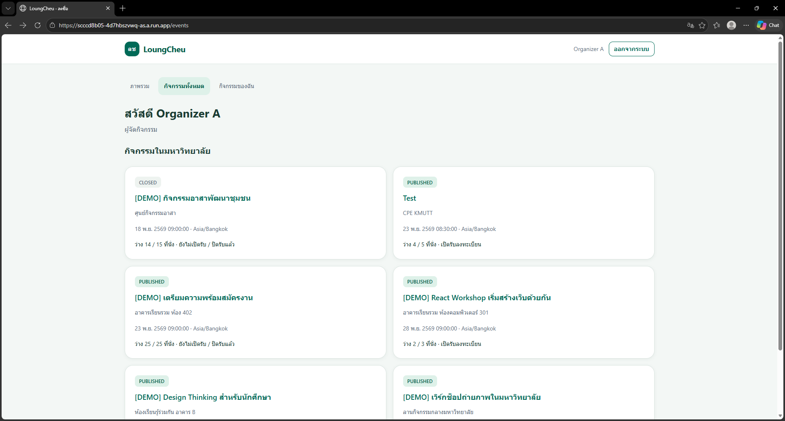

### 03. กิจกรรมของผู้จัด

Organizer A เปิดหน้ากิจกรรมของฉันและมีปุ่มสร้างกิจกรรม


### 04. เปิดแบบฟอร์มสร้างกิจกรรม

แบบฟอร์มสร้างกิจกรรมก่อนกรอกข้อมูล


### 05. กรอกข้อมูลกิจกรรม

กิจกรรม Test2 ที่ CPE KMUTT จำนวน 5 ที่นั่ง จัดวันที่ 24 พ.ย. 2569 เวลา 08:30–16:30 และปิดรับลงทะเบียนวันที่ 23 พ.ย. 2569 เวลา 11:59 ตามแบบฟอร์ม

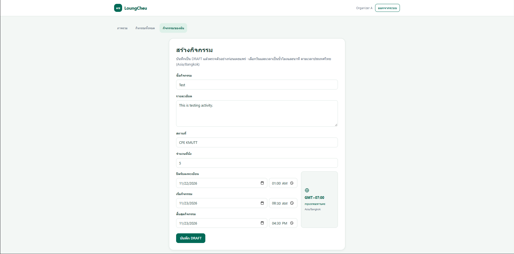

### 06. บันทึกกิจกรรมร่าง

กิจกรรม Test2 อยู่ในสถานะ DRAFT และแสดงปุ่มเผยแพร่กิจกรรม

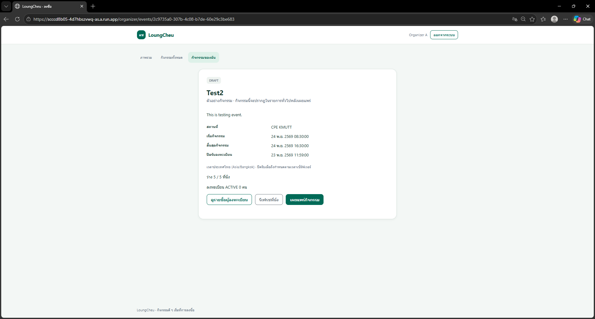

### 07. เผยแพร่กิจกรรมสำเร็จ

กิจกรรม Test2 เปลี่ยนเป็น PUBLISHED มีที่นั่งว่าง 5/5


### 08. เข้าสู่ระบบเป็นผู้เข้าร่วม

Participant A เห็นกิจกรรม Test ในรายการกิจกรรมทั้งหมด


### 09. เลือกกิจกรรมเพื่อลงทะเบียน

Participant A เปิดกิจกรรม Test2 และเห็นปุ่มลงทะเบียน; URL ระบุ event ID 2c9735a0-307b-4c08-b7de-60e29c3be683


### 10. ลงทะเบียนสำเร็จ

แสดงข้อความลงทะเบียน Test2 สำเร็จ เลขอ้างอิง d90146b4-0151-4a0f-b2ef-2bf3f22d69b0; ที่นั่งว่างลดจาก 5/5 เป็น 4/5 และเห็น public URL


### 11. ตรวจรายการลงทะเบียนของฉัน

กิจกรรม Test2 แสดงสถานะ ACTIVE เลขอ้างอิง d90146b4-0151-4a0f-b2ef-2bf3f22d69b0 ตรงกับหน้าลงทะเบียนสำเร็จ; ภาพระบุเวลาลงทะเบียน 22 พ.ย. 2569 00:30:37 และแสดงรายการ Test เดิมแยกกัน

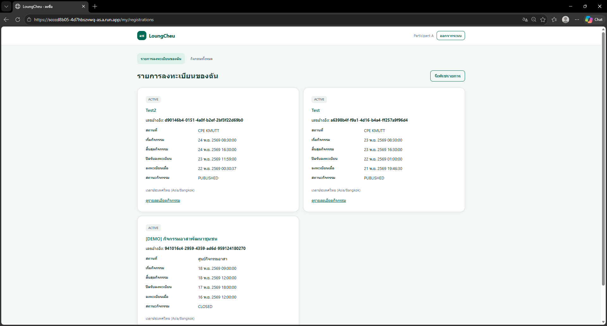

### 12. Login ไม่สำเร็จ — หลักฐานประกอบ

บัญชี inactive.x ได้รับข้อความชื่อผู้ใช้หรือรหัสผ่านไม่ถูกต้อง ตามผลทดสอบที่ผู้ใช้รายงาน; ภาพเพียงอย่างเดียวไม่แยกสาเหตุบัญชี inactive ออกจากรหัสผ่านผิด


### 13. Portal Resources ready

Portal แสดง Resources ready, 6/6 main steps complete และ WIF Connected; Completed at (Thailand time) 14:20:02 โดยภาพไม่แสดงวันที่ จึงไม่อนุมานวันที่จากภาพ

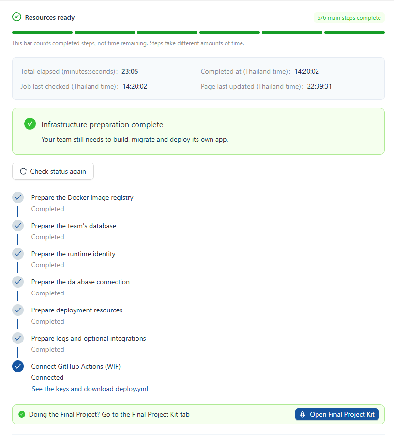

### 14. Cloud Run Console

หน้า Service details ของ scccd8b05 ใน CPE-SE-Course-2026, region asia-southeast1 แสดง revision scccd8b05-00002-72x สถานะพร้อมและ Traffic 100% (to latest), port 3000, คำสั่ง node dist/server.js, APP_VERSION 87c77af07bfbb7f2b4e0d9ada4b69cd79a5c6b5f และ SESSION_SECRET ที่อ้าง scccd8b05-app-secret-1:1 ภาพแสดงเฉพาะชื่อ secret/reference ไม่แสดงค่ารหัสผ่าน ข้อมูล image บน Console ถูกตัดให้สั้นจึงใช้ revision.yaml ประกอบการยืนยัน digest เต็ม; Console ระบุว่าไม่มี build/source information จึงยังไม่ใช่หลักฐาน source-to-image provenance

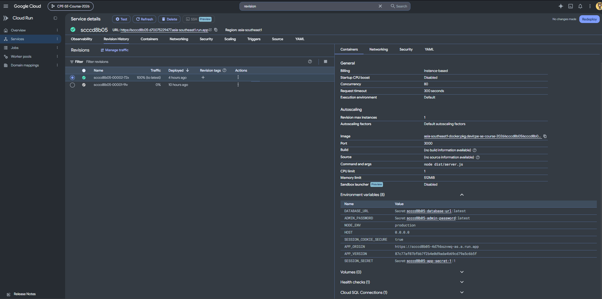

### 15. Cloud Run CLI และ migration

ผล Cloud Shell แสดง public URL, main SHA 87c77af…, latestReadyRevisionName scccd8b05-00002-72x และ traffic 100%; migration execution scccd8b05-migrate-cbp4k ใช้ digest เดียวกับ revision.yaml และสำเร็จ 1 task ณ 2026-11-21T12:05:47.291764Z

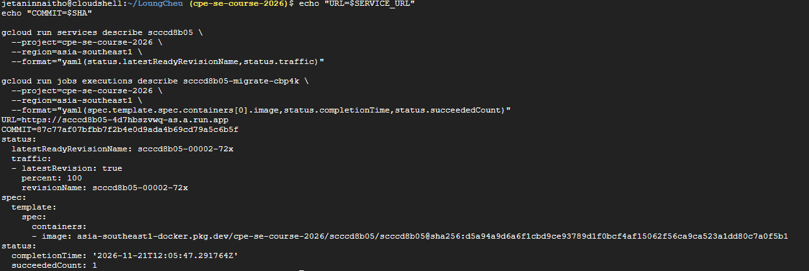

### 16. Release tag → image index → deployed image

Operator-supplied `docker buildx imagetools inspect` output links release tag `87c77af07bfbb7f2b4e0d9ada4b69cd79a5c6b5f` to OCI index `sha256:e4054b99bf312ef871bd08e4c660599961da94638397d0d90954ee8a01ea5397`. Its linux/amd64 child manifest is `sha256:d5a94a9d6a6f1cbd9ce93789d1f0bcf4af15062f56ca9ca523a1dd80c7a0f5b1`, matching the immutable image of revision `scccd8b05-00002-72x` in [revision.yaml](revision.yaml). The parent index digest differs from the child image digest because they identify different OCI objects. The unknown/unknown entry is an attestation manifest referencing that child image; its presence alone does not establish verified source/build provenance.

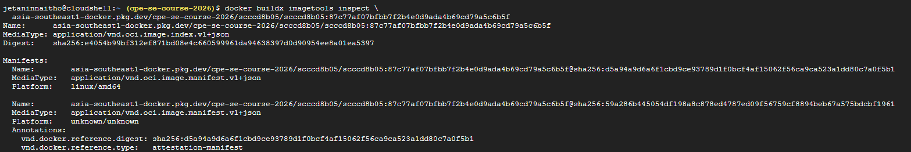

## Capacity restriction — One Participant

This replaces the ambiguous inactive-login screenshot as the explicit rule/access-restriction evidence. All three images show event `98e22d31-fc01-4759-9861-477005e23f83`, titled `One Participant`, at the same public origin. The registration deadline shown is 23 November 2026 23:59, so the captured UI sequence is consistent with the capacity limit rather than an already expired deadline.

The filenames of 20b and 20c do not match their contents; the captions and sequence below follow the inspected images. Files are not renamed by this edit.

### 20a. Published activity with one available seat

Organizer A sees `PUBLISHED`, 1/1 seats available and zero active registrations.

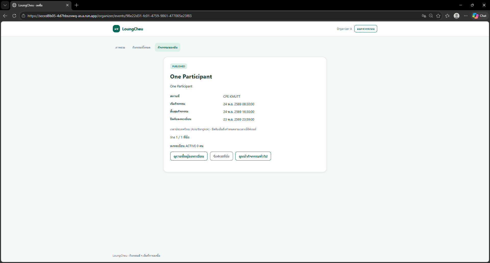

### 20c. Participant A occupies the final seat

Participant A receives registration success, reference `c3d27e48-1234-4a46-8569-2ab6431163a4`. Availability is 0/1 and the active registration count is 1.

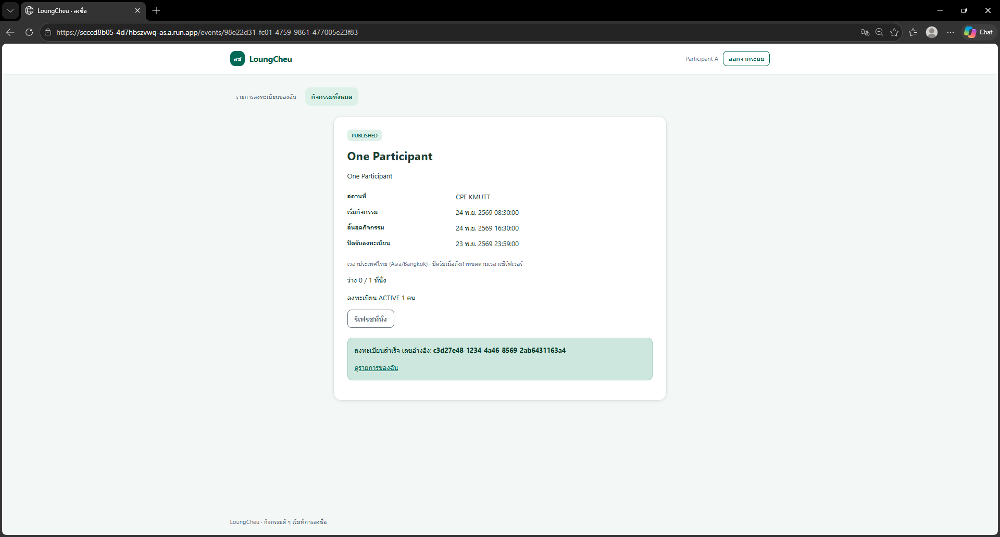

### 20b. Participant B cannot register for the full activity

Participant B sees the same event at 0/1 seats, the message “กิจกรรมนี้ไม่เปิดรับลงทะเบียน หรือไม่มีที่นั่งว่าง”, and a disabled registration button. This is direct evidence of a capacity restriction in the browser UI. No direct API request or server rejection response was captured, so this record does not claim an API-level rejection test.

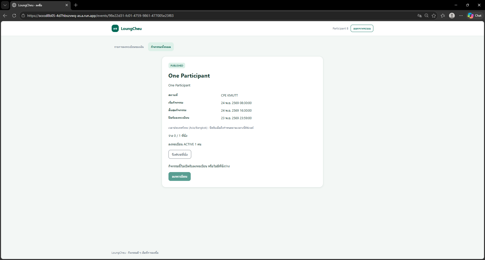

## Additional resource screenshots

### 17. Cloud SQL and storage auto-increase

`scccd8b05-pg` is RUNNABLE and `storageAutoResize` is false.

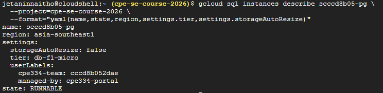

### 18. Runtime service account

The service's actual runtime identity is shown. This does not display its role grants.

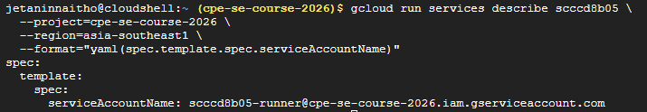

### 19. Artifact Registry

The assigned Docker repository exists in asia-southeast1.

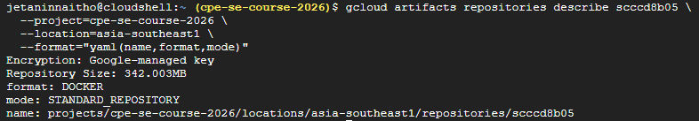

### 21. Secret Manager access limitation

The student account cannot list secrets. No secret payload is shown.

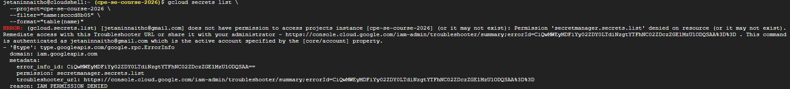

### 22. IAM access limitation

The student account cannot read the project IAM policy. TA confirmation of runtime permissions is still needed.

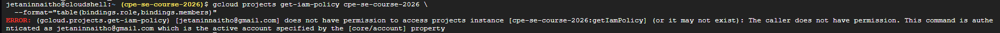
