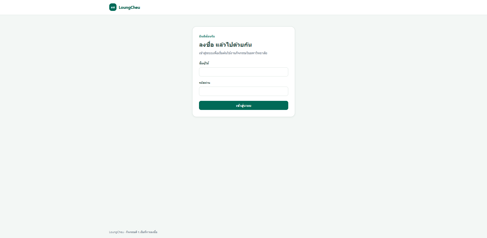
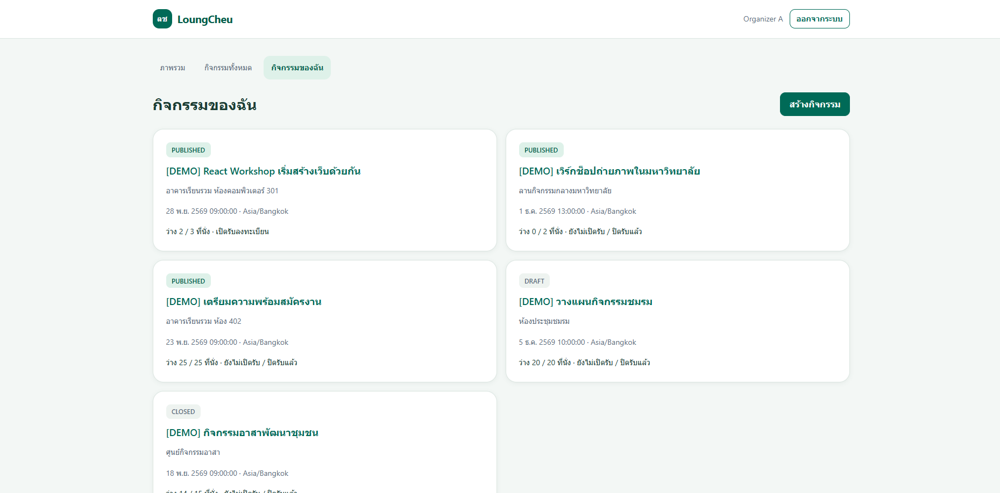
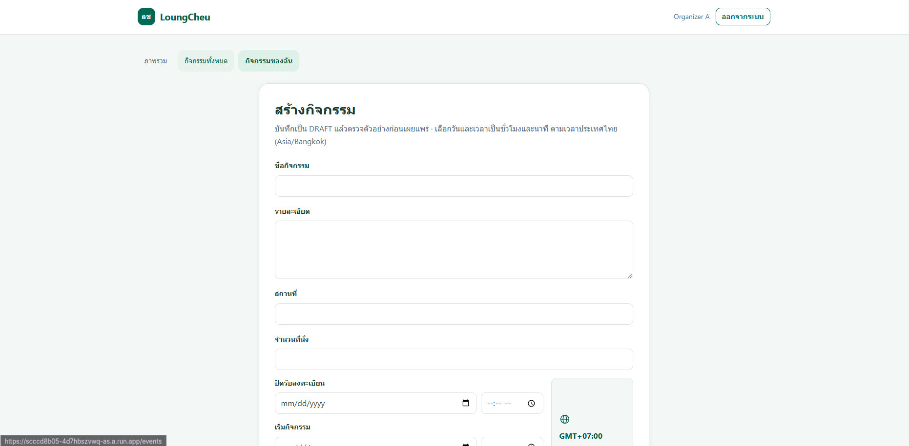
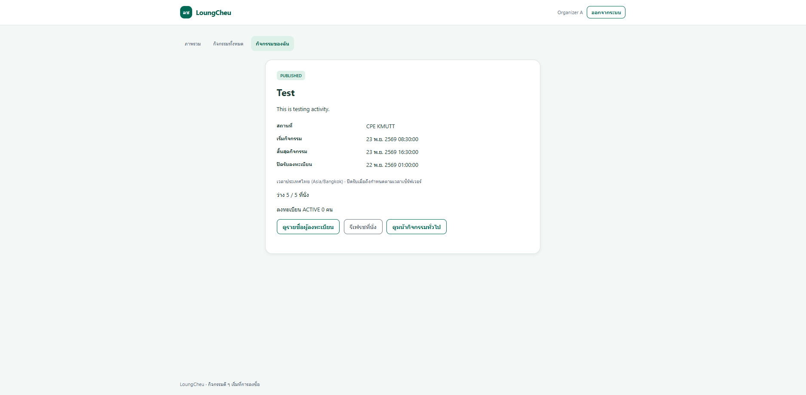
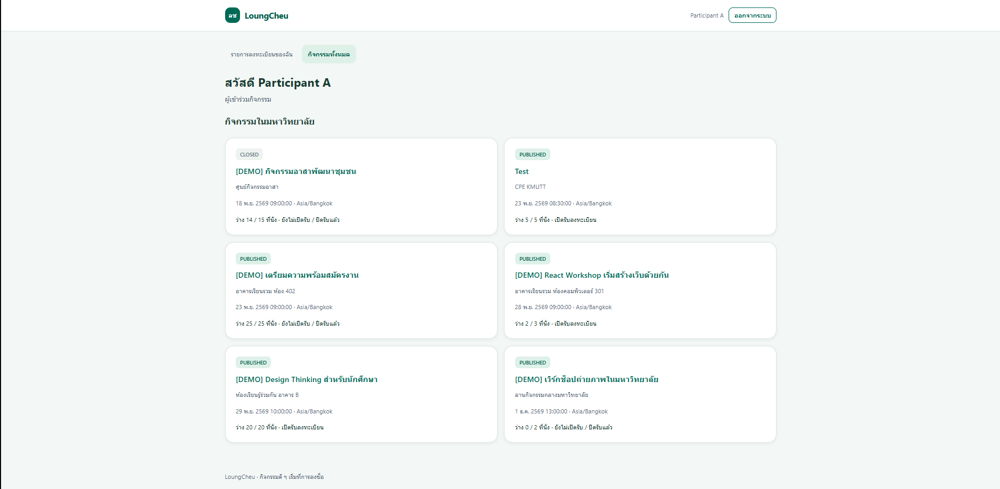
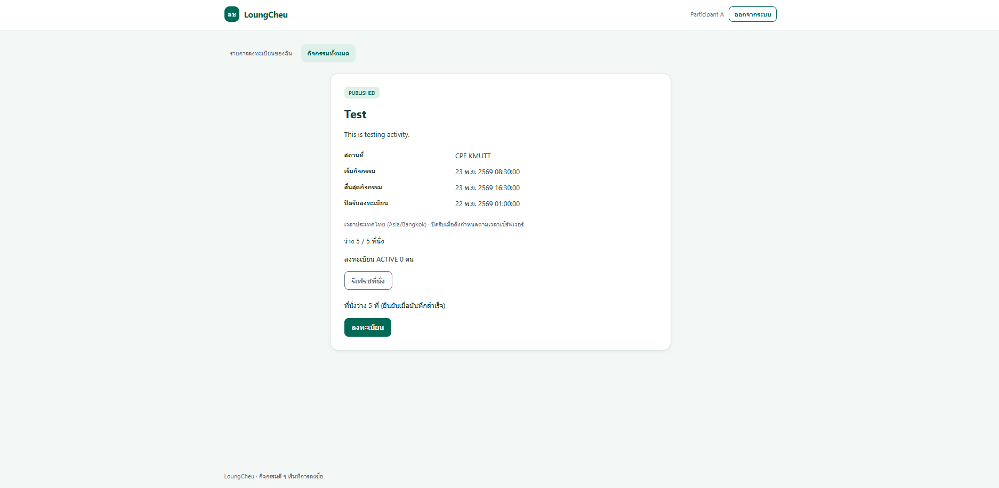
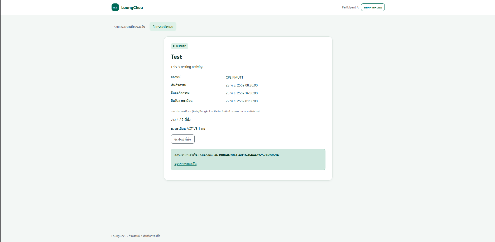
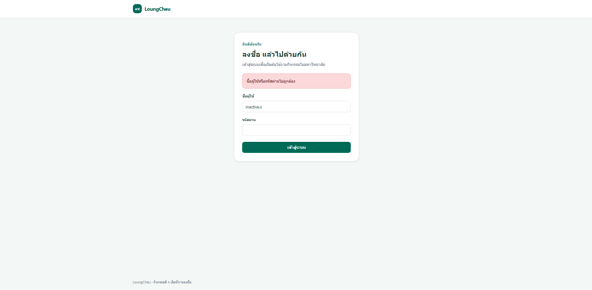

# Issue #17 live deployment evidence — 21 November 2026

Status: manual migration and smoke passed; operator reports live role/business journeys passed. C-04 evidence capture is **incomplete**, so do not close Issue #17 yet.

This is a new live-evidence round. `../issue17-shared-cloud` and `../issue17-offline` remain untouched historical offline records. No secret values, passwords, cookies or tokens belong in this directory.

## Retained evidence and provenance

- [Public readiness response](readiness.json): independently fetched HTTP 200 at the recorded UTC time. The app reports DB connected and APP_VERSION `87c77af07bfbb7f2b4e0d9ada4b69cd79a5c6b5f`; revision/image binding still needs confirmation.
- [Operator transcript excerpts](operator-transcript.log): exact success excerpts supplied in this chat; not a full independently captured Cloud Shell session. Shell variable values were not printed.
- [GitHub merge/CI snapshot](github-record.json): selected public API metadata, collected 21 November 2026, exact source heads, merge commits and Actions conclusions.
- Public app: https://scccd8b05-4d7hbszvwq-as.a.run.app/login
- Issue: https://github.com/jetanin/LoungCheu/issues/17
- PR #24: https://github.com/jetanin/LoungCheu/pull/24
- Release PR #25: https://github.com/jetanin/LoungCheu/pull/25

## Browser results reported by the operator

Organizer: login, create and publish passed. Participant: view and register passed. Inactive account: login rejected. An earlier login error was reported; later operator confirmation supersedes the failing status, without establishing a specific root cause/fix. Screenshots are now linked in the [C-04 screenshot gallery](#c-04-screenshot-gallery). The app screenshots omit the browser address bar; a URL-visible browser capture is still needed.

## Still needed for C-04 / Issue completion

- [x] Portal Resources ready screenshot: [14-team-resources.png](screenshots/14-team-resources.png), completed at 14:20:02 Thailand time; date is not visible in the capture.
- [x] Operator-supplied revision `scccd8b05-00002-72x` and matching spec/status image digest `sha256:d5a94a9d6a6f1cbd9ce93789d1f0bcf4af15062f56ca9ca523a1dd80c7a0f5b1`: [revision output](revision.yaml).
- [x] Service latestReadyRevisionName and 100% traffic point to `scccd8b05-00002-72x`: [Cloud Shell output](screenshots/13-cloud-run.png).
- [ ] Retain image tag/build provenance linking the source SHA to the immutable image; printed shell SHA and APP_VERSION alone are not independent build provenance.
- [x] Migration completion time `2026-11-21T12:05:47.291764Z` and `succeededCount: 1` are associated with `scccd8b05-migrate-cbp4k` in [Cloud Shell output](screenshots/13-cloud-run.png).
- [x] Login and signed-in screens captured with no password shown: [login](screenshots/01-login.png), [organizer](screenshots/02-organizer.png), [participant](screenshots/08-participant.png).
- [ ] Add a browser screenshot with the public URL visible; current app captures omit the address bar. The CLI screenshot records the public URL separately.
- [x] Organizer create/publish and participant registration for the same activity `Test`: [draft](screenshots/06-organizer-draft.png), [published](screenshots/07-organizer-published.png), [registered](screenshots/10-participant-registered.png), [my registrations](screenshots/11-participant-own.png).
- [x] Inactive login rejection screenshot: [12-inactive-rejected.png](screenshots/12-inactive-rejected.png), with the generic authentication error; test intent/account state is operator-reported.
- [x] Cloud Run CLI and team resource screenshots: [13-cloud-run.png](screenshots/13-cloud-run.png), [14-team-resources.png](screenshots/14-team-resources.png). These show CLI state and portal status, not a Cloud Run Console capture.
- [ ] Attach URL/screenshots and release metadata directly to Issue #17 and cross-link this record; then update the Issue/project status.

## Collect missing non-secret release metadata in Cloud Shell

```bash
gcloud run services describe scccd8b05 --project=cpe-se-course-2026 --region=asia-southeast1 --format='yaml(status.latestReadyRevisionName,status.traffic)'
gcloud run jobs executions describe scccd8b05-migrate-cbp4k --project=cpe-se-course-2026 --region=asia-southeast1 --format='yaml(status.completionTime,status.succeededCount)'
```

Use the returned ready revision name in:

```bash
gcloud run revisions describe ACTUAL_READY_REVISION --project=cpe-se-course-2026 --region=asia-southeast1 --format='yaml(metadata.name,spec.containers[0].image,status.imageDigest)'
```

These collection commands have not been run by the documentation agent. Do not copy example/zero digests into evidence. #18/#19/#20 proof remains outside this update; include this C-04 set again in the final LEB2 submission under #20.

## C-04 screenshot gallery

Public app reported by the operator: [LoungCheu login](https://scccd8b05-4d7hbszvwq-as.a.run.app/login). Images below were supplied by the operator and inspected when adding these links. App captures show page content without the browser address bar; they do not by themselves establish the origin. No visible password, secret value, cookie or token was found in these captures.

### 01. หน้าเข้าสู่ระบบ

หน้า login ของ LoungCheu ช่องรหัสผ่านว่าง



### 02. เข้าสู่ระบบเป็นผู้จัดกิจกรรม

แสดง Organizer A หลังเข้าสู่ระบบ


### 03. กิจกรรมของผู้จัด

Organizer A เปิดหน้ากิจกรรมของฉันและมีปุ่มสร้างกิจกรรม



### 04. เปิดแบบฟอร์มสร้างกิจกรรม

แบบฟอร์มสร้างกิจกรรมก่อนกรอกข้อมูล



### 05. กรอกข้อมูลกิจกรรม

กิจกรรม Test ที่ CPE KMUTT จำนวน 5 ที่นั่ง พร้อมกำหนดเวลา


### 06. บันทึกกิจกรรมร่าง

กิจกรรม Test อยู่ในสถานะ DRAFT และแสดงปุ่มเผยแพร่กิจกรรม


### 07. เผยแพร่กิจกรรมสำเร็จ

กิจกรรม Test เปลี่ยนเป็น PUBLISHED มีที่นั่งว่าง 5/5



### 08. เข้าสู่ระบบเป็นผู้เข้าร่วม

Participant A เห็นกิจกรรม Test ในรายการกิจกรรมทั้งหมด



### 09. เลือกกิจกรรมเพื่อลงทะเบียน

Participant A เปิดกิจกรรม Test และเห็นปุ่มลงทะเบียน



### 10. ลงทะเบียนสำเร็จ

แสดงข้อความลงทะเบียนสำเร็จพร้อมเลขอ้างอิง ที่นั่งว่างลดจาก 5/5 เป็น 4/5



### 11. ตรวจรายการลงทะเบียนของฉัน

กิจกรรม Test แสดงสถานะ ACTIVE และเลขอ้างอิงตรงกับหน้าลงทะเบียนสำเร็จ


### 12. ปฏิเสธบัญชี inactive

บัญชี inactive.x ได้รับข้อความชื่อผู้ใช้หรือรหัสผ่านไม่ถูกต้อง ตามผลทดสอบที่ผู้ใช้รายงาน; ภาพเพียงอย่างเดียวไม่แยกสาเหตุบัญชี inactive ออกจากรหัสผ่านผิด



### 13. Cloud Run revision, traffic และ migration

ผล Cloud Shell แสดง main SHA 87c77af…, latestReadyRevisionName scccd8b05-00002-72x และ traffic 100%; migration execution scccd8b05-migrate-cbp4k ใช้ digest เดียวกับ revision.yaml และสำเร็จ 1 task ณ 2026-11-21T12:05:47.291764Z


### 14. Portal Resources ready

Portal แสดง Resources ready, 6/6 main steps complete และ WIF Connected; Completed at (Thailand time) 14:20:02 โดยภาพไม่แสดงวันที่ จึงไม่อนุมานวันที่จากภาพ


