# Issue #20 — persistence baseline, 22 November 2026

Status: **baseline captured and persistence after instance replacement/restart verified from the supplied screenshots; redeploy persistence remains pending**. The recorded scale-to-zero/restore operation and a subsequent new-instance startup occurred on the same revision. C-05 as a whole is not marked PASS until the separate redeploy check is completed. Images were supplied by the operator and inspected when preparing this index; no cloud operation or database change was performed by the documentation agent.

Use only course project `cpe-se-course-2026`, region `asia-southeast1`, service `scccd8b05`. [Issue #20](https://github.com/jetanin/LoungCheu/issues/20). Keep this evidence separate from the historical [Issue #17 deployment round](../issue17-live-20261121/README.md).

## Source and running deployment observations

The local documentation source and deployed app version are different identifiers and must not be substituted for one another.

| Observation | Value transcribed from the supplied screenshot | Evidence |
| --- | --- | --- |
| Local branch | `doc/20-lab5-submission` | [Local source](before/00-local-source.png) |
| Local source HEAD | `9c562d56b333ca878a056f34763192ec3e7e6fdb` | [Local source](before/00-local-source.png) |
| Local working tree at capture | No modified/untracked paths printed; upstream shown as `origin/lab5-staging` | [Local source](before/00-local-source.png) |
| Public origin | `https://scccd8b05-4d7hbszvwq-as.a.run.app` | [Readiness](before/05-before-readiness.png), [service describe](before/04-before-cloud-run.png) |
| Readiness response | `status=ready`, `db=connected`; curl returned JSON, but the screenshot does not print an HTTP status line | [Readiness](before/05-before-readiness.png) |
| App-reported version | `0a2f8bd5540b3db5f7e05fc79fc59e5ae51fd099` | [Readiness](before/05-before-readiness.png) |
| Latest ready revision | `scccd8b05-00005-5xj` | [Service describe](before/04-before-cloud-run.png) |
| Traffic | 100% to `scccd8b05-00005-5xj`, `latestRevision: true` | [Service describe](before/04-before-cloud-run.png) |
| Revision creation time | `2026-11-22T11:16:49.886910Z` (18:16:49.886910 Asia/Bangkok) | [Revision describe](before/06-before-revision-image.png) |
| Revision image | `asia-southeast1-docker.pkg.dev/cpe-se-course-2026/scccd8b05/scccd8b05@sha256:28b5b4fa72bf910369db8f544242cbdde240cff89afee0c0ddbff395d2806e1b` | [Revision describe](before/06-before-revision-image.png) |
| Resolved image digest | `sha256:28b5b4fa72bf910369db8f544242cbdde240cff89afee0c0ddbff395d2806e1b`; spec image and status.imageDigest agree in the capture | [Revision describe](before/06-before-revision-image.png) |

Capture timing matters: the supplied readiness file is named `Screenshot 2026-11-22 181945.png`; the activity/registration images are around 20:04–20:06 and service/revision images around 20:07–20:08. File names are operator capture labels, not independent server timestamps. The registration itself shows 20:05:51 Asia/Bangkok. These are observations at different points, not proof of an uninterrupted instance or a completed restart. The later [restart preflight readiness](before/08-immediately-before-restart-readiness.png), [revision](before/09-before-restart-revision.png) and [configuration](before/10-before-restart-service-config.png) now document the same app version and serving revision before the scaling operation. The readiness command prints 14:05:55 UTC; the screenshot filename is not used as its execution timestamp. Before the separate redeploy, capture the current state again if any other release has intervened. No source-build attestation or tag-to-image mapping is inferred from APP_VERSION alone.

## Persistent records to follow

| Field | Baseline value |
| --- | --- |
| Event name | `L5-C05-20261122-A` |
| Event ID | `1a3914aa-774f-4d13-bd38-105fd08462cd` |
| Organizer | `organizer.a` / Organizer A |
| Description | `Persistence evidence for application restart and redeployment.` |
| Location | `CPE KMUTT` |
| Event status | `PUBLISHED` |
| Capacity | 5 |
| Available / active registrations before registration | 5/5 available; 0 active |
| Available / active registrations after registration | 4/5 available; 1 active |
| Registration closes | 24 November 2026, 23:59 Asia/Bangkok |
| Event starts | 25 November 2026, 09:00 Asia/Bangkok |
| Event ends | 25 November 2026, 12:00 Asia/Bangkok |
| Participant | `participant.a` / Participant A |
| Registration ID / reference | `dd47235f-be9f-46ed-830a-4d49586cf1e2` |
| Registration status | `ACTIVE` |
| Registration time displayed by app | 22 November 2026, 20:05:51 Asia/Bangkok |

- [Public event](https://scccd8b05-4d7hbszvwq-as.a.run.app/events/1a3914aa-774f-4d13-bd38-105fd08462cd)
- [Organizer event](https://scccd8b05-4d7hbszvwq-as.a.run.app/organizer/events/1a3914aa-774f-4d13-bd38-105fd08462cd)
- [My registrations](https://scccd8b05-4d7hbszvwq-as.a.run.app/my/registrations)

These routes may require the appropriate login. The event ID and registration reference must stay identical after each test. Recreating the same title, resetting/reseeding the database or replacing the registration is not evidence that the original records survived. A successful new login alone is not the persistence result.

## Before / after comparison

| Check | Before test | After application restart | After redeploy |
| --- | --- | --- | --- |
| Event ID | `1a3914aa-774f-4d13-bd38-105fd08462cd` | `1a3914aa-774f-4d13-bd38-105fd08462cd` — unchanged | Not tested |
| Event name | `L5-C05-20261122-A` | `L5-C05-20261122-A` — unchanged | Not tested |
| Event status | `PUBLISHED` | `PUBLISHED` | Not tested |
| Registration ID | `dd47235f-be9f-46ed-830a-4d49586cf1e2` | `dd47235f-be9f-46ed-830a-4d49586cf1e2` — unchanged | Not tested |
| Registration status | `ACTIVE` | `ACTIVE` | Not tested |
| Available seats / active count | 4/5; 1 active | 4/5; 1 active — unchanged | Not tested |
| App-reported version | `0a2f8bd5540b3db5f7e05fc79fc59e5ae51fd099` in retained readiness capture | `0a2f8bd5540b3db5f7e05fc79fc59e5ae51fd099` — unchanged | Not tested |
| Serving revision | `scccd8b05-00005-5xj` in retained service capture | `scccd8b05-00005-5xj` — unchanged; 100% traffic | Not tested |
| Image digest | `sha256:28b5b4fa72bf910369db8f544242cbdde240cff89afee0c0ddbff395d2806e1b` | Same immutable revision; digest retained from baseline revision describe, not independently re-described after restart | Not tested |
| Evidence of the actual lifecycle event | Baseline only | Scale 0 succeeded → auto restored → startup log at `2026-11-22T14:45:57.268504Z` on the same revision | Pending release run and new revision |

## Baseline screenshot index

### Local documentation branch and source

The screenshot records the local branch/source and a clean working tree at that point. It is not the deployed app SHA.

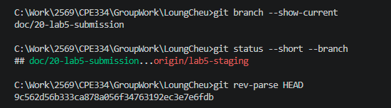

### Event form

Organizer A filled the name, description, capacity and future registration/event times.

### Draft created

The draft has the event ID to be tracked; it has not been published at this step.

### Organizer published the event

The same event is PUBLISHED with 5/5 seats available and zero active registrations.

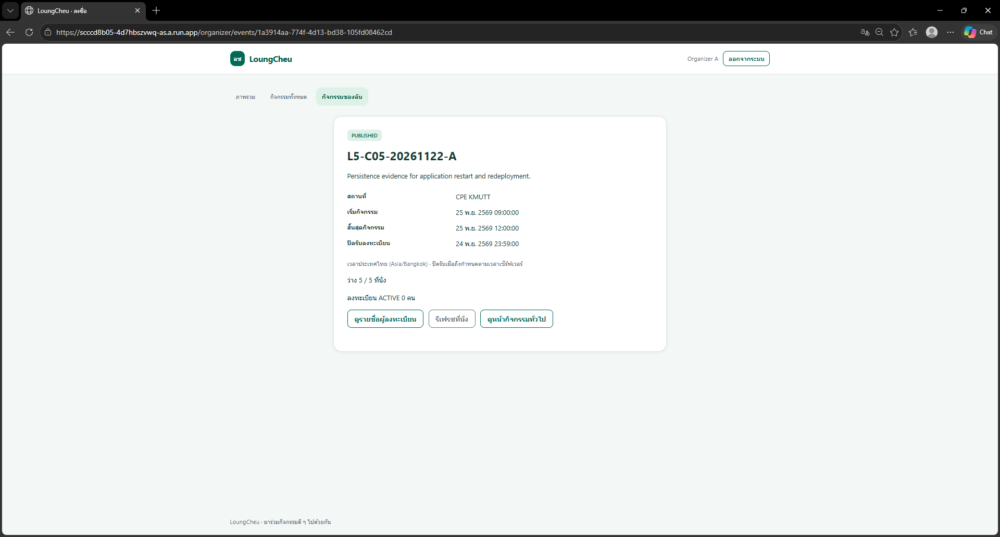

### Participant before registration

Participant A sees the same event and the registration action.

### Registration succeeded

Participant A receives reference `dd47235f-be9f-46ed-830a-4d49586cf1e2`; availability changes to 4/5 with one active registration.

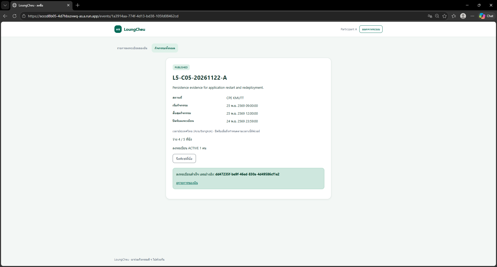

### My registrations

The same registration reference is ACTIVE for `L5-C05-20261122-A`. Other activities visible on the page are not the records used for this C-05 test.

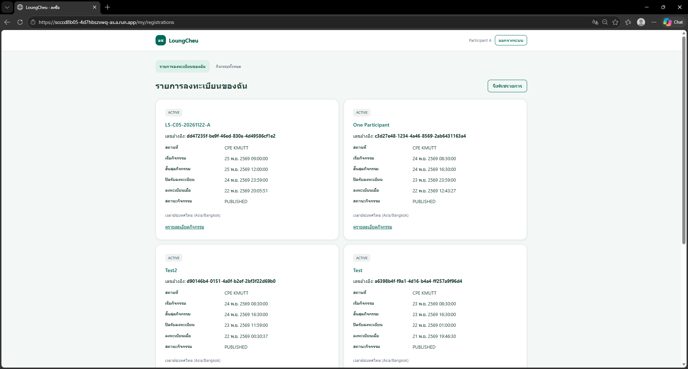

### Service and traffic

The actual service describe output records latestReadyRevisionName and 100% traffic.

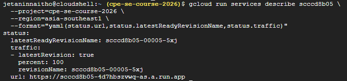

### Database readiness and deployed app version

This readiness capture precedes the activity creation. Refresh it before beginning the lifecycle test rather than claiming it was captured after registration.

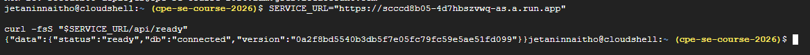

### Revision and immutable image

The supplied revision describe output records creationTimestamp, full image reference and imageDigest.

## Next evidence to collect

- [x] Local source/branch and a separate deployed-app readiness version captured.
- [x] Dedicated event created/published; event ID retained.
- [x] Participant registered; exact registration reference and ACTIVE state retained.
- [x] Baseline revision/traffic/image digest captured.
- [x] Preflight screenshots retain readiness/version and the serving revision for the restart test: [readiness](before/08-immediately-before-restart-readiness.png), [revision](before/09-before-restart-revision.png), [service configuration](before/10-before-restart-service-config.png).
- [ ] Coordinate with the teammate handling #19 so that another deployment is not confused with the restart event.
- [x] Scale-to-zero/restore and a new-instance startup on the same revision are captured, followed by the original same-ID event and ACTIVE registration; see the restart result below. A zero-instance metric screenshot is not retained, so no direct observed counter/continuous instance count is claimed.
- [ ] Demonstrate a separate redeploy, retain its run/new revision/image/version and re-open the original same-ID records. Save under `after-redeploy/`.
- [ ] Complete the comparison table with actual results; do not tick C-05 before both events are evidenced.
- [ ] Link the resulting evidence in Issue #20 and the final submission through the team's reviewed PR/release flow. Existing C-01–C-04/C-06 evidence must be assessed separately; this baseline does not establish those results.

Do not store passwords, SESSION_SECRET/DATABASE_URL values, cookies or tokens in screenshots/logs. No visible secret value was identified in the supplied baseline images. This documentation update does not run tests against the live database, reset data, change Cloud Run, deploy an image, commit, push or close Issue #20. The scaling operations in the supplied screenshots were executed by the operator, separately from this documentation work.

## Restart result — 22 November 2026

**Result: original business records retained after a captured instance-replacement/restart sequence on the same revision. Separate redeploy evidence is still pending.**

| Evidence | Observation |
| --- | --- |
| Preflight | App `0a2f8bd5540b3db5f7e05fc79fc59e5ae51fd099`, DB connected, revision `scccd8b05-00005-5xj`, traffic 100% |
| Stop operation | Operator ran `gcloud run services update ... --scaling=0`; command succeeded at `2026-11-22 14:40:08 UTC` (21:40:08 Asia/Bangkok) |
| Restore operation | Operator ran `--scaling=auto`; update succeeded; screenshot does not print an execution timestamp |
| New instance | Cloud Logging records `Starting new instance. Reason: AUTOSCALING` at `2026-11-22T14:45:57.268504Z` (21:45:57.268504 Asia/Bangkok), on the same revision |
| Earlier startup | The same log capture also contains `2026-11-22T14:05:55.565450Z`; this is earlier than the stop and is not presented as the post-restart startup |
| Readiness after restore | `ready`, `db=connected`, same app version |
| Revision after restore | `scccd8b05-00005-5xj`, 100% traffic; no new revision is claimed for this event |
| Original event | Event URL contains `1a3914aa-774f-4d13-bd38-105fd08462cd`; same title, PUBLISHED, capacity 5, availability 4/5 and 1 active registration |
| Original registration | Detail URL and reference contain `dd47235f-be9f-46ed-830a-4d49586cf1e2`; ACTIVE for the same event, original registration time 22 November 2026 20:05:51 Asia/Bangkok |

Scope: the retained evidence combines a successful scale-to-zero command, a successful restore, a later startup on the same revision, DB readiness and unchanged record IDs. There is no screenshot of the instance-count metric at zero and no before/after instanceId pair, so those specific observations are not asserted. This is not redeploy evidence or a new API write test. The app/DB were not reset or reseeded as part of the documented restart sequence.

### Restart preflight

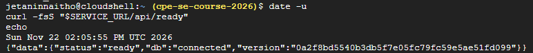

### Stop and restore

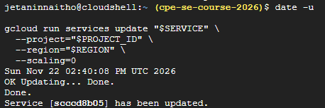

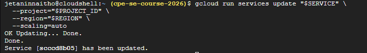

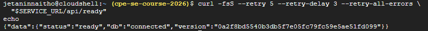

### Same revision, new instance

### Original records after restart

Next: coordinate the separately reviewed release/redeploy with the #19 teammate, keep these original IDs, retain the deployment run/new revision/readiness, and verify the same records again under `after-redeploy/`. Do not mark overall C-05 or Issue #20 complete from the restart result alone.

## Redeploy preflight — 22 November 2026

**Before-redeploy configuration/readiness capture complete; no redeploy result is claimed.** These four supplied images were inspected after the restart result had been recorded. They still show the same application version and revision, so they are a preflight observation rather than evidence of a new release.

| Check | Observation |
| --- | --- |
| Project / region / service | `cpe-se-course-2026` / `asia-southeast1` / `scccd8b05` |
| Public origin | `https://scccd8b05-4d7hbszvwq-as.a.run.app` |
| Readiness execution time | `2026-11-22 15:01:19 UTC` = 22:01:19 Asia/Bangkok, from the printed `date -u` output |
| Readiness | `ready`, `db=connected` |
| App-reported version | `0a2f8bd5540b3db5f7e05fc79fc59e5ae51fd099` |
| BEFORE_REDEPLOY_REVISION | `scccd8b05-00005-5xj` |
| Traffic | 100% to the same revision, `latestRevision: true` |

The original event and registration had just been verified in the [restart result](#restart-result--22-november-2026); these four CLI images do not independently re-query the business records. If another release or data change intervenes before the coordinated test, repeat the preflight and retain the actual new starting state.

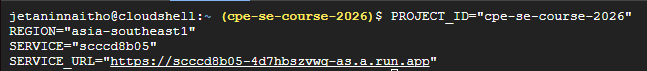

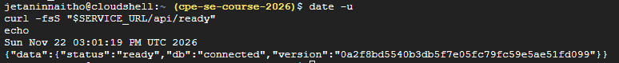

Next: commit/push the baseline/restart documentation through the reviewed feature PR into lab5-staging and release PR into main. Retain the matching #19 deployment run, new revision/image/version, and original same-ID event/registration after that release. `after-redeploy/` remains pending until the real deployment and those checks have occurred. This documentation edit performs no release or GCP change.
