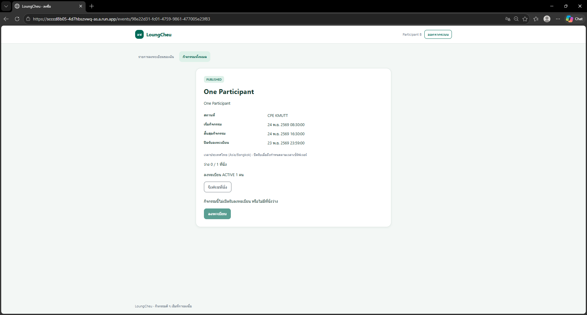
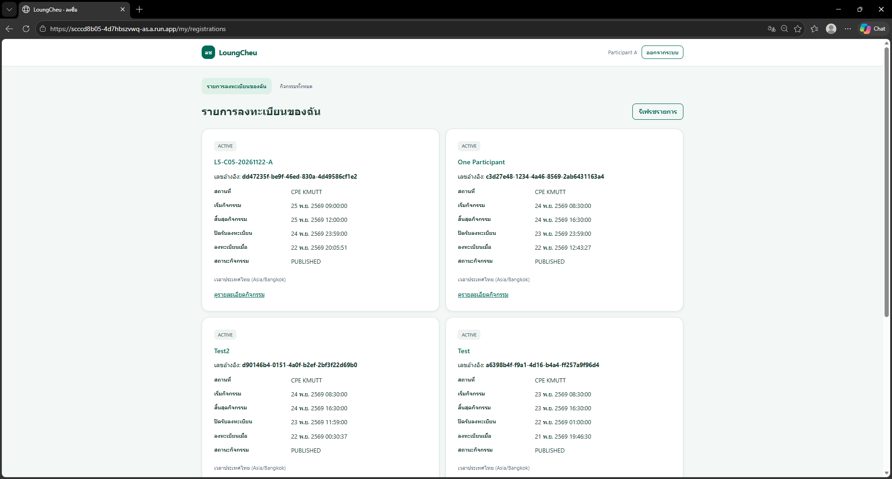
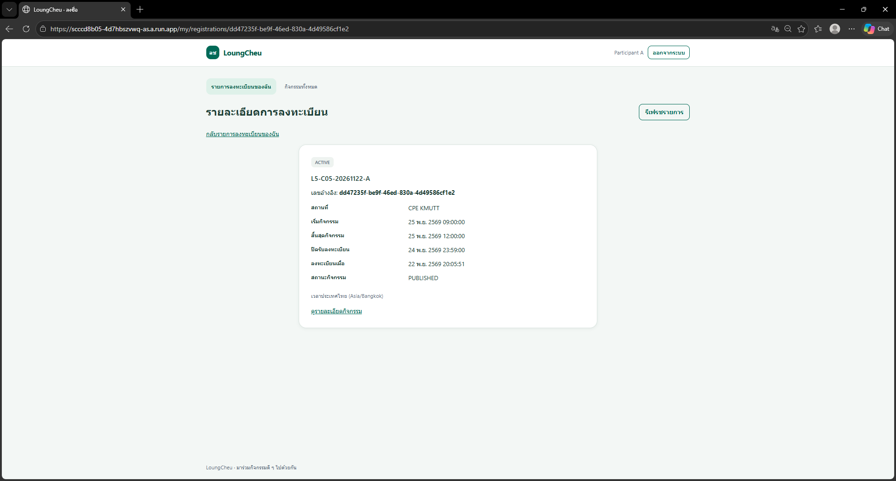
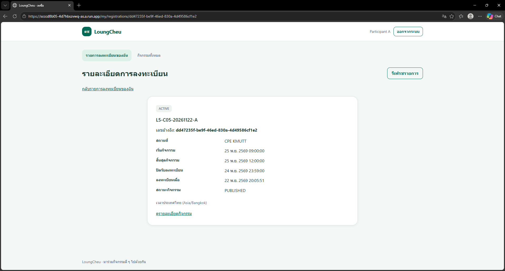

# Lab 5 submission evidence — LoungCheu

Verification date: **22 November 2026 (Asia/Bangkok)**. This is the combined C-01–C-06 evidence index and source for the final PDF. It records existing execution evidence; preparing this document does not run a new deployment, repeat the tests or submit to LEB2. Completed PDF: [lab5_sec1_TH-001_P3.pdf](../../../output/pdf/lab5_sec1_TH-001_P3.pdf), 7 pages, section 1, group TH-001_P3.

## Answer Part 0: Team and Evidence Index

| Item | Value |
| --- | --- |
| Course / section | CPE334 / **section 1** |
| Team / topic | **TH-001_P3** — LoungCheu, university activity publishing and registration; course resource prefix `scccd8b05` |
| Student 1 | **เจตนินทร์ นายโท** — `67070501011` — [jetanin](https://github.com/jetanin) |
| Student 2 | **ปภังกร ล่วนเส้ง** — `67070501083` — [i3artuf](https://github.com/i3artuf); account mapping confirmed by the operator |
| Public repository | [jetanin/LoungCheu](https://github.com/jetanin/LoungCheu) |
| Audited main baseline | [`8b64c48931b5e4fc9d36867fd3d067774a9510be`](https://github.com/jetanin/LoungCheu/commit/8b64c48931b5e4fc9d36867fd3d067774a9510be), merged by [release PR #37](https://github.com/jetanin/LoungCheu/pull/37) |
| Latest baseline deployment | [Deploy demo 45042702690](https://github.com/jetanin/LoungCheu/actions/runs/45042702690): **completed, success**, head equals audited main; updated `2026-11-22T16:20:28Z` (23:20:28 +07) |
| Submitted tag / commit | Submitted application/evidence baseline: `8b64c48931b5e4fc9d36867fd3d067774a9510be`. The PDF identifies this observed main/service baseline; publishing this index and PDF is a later documentation change. |
| Public service | [Application](https://scccd8b05-4d7hbszvwq-as.a.run.app/) · [Login](https://scccd8b05-4d7hbszvwq-as.a.run.app/login) · [Readiness](https://scccd8b05-4d7hbszvwq-as.a.run.app/api/ready) |
| Live observation during this audit | HTTP 200; `status=ready`, `db=connected`, `version=8b64c48931b5e4fc9d36867fd3d067774a9510be`. This is a later live observation, not the version used for the historical C-05 comparison. |
| Project / region / service | `cpe-se-course-2026` / `asia-southeast1` / `scccd8b05`; existing course-portal resources |

### Evidence index

| Rubric part | Check and result | Direct evidence | Tested version / run |
| --- | --- | --- | --- |
| 1 — CI and Quality Gate | **C-01: passing build/test PR** | [PR #23](https://github.com/jetanin/LoungCheu/pull/23), [final-head CI](https://github.com/jetanin/LoungCheu/actions/runs/43743586204), [CI record](ci.md) | PR head `7efa9361ef8ca0f60de019054307c7f841448a4b` |
| 1 — CI and Quality Gate | **C-02: failed required check and blocked merge captured** | [Temporary PR #28](https://github.com/jetanin/LoungCheu/pull/28), [failed run](https://github.com/jetanin/LoungCheu/actions/runs/44930338654), [screenshots in Issue #18](https://github.com/jetanin/LoungCheu/issues/18#issuecomment-7067180668), [active ruleset](https://github.com/jetanin/LoungCheu/rules/27801252) | `016d1b99b17fe1565f11f0e6ed529204643a7aa2`; PR closed without merging |
| 2 — Docker and Reproducible Configuration | **C-03: isolated fresh-clone build and DB-backed run passed** | [C-03 record](evidence/c03-20261115-54fd660/README.md), [commands/output](evidence/c03-20261115-54fd660/transcript.log), [manifest](evidence/c03-20261115-54fd660/manifest.json) | `54fd6603594a7a2e0327aad93624796b61903cc5` |
| 3 — GCP Deployment and Persistence | **C-04: live login, publishing, registration and capacity restriction captured** | [Live deployment record](evidence/issue17-live-20261121/README.md), [supplemental Issue #17 comment](https://github.com/jetanin/LoungCheu/issues/17#issuecomment-7077742818) | First manual release `87c77af07bfbb7f2b4e0d9ada4b69cd79a5c6b5f`; revision `scccd8b05-00002-72x` |
| 3 — GCP Deployment and Persistence | **C-05: same event and ACTIVE registration retained after restart and redeploy** | [Comparison record](evidence/issue20-persistence-20261122/README.md), [redeploy run](https://github.com/jetanin/LoungCheu/actions/runs/45039170919), [results PR #36](https://github.com/jetanin/LoungCheu/pull/36), [release PR #37](https://github.com/jetanin/LoungCheu/pull/37) | `0a2f8bd5540b3db5f7e05fc79fc59e5ae51fd099` → `f8fa8c9519f7196bdf6a8f8a002384e7cbb4089c` |
| 4 — Repeatable Release Pipeline | **C-06: reviewed change released automatically; visible UI, revision and commit recorded** | [Feature PR #31](https://github.com/jetanin/LoungCheu/pull/31), [review](https://github.com/jetanin/LoungCheu/pull/31#pullrequestreview-6011325333), [release PR #32](https://github.com/jetanin/LoungCheu/pull/32), [deploy run](https://github.com/jetanin/LoungCheu/actions/runs/45010299820), [Issue #19 evidence](https://github.com/jetanin/LoungCheu/issues/19#issuecomment-7078428882) | Main `4a02ee90417c8661bda4ac9b46316e038f293348`; revision `scccd8b05-00004-pvr` |

These checks occurred at different commits. Their versions are retained rather than relabelled as tests of the newest main commit. “Passed” describes the recorded check, not completion of the PDF, administrative requirements or every resource inventory inspection.

### Contributions observable in GitHub

| Account | Implementation / evidence | Teammate review examples |
| --- | --- | --- |
| `jetanin` | Docker [#22](https://github.com/jetanin/LoungCheu/pull/22); manual-cloud adaptation [#24](https://github.com/jetanin/LoungCheu/pull/24); live evidence [#27](https://github.com/jetanin/LoungCheu/pull/27); persistence [#34](https://github.com/jetanin/LoungCheu/pull/34), [#36](https://github.com/jetanin/LoungCheu/pull/36), release [#37](https://github.com/jetanin/LoungCheu/pull/37) | [#29 approval](https://github.com/jetanin/LoungCheu/pull/29#pullrequestreview-6010777686), [#31 approval](https://github.com/jetanin/LoungCheu/pull/31#pullrequestreview-6011325333), [#32 approval](https://github.com/jetanin/LoungCheu/pull/32#pullrequestreview-6011602401) |
| `i3artuf` | Cloud readiness [#21](https://github.com/jetanin/LoungCheu/pull/21); CI [#23](https://github.com/jetanin/LoungCheu/pull/23); failed-check experiment [#28](https://github.com/jetanin/LoungCheu/pull/28); automation [#29](https://github.com/jetanin/LoungCheu/pull/29), [#30](https://github.com/jetanin/LoungCheu/pull/30); visible release [#31](https://github.com/jetanin/LoungCheu/pull/31), [#32](https://github.com/jetanin/LoungCheu/pull/32) | [#24 approval](https://github.com/jetanin/LoungCheu/pull/24#pullrequestreview-5995743669), [#27 approval](https://github.com/jetanin/LoungCheu/pull/27#pullrequestreview-6011786133), [#36 approval](https://github.com/jetanin/LoungCheu/pull/36#pullrequestreview-6013187642), [#37 approval](https://github.com/jetanin/LoungCheu/pull/37#pullrequestreview-6013212765) |

The table attributes PR authorship and submitted reviews; it does not invent an individual execution log or claim that authorship alone proves every R-11 participation item. Add any required individual explanation from the actual work performed.

## Answer Part 1: CI and Quality Gate

### C-01 — normal PR passes automated checks

The [CI workflow](../../../.github/workflows/ci-docker.yml) runs on PRs to `lab5-staging` and `main`. It installs the root npm workspace from its lockfile, generates Prisma, migrates a disposable PostgreSQL test database, runs typecheck, unit/integration tests, production build, compiled-route smoke, Chromium E2E and a Docker build. The later script checks validate deployment helpers without GCP credentials; [ci.md](ci.md) distinguishes that from a live deployment.

[PR #23 final-head run 43743586204](https://github.com/jetanin/LoungCheu/actions/runs/43743586204) passed on `7efa9361ef8ca0f60de019054307c7f841448a4b`. Earlier failed and passing runs remain historical evidence rather than substitutes for this final head. The subsequent [release PR #25](https://github.com/jetanin/LoungCheu/pull/25) also has a [passing CI run](https://github.com/jetanin/LoungCheu/actions/runs/44787143909) on its source head.

### C-02 — an intentionally failing PR cannot merge

[PR #28](https://github.com/jetanin/LoungCheu/pull/28), from temporary branch `test/prove-gate`, intentionally changes one password test. [Run 44930338654](https://github.com/jetanin/LoungCheu/actions/runs/44930338654) failed on `016d1b99b17fe1565f11f0e6ed529204643a7aa2`; the PR was closed without merging.

The [active protect-main ruleset](https://github.com/jetanin/LoungCheu/rules/27801252), read during this audit, targets `refs/heads/main`, requires one approval and an up-to-date `test-and-docker` check, prevents deletion/non-fast-forward updates, and lists no bypass actors. The screenshot independently shows the failed check marked **Required**, a disabled merge button and **Merging is blocked**. It also shows a missing approval; this is not presented as an experiment isolating CI as the only unsatisfied condition.

Figure 1. C-02: PR #28 while still open, commit `016d1b9`; required `test-and-docker` failed and merge is blocked. Original image is retained in the [Issue #18 comment](https://github.com/jetanin/LoungCheu/issues/18#issuecomment-7067180668). In the PDF, crop the checks/merge panel at readable size.

## Answer Part 2: Docker and Reproducible Configuration

### C-03 — fresh clone builds and runs against its database

The [C-03 execution record](evidence/c03-20261115-54fd660/README.md) identifies a new remote clone pinned to `54fd6603594a7a2e0327aad93624796b61903cc5`. Its [transcript](evidence/c03-20261115-54fd660/transcript.log) records commands, output and exit codes; the [manifest](evidence/c03-20261115-54fd660/manifest.json) retains source hashes, image IDs and record identifiers. No host `node_modules`, build output, environment file or existing database volume was copied into that clone.

| Recorded command / check | Observed result |
| --- | --- |
| Clone, `git rev-parse HEAD`, clean-source/artifact preflight | Pinned SHA above; source clean; previous local artifacts absent |
| `node scripts/setup-docker-env.mjs` | New private configuration generated from template keys; values excluded from evidence |
| Compose `config --quiet` and `build --no-cache --pull server client` | Configuration valid; dependency install, Prisma generation, compilation and images built |
| Compose `up --no-build -d --wait` and `ps -a` | Isolated database and server healthy; migration exited 0; frontend running |
| Health/readiness and application smoke | HTTP 200, expected source version; SPA/login/publish/register and denial checks passed |

Configuration artifacts: [root Dockerfile](../../../Dockerfile), [Docker ignore](../../../.dockerignore), [Compose definition](../../../compose.docker.yaml), [Docker environment template](../../../.env.docker.example), [server template](../../../server/.env.example), [environment-variable table](deployment.md). [docker.md](docker.md) explains the app-specific container layout. Do not include filled environment files or secret values in the PDF. This historical C-03 run is not represented as a new clean-clone test of `8b64c489`.

## Answer Part 3: GCP Deployment and Persistence

### C-04 — public application, database and business rules

The [manual first-deployment record](first-deployment.md) and [live evidence gallery](evidence/issue17-live-20261121/README.md) retain public URL, migration, readiness, login, organizer publishing, participant registration and a full-capacity restriction. [Issue #17's supplemental comment](https://github.com/jetanin/LoungCheu/issues/17#issuecomment-7077742818) links the added screenshots directly. The initial manual deployment used main `87c77af07bfbb7f2b4e0d9ada4b69cd79a5c6b5f`, revision `scccd8b05-00002-72x` and 100% traffic; migration execution `scccd8b05-migrate-cbp4k` completed successfully at `2026-11-21T12:05:47.291764Z`.

| Evidence | What it establishes |
| --- | --- |
| [Login](evidence/issue17-live-20261121/screenshots/01-login.png), [published event](evidence/issue17-live-20261121/screenshots/07-organizer-published.png), [registered participant](evidence/issue17-live-20261121/screenshots/10-participant-registered.png) | UI journeys at the public origin; publishing and registration succeeded |
| [Full-capacity restriction](evidence/issue17-live-20261121/screenshots/20b-capacity-last-seat-registered.png), [last-seat registration](evidence/issue17-live-20261121/screenshots/20c-capacity-full-blocked.png) | Participant B's registration action is disabled when capacity is exhausted; Participant A holds the seat. Captions follow image contents despite the swapped descriptive filenames. No API rejection code is inferred. |
| [Readiness JSON](evidence/issue17-live-20261121/readiness.json), [Cloud Run CLI](evidence/issue17-live-20261121/screenshots/15-cloud-run-cli.png), [revision](evidence/issue17-live-20261121/revision.yaml) | DB-connected readiness and the recorded serving revision/traffic |
| [Cloud SQL](evidence/issue17-live-20261121/screenshots/17-cloud-sql.png), [runtime identity](evidence/issue17-live-20261121/screenshots/18-runtime-service-account.png), [Artifact Registry](evidence/issue17-live-20261121/screenshots/19-artifact-registry.png) | SQL RUNNABLE, storage auto-increase disabled; runtime account name; team Docker repository |

Figure 2. C-04: the full-capacity activity blocks Participant B's registration action at the public service URL. This is a visible UI rule restriction; the generic inactive-login error is only supporting evidence and does not independently prove the account's status.

Guide 5.7 scope: the student cannot enumerate Secret Manager inventory or project IAM grants; [Secret Manager denial](evidence/issue17-live-20261121/screenshots/21-secret-manager-access.png) and [IAM denial](evidence/issue17-live-20261121/screenshots/22-iam-access.png) document this limitation, not a PASS for those inspections. Portal Resources ready, successful deploy/migration and DB-connected readiness are functional evidence; they do not prove that each enabled API was inspected. [Scaling configuration](evidence/issue17-live-20261121/screenshots/23-min-instances-config.png) contains no explicit service/template `minScale` override, consistent with default minimum zero; it does not show a Console minimum-instance value or prove an observed instance count of zero. Restricted detail views alone are not treated as a review blocker; any instructor-required inventory confirmation must come from an authorized person.

The failed automatic run on `49aa645` remains historical and is not counted as successful first deployment. The #17 parked workflow is historical; current automatic releases follow #19 below.

### C-05 — retained records across restart and redeploy

The [complete comparison and metadata](evidence/issue20-persistence-20261122/README.md) follows event `L5-C05-20261122-A`, ID `1a3914aa-774f-4d13-bd38-105fd08462cd`, and registration `dd47235f-be9f-46ed-830a-4d49586cf1e2`. Across all three observations, the event remains PUBLISHED, the registration remains ACTIVE, and capacity remains 4/5 available with one active registration.

| Observation | Version / revision | Record evidence |
| --- | --- | --- |
| Before | `0a2f8bd5540b3db5f7e05fc79fc59e5ae51fd099`; `scccd8b05-00005-5xj` | [Event](evidence/issue20-persistence-20261122/before/01-before-organizer-event.png), [registration](evidence/issue20-persistence-20261122/before/03-before-my-registrations.png) |
| After restart | Same version/revision; startup log at `2026-11-22T14:45:57.268504Z` after manual scale-to-zero and restore-auto commands | [Scale zero](evidence/issue20-persistence-20261122/after-restart/01-scale-to-zero.png), [restore](evidence/issue20-persistence-20261122/after-restart/03-restore-auto-scaling.png), [startup](evidence/issue20-persistence-20261122/after-restart/06-instance-startup.png), [event](evidence/issue20-persistence-20261122/after-restart/07-original-event.png), [registration](evidence/issue20-persistence-20261122/after-restart/08-original-registration.png) |
| After redeploy | `f8fa8c9519f7196bdf6a8f8a002384e7cbb4089c`; new revision `scccd8b05-00006-68j`, 100% traffic | [Run 45039170919](https://github.com/jetanin/LoungCheu/actions/runs/45039170919), [revision/digest](evidence/issue20-persistence-20261122/after-redeploy/04-new-revision-traffic-digest.png), [readiness](evidence/issue20-persistence-20261122/after-redeploy/05-readiness.png), [event](evidence/issue20-persistence-20261122/after-redeploy/06-original-event.png), [registration](evidence/issue20-persistence-20261122/after-redeploy/07-original-registration.png) |

Figure 3. C-05 baseline at the public application: original ACTIVE registration for `L5-C05-20261122-A`, serving version `0a2f8bd5…` / revision `00005-5xj` as recorded in the paired readiness/service evidence.

Figure 4. C-05 after restart: the same registration ID, event and ACTIVE state remain after the new-instance startup on revision `00005-5xj`.

Figure 5. C-05 after redeploy: the same registration remains; paired readiness and service evidence identify release `f8fa8c95…`, run `45039170919`, new revision `00006-68j`. Keep each image readable in the PDF; event images linked above provide the matching organizer-side record.

The restart evidence records successful scaling commands and a later new-instance startup, without an instance-count metric or before/after instance-ID pair. The redeploy CLI capture reports manifest digest `sha256:33365920b8babb6d9842319e32bd19434b2394fc3e9f8f37be24d0277ee7b6ca`; the Actions summary records a different digest. An OCI index/manifest relationship for this particular C-05 image was not independently checked and is not asserted. Record retention and the change of revision/version are directly captured.

Results are now published through reviewed [PR #36 → lab5-staging](https://github.com/jetanin/LoungCheu/pull/36) and [PR #37 → main](https://github.com/jetanin/LoungCheu/pull/37). Later documentation releases do not overwrite this C-05 test round.

## Answer Part 4: Repeatable Release Pipeline

### C-06 — reviewed change reaches the running service automatically

The [current deploy workflow](../../../.github/workflows/deploy.yml) runs on main pushes, reuses PR CI, uses environment `demo` and WIF, then builds/pushes the image, runs migration before the service update and performs release smoke checks. [Release procedure](deployment.md#release-procedure--issue-19--guide-episode-7) describes this current #19 behavior. No JSON credential key is required. Optional rollback is separate and is not counted as an additional Episode 7 completion condition.

| Step | Direct evidence / observed result |
| --- | --- |
| Labelled Issue and feature PR | [Issue #19](https://github.com/jetanin/LoungCheu/issues/19), [PR #31 → lab5-staging](https://github.com/jetanin/LoungCheu/pull/31), both labelled `lab5`; footer changed to `LoungCheu · มาร่วมกิจกรรมดี ๆ ไปด้วยกัน` |
| Specific teammate review and CI | [Approval by jetanin](https://github.com/jetanin/LoungCheu/pull/31#pullrequestreview-6011325333) on author i3artuf's head `74caa5b6b352cd9b04d6eb16d966e3b4da85df14`; [CI passed](https://github.com/jetanin/LoungCheu/actions/runs/45003688795) |
| Reviewed release PR | [PR #32 → main](https://github.com/jetanin/LoungCheu/pull/32), [teammate approval](https://github.com/jetanin/LoungCheu/pull/32#pullrequestreview-6011602401), [passing source-head CI](https://github.com/jetanin/LoungCheu/actions/runs/45005269817); main merge `4a02ee90417c8661bda4ac9b46316e038f293348` |
| Automatic pipeline | [Deploy demo run 45010299820](https://github.com/jetanin/LoungCheu/actions/runs/45010299820): push-triggered, successful on that main merge; migration and release smoke passed |
| Running release | [Issue #19 evidence comment](https://github.com/jetanin/LoungCheu/issues/19#issuecomment-7078428882): readiness version matches merge SHA; `scccd8b05-00004-pvr` receives 100% traffic; refreshed public page shows changed footer |
| Immutable image identity | Same comment captures index `sha256:a72e8575a46cb62588131e75cf17a36e35c7c9ef8b905b4280e401c0959e2724` containing linux/amd64 manifest `sha256:73f7513cb5c34792f04ffdcccdd303010e157586f47d188c7e1fa6ae326631181`, matching the revision's image digest |

Figure 6. C-06: public login page after reviewed release PR #32, visible new footer, release `4a02ee90…` / run `45010299820`. Pair with the [revision, readiness, migration and image-inspection captures](https://github.com/jetanin/LoungCheu/issues/19#issuecomment-7078428882); the screenshot alone does not identify the serving commit.

First automatic release [#29](https://github.com/jetanin/LoungCheu/pull/29) → [#30](https://github.com/jetanin/LoungCheu/pull/30) → [44996433053](https://github.com/jetanin/LoungCheu/actions/runs/44996433053) is retained as history. The second release above demonstrates the Guide's repeatable visible-change exercise.

## Final submission checklist

- [x] C-01–C-06 direct evidence collected into one index, with tested commits kept separate.
- [x] Persistence evidence merged through #36 → staging and #37 → main, with teammate approvals.
- [x] Issues #16–#19 are closed as observed during this audit; this does not replace checking their artifacts.
- [x] Section **1**, group **TH-001_P3**, and exact Thai names **เจตนินทร์ นายโท** / **ปภังกร ล่วนเส้ง** supplied by the operator; PDF baseline pinned to `8b64c48931b5e4fc9d36867fd3d067774a9510be`.
- [x] `lab5` labels on [PR #34](https://github.com/jetanin/LoungCheu/pull/34) and [PR #35](https://github.com/jetanin/LoungCheu/pull/35) re-read and verified after the operator added them; the original audit snapshot is retained.
- [x] [Issue #20 C-05 evidence comment](https://github.com/jetanin/LoungCheu/issues/20#issuecomment-7082236743) posted and read back: six before/after captures, public URL, tested SHA/revision, Actions run and reviewed PRs. Add the public index/PDF link after this documentation PR is merged.
- [ ] Review and merge this index through `feature branch → lab5-staging → main`; do not edit main directly. Verify the new head's CI and the subsequent deployment result.
- [x] Created [final submission PDF](../../../output/pdf/lab5_sec1_TH-001_P3.pdf): 7 pages, Answer Parts 0–4, numbered captions, 100 clickable link annotations, exact Thai names verified by extraction and visual review; all pages rendered and inspected.
- [ ] Submit `lab5_sec1_TH-001_P3.pdf` to LEB2 and retain submission confirmation. PDF creation is complete; a LEB2 submission has not been verified.
- [ ] Update Issue #20/project status after its required evidence and final submission are complete; keep the service available for grading.

### Sources and verification boundaries

Course sources: `01_SE_Lab_5_updated.pdf`, pp. 3–4 (requirements), p. 7 (C-01–C-06), pp. 9–10 (single-PDF evidence index, Answer Parts 0–4); `03_Student-Guide-GCP-Deployment-and+CI+CD-V1_1.pdf`, §§5.5–5.8 and §7.7. Use the newer course-portal provisioning/WIF instructions for the shared project rather than the older personal Free Trial setup. This document does not change IAM, secrets, infrastructure, running application data or Git history.

[Machine-readable audit](evidence/submission-audit-20261122.json) retains the public verification results. GitHub PRs, runs, reviews, ruleset, Issue comments and main tree were read during this audit; live readiness was queried read-only. Source and historical screenshot records remain in their original evidence folders. Old pending-review statements in historical deployment documents must be read as snapshots; the merged PRs and current Issue states recorded here supersede those status claims. The operator's existing local `deployment.md` changes are preserved.
