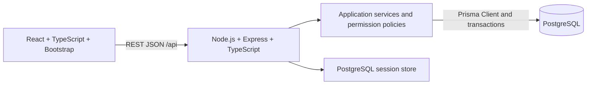
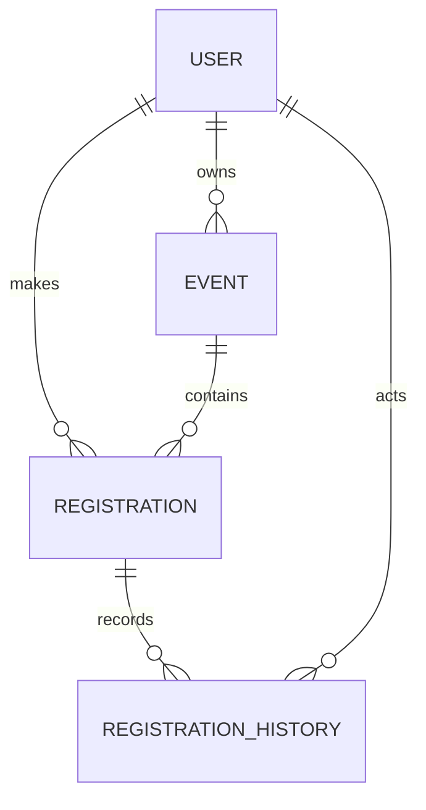

# Part C — System-Level Software Design Specification

เอกสาร LC-SYS-SDS | Version 0.2 | 4 พฤศจิกายน 2026 | Stack ยืนยันตามผู้ใช้; รายละเอียด design ยังไม่ implement

## 1. Architecture และ stack ที่กำหนด

ใช้ React + TypeScript + Vite + Bootstrap สำหรับ frontend และ Node.js + Express + TypeScript สำหรับ backend ติดต่อผ่าน REST-style JSON APIs ใช้ PostgreSQL เป็นฐานข้อมูลและ Prisma สำหรับ data access/migrations ตาม stack ที่ผู้ใช้ระบุเมื่อ 4 พฤศจิกายน 2026 แยก UI, application/API และ persistence เป็นสาม logical layers โดย backend ยังเป็น modular monolith

Frontend เป็น React SPA; ระหว่างพัฒนา Vite proxy `/api` ไป Express เพื่อใช้ same-origin contract เมื่อ deploy เสนอให้ Express serve frontend build และ API ภายใต้ origin เดียวกัน ไม่ต้องแยก frontend cloud service เวอร์ชัน dependencies จะเลือกและ pin เมื่อเริ่ม implementation ยังไม่มี lockfile หรือผล compatibility test

| Area | Technology / responsibility |
|---|---|
| Frontend | React + TypeScript; Vite dev/build; Bootstrap layout/forms/status feedback |
| Backend | Node.js + Express + TypeScript; REST routes, middleware, application services |
| Database | PostgreSQL + Prisma Client/Prisma Migrate; SQL migrations สำหรับ constraints ที่จำเป็น |
| Testing | Vitest สำหรับ unit/integration runner; Supertest สำหรับ Express API; PostgreSQL จริงสำหรับ integration/concurrency |
| Selected UI/E2E | เสนอ Playwright เพิ่มสำหรับ browser journeys; ไม่ใช้แทน Vitest/Supertest; ยังไม่ implement |
| Workflow | Git, GitHub Projects, main/dev/feature branches, Pull Requests และ peer review |

| Module | ความรับผิดชอบ |
|---|---|
| accounts | Seed accounts, password verification, Login/Logout/identity, role policy |
| events | Event validation, owner-scoped queries, create/publish/list; Sprint 2 edit/close |
| registrations | Atomic seat allocation, duplicate checks, own registrations, owner roster; Sprint 2 cancel/reactivate |
| attendance | Sprint 3 check-in และ reporting |
| shared | Error response, time conventions, configuration และ version metadata |

Business rules อยู่ใน application services และ constraints ฝั่ง DB ไม่พึ่งแค่ form validation Frontend ทำ validation เพื่อช่วยผู้ใช้แต่ต้องไม่ใช้แทน backend checks

## 2. Data model

| Entity | Fields สำคัญ | Constraints / ownership |
|---|---|---|
| User | id, username, password_hash (salt + scrypt hash + parameters), display_name, role, is_active | username unique; role PARTICIPANT/ORGANIZER; ไม่มี plaintext password |
| Event | id, organizer_id, title, description, location, starts_at, ends_at, registration_closes_at, capacity, status, created_at, updated_at | FK User; capacity 1..1000; ordered timestamps; status DRAFT/PUBLISHED/CLOSED; owner immutable |
| Registration | id, event_id, participant_id, status, registered_at, cancelled_at (S2), checked_in_at (S3), checked_in_by_id (S3) | UNIQUE(event_id, participant_id); FK ทั้งคู่; ACTIVE/CANCELLED; ไม่ hard delete |
| RegistrationHistory (S2) | id, registration_id, actor_id, action, occurred_at | REGISTERED/CANCELLED/REACTIVATED; backfill initial REGISTERED ของ S1; อ่านผ่านการแสดงประวัติของเจ้าของเท่านั้นถ้า UI เพิ่มภายหลัง |

Database session table เป็น infrastructure ไม่ใช่ domain entity Registration.status เตรียม ACTIVE/CANCELLED ตั้งแต่ Sprint 1 แต่ไม่มี operation CANCELLED จน Sprint 2 Fields ของ Sprint 2/3 และ history ใช้ migration เพิ่มเมื่อถึง Sprint นั้น ไม่อ้างว่ามีแล้ว

Prisma schema กำหนด entities, relations, enums และ unique pair ของ Registration; Prisma Migrate version schema changes และเพิ่ม SQL check constraints สำหรับ capacity/timestamp ordering ตามที่ต้องใช้ ตรวจ generated migration ก่อนยอมรับ ส่วน role relation, capacity count และ transition ตรวจใน service ภายใต้ transaction ห้ามใช้ schema sync ที่ไม่เก็บ migration มาแทน release migration history

Index ที่เสนอ: Event(status, starts_at), Event(organizer_id), Registration(participant_id, registered_at), Registration(event_id, status) ผลจริง/ความเหมาะสมทบทวนเมื่อมี query และข้อมูลจริง ไม่อ้างผล performance ล่วงหน้า

### Atomic registration และ concurrency

ทุก mutation ที่กระทบการรับที่นั่งใช้ transaction และ lock Event row เดียวกันก่อนอ่าน count/สถานะ:

1. ตรวจ session และ role ก่อนเริ่ม domain operation
2. ใช้ Prisma interactive transaction และ parameterized SQL `SELECT ... FOR UPDATE` เพื่อ lock Event row ผ่าน transaction client เดียวกัน; ตรวจสถานะและเวลา server ภายใน transaction
3. ตรวจ registration เดิมของ participant; Sprint 1 ถ้ามี ACTIVE ตอบ duplicate; Sprint 2 ถ้า CANCELLED จึงพิจารณา reactivate
4. นับ ACTIVE ผ่าน Prisma transaction client เดิมจาก DB; ถ้าเต็มปฏิเสธ
5. Insert/activate registration และ commit; unique constraint เป็นแนวป้องกันซ้ำชั้นสุดท้าย
6. คืน 201 หลัง commit สำเร็จเท่านั้น

การ publish/close/cancel/capacity edit ใช้ lock order Event → Registration เหมือนกัน ลดการแย่ง lock ข้ามลำดับ F-06/07 ต้องรักษาวิธีนี้ ใช้ PostgreSQL READ COMMITTED และทำทุก read/write หลัง lock ด้วย transaction client เดียวกัน Last-seat test ต้องใช้ PostgreSQL และแยก connections/transactions จริง; SQLite หรือ mock Prisma อย่างเดียวไม่พิสูจน์กฎนี้ SQL identifiers ใช้ค่าคงที่จาก schema และ bind ค่า input ห้ามต่อ SQL ด้วย user input

ไม่ใช้ตัวนับ capacity ที่ browser ส่งมา ไม่เชื่อ event owner หรือ participant ID ที่ client ส่งแทน session การขัดแย้งจาก constraint แปลงเป็น domain error โดยไม่ส่ง SQL ออกไป

## 3. UI และ navigation

Screens เป็น React routes และใช้ Bootstrap components/classes ร่วมกับ state ของ React; Express รับผิดชอบ `/api` และเสิร์ฟ SPA fallback เฉพาะ frontend routes เมื่อ deploy API ที่ไม่พบต้องคืน JSON 404 ไม่ส่ง HTML ของ SPA แทน

| Screen | Role / ข้อมูล | Sprint |
|---|---|---:|
| /login | Form username/password และข้อความผิดแบบไม่เปิดเผยว่าบัญชีใดมีอยู่ | 1 |
| /events | ทุก authenticated user; รายการ PUBLISHED/CLOSED, วันเวลา สถานที่ จำนวนว่าง และสถานะเปิดรับ | 1 |
| /events/{id} | รายละเอียด + ปุ่มลงทะเบียนเฉพาะ Participant; ไม่แสดง roster | 1 |
| /my/registrations | Participant; รายการและรายละเอียดของตน ลิงก์กิจกรรม | 1 |
| /organizer/events | Organizer; กิจกรรมของตนรวม DRAFT และปุ่มสร้าง | 1 |
| /organizer/events/new | Organizer; Form สร้าง DRAFT | 1 |
| /organizer/events/{id} | Organizer เจ้าของ; preview, publish, roster/count | 1 |
| หน้ารายการเดิมเพิ่ม Cancel/Close/Edit | ตามสิทธิ์และ deadline | 2 |
| หน้า roster เพิ่ม Check-in; หน้า summary | Organizer เจ้าของ; Participant เห็น check-in เฉพาะของตน | 3 |

State conventions: ขณะส่งแสดง loading และปิดปุ่มซ้ำ; empty list แสดงข้อความและทางไปดู/สร้างกิจกรรม; field error แสดงใต้ช่อง; 409 refresh availability และอธิบายสาเหตุ; network error ให้ retry ได้; expired session กลับ Login โดยไม่แสดงข้อมูลเดิม; API 403 แสดงไม่มีสิทธิ์; 404 แสดงไม่พบข้อมูลโดยไม่เปิดเผยว่าของคนอื่นมีอยู่

Frontend ไม่ถือว่าปุ่ม disabled ป้องกัน duplicate ได้จริง ข้อมูล saved result ต้องดึงใหม่จาก API/DB ไม่ใช่แสดงเฉพาะ state ใน browser

## 4. API conventions

- REST-style APIs ใช้ prefix `/api`, JSON และ Express routers ตาม feature contracts; ID ในเอกสารเป็น opaque identifier ไม่ใช้ ID เป็นกลไก authorization
- Success object: `{ "data": ... }`; list มี `data` array เรียงตามที่ contract กำหนด; Sprint 1 ยังไม่ต้อง pagination/filter
- Error: `{ "error": { "code": "EVENT_FULL", "message": "กิจกรรมเต็มแล้ว", "fields": {} } }`
- `200` อ่าน/เปลี่ยนสถานะสำเร็จ, `201` สร้าง, `204` Logout; `400` malformed/invalid fields, `401` ไม่มีหรือ session หมดอายุ, `403` role/CSRF ไม่ผ่าน, `404` ไม่พบ/อยู่นอก owner scope, `409` duplicate/full/closed/transition conflict
- Reject unknown input fields รวม owner/participant/status ที่ endpoint ไม่ให้ตั้งด้วย 400; error ไม่ echo credential หรือ input ลับ
- Dates ต้องมี offset, เก็บ UTC; ปัดเวลาจาก server ไม่ใช้เวลาของ browser ตัดสิน
- Express CSRF middleware และ central error handler ต้องคืน JSON error สำหรับ API ไม่ใช่ HTML stack trace; ทดสอบ unauthenticated access ด้วย CSRF precondition ที่ถูกต้องเพื่อแยก authentication จาก CSRF
- API query ของ own records ต้อง filter owner ก่อนคืนข้อมูล ไม่มี endpoint อ่าน registration ของผู้อื่นให้ Participant

## 5. Role/permission matrix

| Operation | No session | Participant | Organizer |
|---|---|---|---|
| Login / CSRF bootstrap | อนุญาต | ใช้ได้ | ใช้ได้ |
| Me / Logout | 401 | ของตน | ของตน |
| List/read published/closed events | 401 | ได้ | ได้ |
| Create / publish / own event list | 401 | 403 | เฉพาะของตน; เจ้าของอื่น 404 |
| Register | 401 | ของตนจาก session | 403 |
| List/read own registrations | 401 | ของตน; คนอื่น 404 | 403 |
| Event roster / count | 401 | 403 | ของตน; เจ้าของอื่น 404 |
| Cancel / reactivate (S2) | 401 | ของตนตามกฎ | 403 |
| Edit / close event (S2) | 401 | 403 | ของตนตามกฎ |
| Check-in / summary (S3) | 401 | 403 | ของตนตามกฎ |

CSRF failure 403 อาจเกิดก่อน domain authorization เมื่อ token ผิด ทั้งสองต้องทดสอบแยกกัน Permission tests ส่ง token ถูกต้องตาม route ที่ต้องใช้

## 6. Authentication และ credential lifecycle

เสนอใช้ `express-session` กับ PostgreSQL-backed session store ที่รองรับการ invalidate session ไม่ใช้ process memory store ใน deployment Hash password ด้วย Node.js crypto scrypt พร้อม random salt ต่อ password และเก็บ parameters/salt/hash; verify แบบ constant-time หลัง derive ค่า ไม่สร้างระบบเข้ารหัสเอง Login ตรวจ active account และ regenerate session identifier หลังสำเร็จ Session cookie HttpOnly, SameSite=Lax และ Secure ใน HTTPS environment; บังคับอายุสูงสุด 2 ชั่วโมงจาก Login ด้วย authenticated_at/expiry ฝั่ง server ไม่มี sliding extension ใน baseline รายละเอียด auth นี้ยังเป็น design proposal ไม่ใช่ผล implementation

`GET /api/auth/csrf` สร้าง pre-auth session ตามจำเป็นและให้ synchronizer token ผูก session; React ส่ง token ใน `X-CSRF-Token` สำหรับ Login และ mutations โดย Express middleware ตรวจรับ หลัง Login regenerate session และออก CSRF token ใหม่ (React fetch bootstrap อีกครั้งก่อน mutation ถัดไป) Session identity/role อ่านจาก backend และข้อมูล user ปัจจุบัน; `GET /api/auth/me` คืน id/display_name/role ไม่คืน hash หรือ session ID Logout destroy session ฝั่ง server และ clear cookie ด้วย cookie attributes เดิม Protected request ด้วย cookie เก่าต้องไม่ผ่าน กรณี session หมดอายุคืน 401 และให้ Login ใหม่

Seed script ที่จะทำภายหลังต้องรับ demo password ผ่าน environment/private local handoff แล้ว hash ก่อนบันทึก ไม่ commit หรือพิมพ์ credential ใน logs/PDF Seed อย่างน้อย Participant A/B/C และ Organizer A/B พร้อม inactive account สำหรับ negative test โดยเลือกข้อมูลสังเคราะห์

## 7. Database setup และ reproduction design

ยังไม่มีคำสั่งของแอปที่รันจริง แผน README implementation ต้องระบุขั้นตอนตามลำดับ:

1. ติดตั้ง Node.js และ dependencies ของ frontend/backend ตาม lockfile และสร้าง environment จากตัวอย่างที่ไม่มี secrets
2. เตรียม PostgreSQL database และบัญชี least-privilege ของแอป
3. Generate Prisma Client และ run versioned Prisma migrations จาก repository; ตรวจ constraints รวม SQL ที่เพิ่มไว้
4. Run idempotent synthetic seed ผ่าน Prisma สำหรับ local/test; production ไม่ reset ข้อมูลอัตโนมัติ
5. Run Express/Vite ใน development หรือ serve Vite production build ผ่าน Express; type-check TypeScript/build frontend/backend แล้วรัน Vitest/Supertest และ selected browser checks; ทำ normal journey และ restart verification

Seed รองรับกรณี open event, capacity=1, full event, deadline boundary, DRAFT และ CLOSED ใน isolated test fixtures โดย freeze clock ตาม scenario เมื่อรัน test แยก test database ออกจากข้อมูล demo

## 8. Configuration และ delivery plan

| Environment name ที่เสนอ | หน้าที่ / ตัวอย่างปลอดภัย |
|---|---|
| DATABASE_URL | PostgreSQL connection จาก local environment/secret store; ไม่ใส่ค่าจริงในเอกสาร |
| SESSION_SECRET | ค่าสุ่มสำหรับ session signing จาก secret store ไม่รวมใน image/Git |
| NODE_ENV | production เมื่อ deploy; error handler ไม่เปิดเผย stack trace |
| PORT | listening port ของ Express ตาม environment |
| APP_ORIGIN | origin ที่อนุญาตสำหรับ origin/CSRF validation |
| API_PROXY_TARGET | Express URL สำหรับ Vite development proxy; ไม่ใช่ secret |
| SESSION_COOKIE_SECURE | true เมื่อใช้ HTTPS; local HTTP exception ต้องระบุ |
| DEMO_SEED_PASSWORD | ใช้เฉพาะ synthetic seed/private handoff ไม่พิมพ์ log |
| APP_VERSION | immutable release commit/tag จาก pipeline |

ค่าข้างต้นเป็น configuration contract ของแอปที่เสนอ ไม่ได้เป็น environment variables ที่ Express/Prisma อ่านให้อัตโนมัติทั้งหมด Frontend ต้องไม่มี DATABASE_URL/SESSION_SECRET/DEMO_SEED_PASSWORD หรือ secret ใดใน Vite client environment/build

Docker design: multi-stage build ของ React/Vite และ Express/TypeScript เป็น image เดียว; runtime ใช้ Express serve frontend static build/REST API และใช้ external PostgreSQL ผ่าน Prisma ไม่เก็บ domain data/session ใน ephemeral container filesystem Proposed GCP target คือ Cloud Run สำหรับ web และ Cloud SQL for PostgreSQL สำหรับ durable data ทั้งนี้ต้องยืนยันทรัพยากรตาม Lab 5 ก่อน ไม่มีการ provision หรือคาดการณ์ราคาในงานนี้

Lab 5 pipeline plan: feature PR เข้า dev รัน TypeScript checks/frontend-backend build/Vitest-Supertest เป็น required checks → teammate review → dev integration → reviewed release PR จาก dev เข้า main → build image ผูก commit → Prisma migration เป็นขั้นตอนควบคุมที่ทำซ้ำได้ก่อนเปิดใช้ release ที่ต้องพึ่ง schema ใหม่ → deploy → post-deploy journey/persistence/version check การอนุมัติ manual ใน pipeline ทำได้ ไม่มีข้อบังคับให้มี cloud staging แยก

ควรมี health endpoint ที่ไม่เปิดเผยข้อมูลลับ และ version metadata ที่ตรวจ release ได้ใน Lab 5 รายละเอียด endpoint นี้เป็นงาน SYS-DELIVERY ไม่ใช่หลักฐานว่ามีแล้ว

## 9. ความเสี่ยงและการตรวจรับ design

| ความเสี่ยง | การควบคุม / หลักฐานที่ต้องมี |
|---|---|
| Last-seat race และ duplicate race | Event lock + DB unique; TEST-20/21 บน PostgreSQL |
| Owner filter หลุดเมื่อเพิ่ม endpoint | Permission matrix + tests ต่อ endpoint รวมหลัง Sprint 1 |
| ข้อมูลหายเมื่อ redeploy | External durable DB; local restart และ Lab 5 redeploy check |
| Integration ระหว่าง React/Express/session | Same-origin ผ่าน Vite proxy ตอน dev และ Express static hosting ตอน deploy; ทดสอบ cookie/CSRF ด้วย Supertest และ browser |
| เวลาสั้นก่อน D1 | ใช้ Bootstrap, seed accounts และ backend เดียว; ไม่เพิ่มบริการนอก scope |

Stack ยืนยันตามคำสั่งผู้ใช้แล้ว ส่วน baseline design รายละเอียด session/transaction/deployment ยังรอการทบทวนจากสมาชิกทั้งคู่ ไม่มีการอ้างว่า architecture นี้ผ่าน test หรือได้รับอนุมัติจากอาจารย์แล้ว
