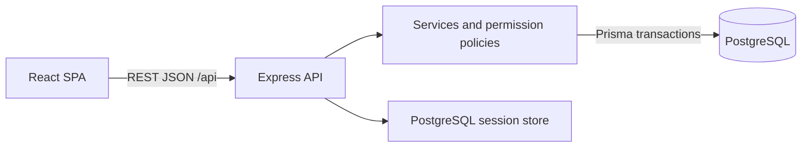
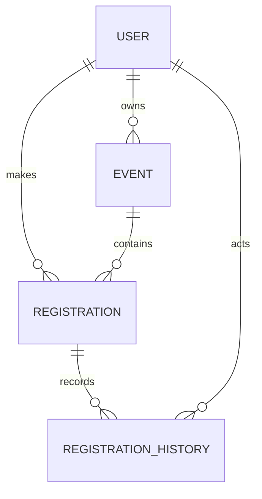

# Part C — System-Level Software Design Specification

เอกสาร LC-SYS-SDS | Documentation baseline v0.5 | 5 พฤศจิกายน 2026

## 1. Architecture

React SPA → REST JSON `/api` → Express application services → PostgreSQL ผ่าน Prisma ใช้ modular monolith และ origin เดียว: development ใช้ Vite proxy; production ให้ Express serve frontend build และ API

| Component | Responsibility |
|---|---|
| React + TypeScript + Vite + Bootstrap | Screens, navigation, form validation และ loading/empty/error states |
| Express + TypeScript | Routers, session/CSRF middleware, authorization, services และ JSON errors |
| PostgreSQL + Prisma | Domain/session persistence, migrations, constraints และ transactions |
| Vitest + Supertest | Unit และ API/database integration; concurrency ใช้ PostgreSQL จริง |
| Browser E2E | เสนอ Playwright สำหรับ selected critical journeys |



Modules: accounts (auth/seed), events (create/publish/list; S2 edit/close), registrations (allocate seats/own records/roster; S2 cancel/reactivate), attendance (S3 check-in/summary) และ shared (errors/time/config/version) Backend/DB บังคับกฎ; frontend validation ช่วยผู้ใช้

### Planned source layout

เป็นแผนสำหรับ setup; ปัจจุบัน repository มี README/docs/.gitignore

```text
LoungCheu/
├── package.json / package-lock.json
├── frontend/
│   ├── package.json / vite.config.ts / tsconfig.json / index.html
│   └── src/{main.tsx,app/,components/,lib/,styles/,features/}
├── backend/
│   ├── package.json / tsconfig.json / .env.example
│   ├── prisma/{schema.prisma,seed.ts,migrations/}
│   ├── src/{app.ts,server.ts,config/,db/,middleware/,shared/}
│   ├── src/modules/{accounts,events,registrations}/
│   └── tests/{unit,integration}/
└── tests/e2e/
```

app.ts ประกอบ Express app สำหรับ Supertest; server.ts เปิด port; routes/controller รับส่ง HTTP, service ดูแลกฎ/transaction และ validation ตรวจ input Frontend features แบ่ง auth/events/registrations; component tests วางคู่ component ส่วน attendance เพิ่มใน S3 สร้างไฟล์ตามงานจริงและ pin versions/lockfile ตอน setup

## 2. Data model / migrations



| Entity | Fields | Constraints / ownership |
|---|---|---|
| User | id, username, password_hash (salt/hash/parameters), display_name, role, is_active | username unique; role PARTICIPANT/ORGANIZER |
| Event | id, organizer_id, title, description, location, starts_at, ends_at, registration_closes_at, capacity, status, created_at, updated_at | FK User; owner immutable; capacity 1–1000; ordered timestamps; DRAFT/PUBLISHED/CLOSED |
| Registration | id, event_id, participant_id, status, registered_at | FK Event/User; UNIQUE(event_id, participant_id); enum ACTIVE/CANCELLED; S1 สร้าง ACTIVE เท่านั้น |
| Registration extensions | cancelled_at (S2), checked_in_at/checked_in_by_id (S3) | nullable จนเกิด action; checked_in_by_id FK User |
| RegistrationHistory (S2) | id, registration_id, actor_id, action, occurred_at | FK Registration/User; REGISTERED/CANCELLED/REACTIVATED; backfill initial REGISTERED ของ S1 |

IDs ใช้ UUID; timestamps ใช้ `timestamptz(3)` UTC ตาม BR-14 Fields ใน S1 required/non-null เพิ่ม S2/S3 fields/history ผ่าน versioned migrations ไม่มี hard delete และไม่มี history UI ใน baseline

registered_at เป็นเวลาลงครั้งแรกที่ service ใส่จาก clock หลัง Event lock; S2 cancel ตั้ง cancelled_at และ append history, reactivate คง registered_at/ล้าง cancelled_at พร้อม REACTIVATED history; S3 checked_in_at/checked_in_by_id มีค่าพร้อมกันเมื่อเช็กชื่อและไม่เปลี่ยนเมื่อเช็กซ้ำ

Prisma schema กำหนด relations/enums/unique; migrations เพิ่ม SQL checks สำหรับ capacity/time ordering ส่วน role relations, transitions และ ACTIVE count ตรวจใน service/transaction PostgreSQL session table เป็น infrastructure แยกจาก domain model

Proposed indexes: Event(status, starts_at), Event(organizer_id), Registration(participant_id, registered_at), Registration(event_id, status)

### Atomic registration

1. ตรวจ active session/role และ lock Event ด้วย parameterized `SELECT ... FOR UPDATE` ใน Prisma interactive transaction
2. หลังได้ lock ตรวจ event status และเรียก server application clock ใหม่เพื่อตรวจ deadline
3. ใช้ precedence ตาม F-03 contract: event scope → status/deadline → duplicate → capacity; นับ ACTIVE ใหม่หลัง lock, insert ACTIVE แล้ว commit
4. คืน 201 หลัง commit; failure ไม่เพิ่ม record/count; validation และ registered_at ใช้ค่าจาก clock หลัง lock เดียวกัน

ใช้ READ COMMITTED และ transaction client เดียวตลอด operation Seat mutations ของ publish/close/cancel/reactivate/capacity edit ใช้ lock order Event → Registration เดียวกัน Unique pair ป้องกัน duplicate ชั้นสุดท้าย; แปลง constraint conflicts เป็น domain errors โดยไม่คืน SQL

Concurrency tests ใช้ separate connections/transactions และ barrier บน PostgreSQL จริงตาม STS ฝั่ง browser ไม่ส่ง owner/participant/count แทนค่าที่ server ตรวจ Read payloads เช่น roster/count/availability ใช้ committed snapshot เดียวกันเพื่อไม่ให้ response ขัดกัน

## 3. UI / navigation

| Screen | Role / purpose | Sprint |
|---|---|---:|
| /login | Username/password และ generic credential error | 1 |
| /events, /events/{id} | Authenticated users ดู PUBLISHED/CLOSED; Participant ลงทะเบียน | 1 |
| /my/registrations, /my/registrations/{id} | Participant อ่าน list/detail ของตน | 1 |
| /organizer/events, /organizer/events/new | Organizer ดูของตนรวม DRAFT และสร้างกิจกรรม | 1 |
| /organizer/events/{id} | เจ้าของ preview/publish/roster/count | 1 |
| หน้าเดิมเพิ่ม Cancel/Close/Edit | ตาม role/ownership/deadline | 2 |
| Roster เพิ่ม Check-in; own record เพิ่ม attendance; หน้า summary | ตาม permission matrix | 3 |

Loading ปิดปุ่มซ้ำ; empty มีทางเลือกดู/สร้างกิจกรรม; field errors อยู่ใต้ input; conflicts อธิบายเหตุผลและ refresh availability; network errors retry ได้; expired session กลับ Login และล้าง private state; 403/404 ไม่เปิดเผยข้อมูลนอกสิทธิ์ เวลา UI แสดง Asia/Bangkok

Express SPA fallback ใช้เฉพาะ frontend routes; unknown API คืน JSON 404

## 4. API conventions

- Success `{ "data": ... }`; list ใช้ array; Logout 204 ไม่มี body
- Error `{ "error": { "code": "EVENT_FULL", "message": "กิจกรรมเต็มแล้ว", "fields": {} } }`; code/message เป็น strings, fields เป็น object mapping ชื่อ field → string[] และใช้ {} เมื่อไม่มี field error; ไม่คืน secrets/SQL/stack trace
- Success: 200 read/update, 201 create, 204 Logout; error codes ตามตารางด้านล่าง
- ตรวจ auth/role ก่อน CSRF สำหรับ protected mutations แล้ว validate input และ record scope/domain rules; Login ใช้ pre-auth CSRF token Permission tests แยกจาก CSRF failures
- Body ตรง JSON object schema; malformed JSON, array/null/primitive, wrong type หรือ unknown fields รวม owner/participant/status ที่ไม่อนุญาต ตอบ 400 INVALID_INPUT; EmptyInput ตาม contract อนุญาตไม่มี body
- UUID path ผิดรูปแบบ=400 INVALID_INPUT หลัง auth/role; valid UUID ที่ไม่พบ/นอก scope=404
- Input timestamp มี offset (Z หรือ ±HH:mm) และเศษวินาที 0–3 หลัก; เกินหรือไม่มี offset=400 INVALID_INPUT; output UTC `YYYY-MM-DDTHH:mm:ss.SSSZ` ตาม BR-14
- Own queries scope จาก session ก่อนคืนข้อมูล; named schemas/endpoints อยู่ใน [Contracts](sprints/sprint-1/contracts.md)
- เมื่อมี Origin header ต้องตรง APP_ORIGIN; หากไม่มี header ยังต้องผ่าน CSRF token สำหรับ mutations

| HTTP | error.code / ความหมาย |
|---|---|
| 400 | INVALID_INPUT: body/path/schema ไม่ถูกต้อง |
| 401 | INVALID_CREDENTIALS: Login ผิด; AUTH_REQUIRED: protected request ไม่มี/หมดอายุ/inactive session |
| 403 | ROLE_FORBIDDEN: role ไม่ผ่าน; CSRF_FAILED: token/origin ไม่ผ่าน |
| 404 | EVENT_NOT_FOUND หรือ REGISTRATION_NOT_FOUND: ไม่พบ/นอก record scope; ROUTE_NOT_FOUND: unknown API |
| 409 | INVALID_TRANSITION, DEADLINE_PASSED (publish), REGISTRATION_CLOSED, ALREADY_REGISTERED, EVENT_FULL; ALREADY_CHECKED_IN เริ่ม S3 |
| 500 | INTERNAL_ERROR: generic message, fields={} และไม่คืน internal details |

## 5. Role/permission matrix

| Operation | No session | Participant | Organizer |
|---|---|---|---|
| Login / CSRF bootstrap | อนุญาต | ได้ | ได้ |
| Me / Logout | 401 | ของตน | ของตน |
| Shared list/detail PUBLISHED/CLOSED | 401 | ได้ | ได้ |
| Create/publish/own event list/detail | 401 | 403 | ของตน; เจ้าของอื่น 404 |
| Register | 401 | ของตน | 403 |
| Own registration list/detail | 401 | ของตน; คนอื่น 404 | 403 |
| Roster/count | 401 | 403 | ของตน; เจ้าของอื่น 404 |
| Cancel/reactivate (S2) | 401 | ของตนตามกฎ | 403 |
| Edit/close (S2) | 401 | 403 | ของตนตามกฎ |
| Check-in/summary (S3) | 401 | 403 | ของตนตามกฎ |
| Own attendance status (S3) | 401 | ของตนผ่าน registration | 403 |

ตารางใช้ session/CSRF/input ที่ถูกต้องเมื่อทดสอบ record scope การซ่อนปุ่มไม่แทน backend authorization

## 6. Authentication / credentials

ใช้ `express-session` กับ PostgreSQL store Hash password ด้วย Node.js crypto scrypt พร้อม random salt และ parameters; verify แบบ constant-time หลัง derive ค่า Login ตรวจ is_active และ regenerate session ID

Cookie: HttpOnly, SameSite=Lax, Secure บน HTTPS; server expiry 2 ชั่วโมงจาก Login ไม่มี sliding extension Protected endpoints อ่าน user/role/current active state จาก backend

`GET /api/auth/csrf` สร้าง pre-auth session เมื่อจำเป็น หรือคืน token ของ current session; mutations ส่ง `X-CSRF-Token` หลัง Login fetch token ใหม่เพราะ session rotate `GET /api/auth/me` คืน Identity ตาม contract Logout destroy server session และ clear cookie attributes เดิม; cookie เก่าใช้ protected API ไม่ได้

Seed ใช้ Participant A/B/C, Organizer A/B และ inactive account จากข้อมูลสังเคราะห์ Username trim แล้วเทียบ case-sensitive ตาม seed รับ demo password ผ่าน environment/private handoff แล้ว hash ไม่ commit/log credentials Demo events ใช้เวลาที่ยังเป็นอนาคตขณะ seed/สร้างผ่าน UI; fixed t0 ใช้เฉพาะ automated fixtures

## 7. Setup / reproduction design

README implementation ต้องระบุ runtime/dependency versions และคำสั่งจริง:

1. Install dependencies ตาม lockfile และเตรียม safe environment
2. สร้าง PostgreSQL database/account และ run versioned migrations/Prisma Client generation
3. Run idempotent synthetic seed; test DB แยกจาก demo/deployment
4. Build/run frontend/backend, unit/API/DB/browser tests
5. ทำ normal journey, restart persistence และ teammate clean reproduction

Fixtures/time control และ expected results ตาม [STS](sprints/sprint-1/sts.md)

## 8. Configuration / delivery design

| Environment | Purpose |
|---|---|
| DATABASE_URL | PostgreSQL connection |
| SESSION_SECRET | Session signing secret |
| NODE_ENV / PORT | Runtime mode/listening port |
| APP_ORIGIN | Origin/CSRF validation |
| API_PROXY_TARGET | Vite development proxy target |
| SESSION_COOKIE_SECURE | true บน HTTPS; false เฉพาะ local HTTP |
| DEMO_SEED_PASSWORD | Synthetic seed/private access |
| APP_VERSION | Release commit/tag |

แอปต้องอ่าน/validate config เอง Frontend build ห้ามมี DB/session/seed secrets

Lab 5 design: multi-stage Docker build ให้ Express serve SPA/API ใน image เดียว; ใช้ external durable PostgreSQL สำหรับ domain/session data เสนอ Cloud Run + Cloud SQL โดยยืนยัน resources ตาม Lab 5 ก่อน deploy

Delivery: PR build/tests gate → teammate review → staging integration → reviewed release PR เข้า main → image ผูก commit → controlled versioned migration → deploy → workflow/persistence/version checks ดู milestones ใน [Sprint plan](sprints/plan.md) มี health/version metadata สำหรับตรวจ release

## 9. Risks / verification

| Risk | Verification |
|---|---|
| Last-seat/duplicate race | TEST-20/21 และ DB invariant |
| Owner/role leaks | Endpoint permission matrix และ negative tests |
| Data loss | Local restart; Lab 5 restart/redeploy |
| SPA/API session integration | Cookie/CSRF API tests และ browser journey |
| เวลาก่อน D1 | จำกัด F-01–05, seed accounts และ backend เดียว |
